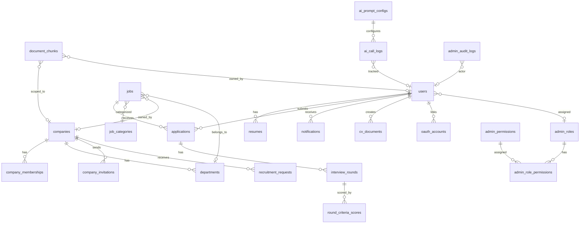

# 📋 BẢN ĐỒ TOÀN BỘ CHỨC NĂNG HỆ THỐNG — AI Job Portal

> **Người soạn:** Tech Lead  
> **Ngày:** 20/09/2026  
> **Mục đích:** Review toàn bộ hệ thống, phân luồng rõ ràng từng tầng (Frontend → API → Backend Service → Database)  
> **Phiên bản:** 1.0

---

## MỤC LỤC

1. [Tổng quan kiến trúc](#1-tổng-quan-kiến-trúc)
2. [Database Schema — 22 bảng](#2-database-schema--22-bảng)
3. [Phân luồng theo Actor](#3-phân-luồng-theo-actor)
   - 3.1 [Guest (Khách)](#31-guest-khách)
   - 3.2 [Candidate (Ứng viên)](#32-candidate-ứng-viên)
   - 3.3 [Employer (Nhà tuyển dụng)](#33-employer-nhà-tuyển-dụng)
   - 3.4 [Admin (Quản trị viên)](#34-admin-quản-trị-viên)
4. [Phân luồng theo Module chức năng](#4-phân-luồng-theo-module-chức-năng)
5. [AI Features Map](#5-ai-features-map)
6. [Real-time & Cross-cutting Concerns](#6-real-time--cross-cutting-concerns)

---

## 1. TỔNG QUAN KIẾN TRÚC

```
┌─────────────┐     ┌──────────────┐     ┌───────────────┐     ┌──────────────┐
│  React SPA  │────▶│  Nginx       │────▶│  FastAPI       │────▶│ PostgreSQL   │
│  (Vite)     │     │  Reverse     │     │  + Uvicorn     │     │ 17 + pgvector│
│  Port 3000  │     │  Proxy       │     │  Port 8000     │     │ Port 5432    │
└─────────────┘     └──────────────┘     └───────┬────────┘     └──────────────┘
                                                  │
                                         ┌────────▼────────┐
                                         │ DeepSeek API    │
                                         │ (LLM Service)   │
                                         └─────────────────┘
                                         ┌─────────────────┐
                                         │ Sentence-        │
                                         │ Transformers     │
                                         │ (Local ML Model) │
                                         └─────────────────┘
```

| Tầng | Công nghệ | Vai trò |
|------|-----------|---------|
| **Frontend** | React 18 + TypeScript + Vite + Tailwind CSS + Shadcn UI + Framer Motion | SPA, lazy-loaded routes |
| **State** | Zustand (4 stores: auth, job, chat, assistant) | Client state management |
| **Routing** | React Router v6 + ProtectedRoute (RBAC) | 44 routes, 3 layout wrappers |
| **API Gateway** | Nginx (reverse proxy, static assets, SPA fallback) | SSL termination point |
| **Backend** | Python FastAPI + Pydantic v2 + SQLAlchemy 2.0 | 28 router files, 36 service files |
| **Auth** | JWT (HS256) + bcrypt + OAuth2 (Google) + token_version | Session revocation |
| **Database** | PostgreSQL 17 + pgvector + Alembic migrations | 22 tables, 3 HNSW indexes |
| **AI/ML** | DeepSeek Chat API + paraphrase-multilingual-MiniLM-L12-v2 (384-dim) | 10 AI features |

---

## 2. DATABASE SCHEMA — 22 BẢNG

### 2.1 Bảng phân nhóm theo nghiệp vụ



### 2.2 Chi tiết từng bảng

| # | Bảng | Số cột | Mô tả | Indexes đặc biệt |
|---|------|--------|-------|-------------------|
| 1 | `users` | 16 | Tài khoản (3 roles: candidate, employer, admin) | email UNIQUE, admin_role_id FK |
| 2 | `jobs` | 17 | Tin tuyển dụng + embedding vector 384-dim | HNSW cosine index |
| 3 | `job_categories` | 3 | Danh mục nghề (slug-based) | name UNIQUE |
| 4 | `applications` | 18 | Đơn ứng tuyển + AI matching score + hiring recommendation | UQ(candidate_id, job_id) |
| 5 | `resumes` | 17 | CV + parsed metadata + embedding vector 384-dim | HNSW cosine index |
| 6 | `cv_documents` | 7 | CV Builder (JSON-based structured CV) | user_id FK |
| 7 | `companies` | 17 | Công ty/tổ chức (multi-tenant) | is_verified, ai_matching_weights |
| 8 | `departments` | 6 | Phòng ban trong company | UQ(company_id, name) |
| 9 | `company_memberships` | 12 | Thành viên công ty (HR/Department Head) | Composite index scope |
| 10 | `company_invitations` | 16 | Lời mời tham gia company (token-based) | token_hash UNIQUE |
| 11 | `job_assignments` | 4 | Phân công job cho member | UQ(job_id, membership_id) |
| 12 | `recruitment_requests` | 20 | Yêu cầu tuyển dụng từ phòng ban | Composite status indexes |
| 13 | `interview_rounds` | 16 | Vòng phỏng vấn (CV Screen → Tech → HR → Final) | Review status index |
| 14 | `round_criteria_scores` | 5 | Điểm đánh giá theo tiêu chí (0-10) | CHECK constraint |
| 15 | `conversations` | 13 | Cuộc trò chuyện HR↔Candidate | application_id UNIQUE |
| 16 | `chat_messages` | 7 | Tin nhắn chat | conversation_id, sender_id |
| 17 | `notifications` | 6 | Thông báo in-app | user_id FK |
| 18 | `document_chunks` | 11 | RAG chunks + embedding 384-dim | HNSW index, tenant index |
| 19 | `ai_call_logs` | 10 | Log mỗi lần gọi DeepSeek API | feature, user_id |
| 20 | `ai_prompt_configs` | 7 | System prompt admin-editable | feature UNIQUE |
| 21 | `user_feedbacks` | 17 | Phản hồi/bug report từ user | Composite role+status index |
| 22 | `assessment_attempts` | 8 | Kết quả trắc nghiệm MBTI/MI | user_id + type index |
| 23 | `oauth_accounts` | 7 | Tài khoản OAuth liên kết (Google) | user_id FK |
| 24 | `admin_roles` | 5 | Vai trò quản trị (RBAC) | code UNIQUE |
| 25 | `admin_permissions` | 5 | Quyền hạn chi tiết | code UNIQUE |
| 26 | `admin_role_permissions` | 2 | Junction table Role↔Permission | Composite PK |
| 27 | `admin_audit_logs` | 9 | Nhật ký audit admin | target_type + target_id index |
| 28 | `contact_leads` | 8 | Lead từ landing page B2B | email index |

> **Tổng cộng: 28 bảng** (22 model files, một số file chứa nhiều model)

---

## 3. PHÂN LUỒNG THEO ACTOR

### 3.1 GUEST (Khách — chưa đăng nhập)

| # | Chức năng | Frontend Page | Route | API Endpoint | Backend Service | DB Table |
|---|-----------|---------------|-------|-------------|----------------|----------|
| G1 | Xem danh sách việc làm | `JobListPage` | `/` , `/jobs` | `GET /jobs` | `crud/job.py` | `jobs`, `job_categories` |
| G2 | Xem chi tiết việc làm | `JobDetailPage` | `/jobs/:id` | `GET /jobs/{id}` | `crud/job.py` | `jobs`, `companies` |
| G3 | Đăng ký tài khoản | `RegisterPage` | `/register` | `POST /auth/register` | `auth_service.py` | `users` |
| G4 | Đăng nhập | `LoginPage` | `/login` | `POST /auth/login` | `auth_service.py` | `users` |
| G5 | Đăng nhập Google | `GoogleCallback` | `/auth/google/callback` | `GET /auth/google/callback` | `oauth_service.py` | `users`, `oauth_accounts` |
| G6 | Quên mật khẩu | `ForgotPasswordPage` | `/forgot-password` | `POST /auth/forgot-password` | `password_reset_service.py` | `users` |
| G7 | Landing page NTD | `EmployerLandingPage` | `/employer` | — | — | — |
| G8 | Gửi liên hệ B2B | `ContactFormSection` | `/employer` (section) | `POST /contact` | `routers/contact.py` | `contact_leads` |
| G9 | Trắc nghiệm MBTI/MI | `AssessmentPage` | `/tools/:type` | `POST /assessments/submit` | `assessment_engine.py` | `assessment_attempts` |
| G10 | Trang công cụ | `ToolsLandingPage` | `/tools` | — | — | — |
| G11 | AI Matching (public) | `AIMatchingPage` | `/ai/matching` | `POST /ai/match-jobs` | `ai_matching.py` | `jobs`, `resumes` |
| G12 | AI Roadmap (public) | `RoadmapPage` | `/ai/roadmap` | `POST /ai/roadmap` | `roadmap_suggest.py` | — |
| G13 | Chấp nhận lời mời | `EmployerInvitationAcceptPage` | `/employer/invitations/:token/accept` | `POST /company-team/invitations/{token}/accept` | `company_service.py` | `company_invitations`, `company_memberships` |

---

### 3.2 CANDIDATE (Ứng viên — role="candidate")

| # | Chức năng | Frontend Page/Component | Route | API Endpoint | Backend Service | DB Tables |
|---|-----------|------------------------|-------|-------------|----------------|-----------|
| **Hồ sơ & CV** |
| C1 | Dashboard tổng quan | `CandidateDashboard` | `/dashboard` | `GET /users/me`, `GET /applications/me` | `crud/user.py`, `crud/application.py` | `users`, `applications`, `jobs` |
| C2 | Upload CV (file) | `CandidateDashboard` | `/dashboard` | `POST /resumes/upload` | `cv_parser.py`, `embedding_service.py` | `resumes` |
| C3 | Xem/sửa CV text | `CandidateDashboard` | `/dashboard` | `GET/PUT /resumes/{id}` | `crud/resume.py` | `resumes` |
| C4 | CV Builder (tạo mới) | `CVEditorPage` | `/cv/new` | `POST /cv-documents` | `crud/cv_document.py` | `cv_documents` |
| C5 | CV Builder (chỉnh sửa) | `CVEditorPage` | `/cv/:id/edit` | `PUT /cv-documents/{id}` | `crud/cv_document.py` | `cv_documents` |
| C6 | CV Preview & Export PDF | `CVPreview` | `/cv/:id/preview` | `GET /cv-documents/{id}` | — (client-side render) | `cv_documents` |
| C7 | Danh sách CV | `CVListPage` | `/cv` | `GET /cv-documents` | `crud/cv_document.py` | `cv_documents` |
| **Ứng tuyển & Theo dõi** |
| C8 | Ứng tuyển việc làm | `JobDetailPage` | `/jobs/:id` | `POST /applications` | `crud/application.py`, `ai_matching.py` | `applications`, `jobs`, `resumes` |
| C9 | Xem đơn ứng tuyển | `CandidateDashboard` | `/dashboard` | `GET /applications/me` | `crud/application.py` | `applications`, `jobs` |
| C10 | Xem lịch phỏng vấn | `CandidateDashboard` | `/dashboard` | `GET /interview-rounds/me` | `crud/interview_round.py` | `interview_rounds` |
| **AI Features** |
| C11 | AI Đánh giá CV | `CandidateDashboard` | `/dashboard` | `POST /ai/evaluate-cv/{resume_id}` | `cv_evaluator.py` | `resumes`, `ai_call_logs` |
| C12 | AI Matching Score | `AIMatchingPage` | `/ai/matching` | `POST /ai/match-jobs` | `ai_matching.py` | `jobs`, `resumes`, `document_chunks` |
| C13 | AI Roadmap nghề nghiệp | `RoadmapPage` | `/ai/roadmap` | `POST /ai/roadmap` | `roadmap_suggest.py` | `ai_call_logs` |
| C14 | AI Gợi ý cover letter | `JobDetailPage` | `/jobs/:id` | `POST /ai/cover-letter` | `cover_letter.py` | `ai_call_logs` |
| C15 | AI Gợi ý cải thiện CV | `AISuggestionPanel` | `/cv/:id/edit` | `POST /ai/cv-suggestions` | `cv_suggestions.py` | `cv_documents`, `ai_call_logs` |
| C16 | AI Assistant (chatbot) | `AIAssistantWidget` | (floating widget) | `POST /ai/assistant/chat` | `assistant_service.py`, `rag_service.py` | `document_chunks`, `ai_call_logs` |
| **Giao tiếp** |
| C17 | Chat với HR | `FloatingMessengerWidget` | (floating widget) | `GET/POST /chat/...` | `crud/chat.py` | `conversations`, `chat_messages` |
| C18 | Thông báo realtime | `useWebSocketNotifications` | (WebSocket) | `WS /ws/notifications` | `websocket_manager.py` | `notifications` |
| C19 | Gửi feedback | `FloatingFeedbackButton` | (floating button) | `POST /feedback` | `crud/feedback.py` | `user_feedbacks` |
| C20 | Lịch sử trắc nghiệm | `AssessmentHistoryPage` | `/tools/assessments/history` | `GET /assessments/history` | `crud/assessment.py` | `assessment_attempts` |

---

### 3.3 EMPLOYER (Nhà tuyển dụng — role="employer")

| # | Chức năng | Frontend Page/Component | Route | API Endpoint | Backend Service | DB Tables |
|---|-----------|------------------------|-------|-------------|----------------|-----------|
| **Dashboard & Company** |
| E1 | Dashboard tổng quan | `EmployerDashboard` | `/employer/dashboard` | `GET /employer/dashboard-stats` | `admin_service.py` | `jobs`, `applications`, `companies` |
| E2 | Cài đặt công ty | `EmployerSettingsPage` | `/employer/settings` | `GET/PUT /companies/{id}` | `company_service.py` | `companies` |
| **Quản lý việc làm** |
| E3 | Danh sách jobs | `EmployerJobsPage` | `/employer/jobs` | `GET /employer/jobs` | `crud/job.py` | `jobs` |
| E4 | Tạo job mới | `NewJobPage` | `/employer/jobs/new` | `POST /jobs` | `crud/job.py`, `embedding_service.py` | `jobs`, `document_chunks` |
| E5 | Chỉnh sửa/ẩn job | `EmployerJobsPage` | `/employer/jobs` | `PUT /jobs/{id}` | `crud/job.py` | `jobs` |
| E6 | AI Tạo mô tả job (JD) | `NewJobPage` | `/employer/jobs/new` | `POST /ai/generate-jd` | `jd_generator.py` | `ai_call_logs` |
| **Quản lý ứng viên** |
| E7 | Danh sách ứng viên | `EmployerCandidatesPage` | `/employer/candidates` | `GET /applications` | `crud/application.py` | `applications`, `users`, `resumes` |
| E8 | Cập nhật trạng thái ĐT | `EmployerCandidatesPage` | `/employer/candidates` | `PATCH /applications/{id}/status` | `crud/application.py` | `applications` |
| E9 | Hiring recommendation | `EmployerCandidatesPage` | `/employer/candidates` | `POST /applications/{id}/recommendation` | `recruitment_pipeline_service.py` | `applications` |
| E10 | AI Đánh giá ứng viên | `EmployerCandidatesPage` | `/employer/candidates` | `POST /ai/evaluate-cv/{resume_id}` | `cv_evaluator.py` | `resumes`, `ai_call_logs` |
| E11 | Tìm kiếm tài năng | `EmployerTalentSearch` | `/employer/talent-search` | `POST /ai/search-candidates` | `ai_matching.py` | `resumes`, `document_chunks` |
| E12 | AI Tạo email HR | `EmployerCandidatesPage` | `/employer/candidates` | `POST /ai/generate-email` | `email_generator.py` | `ai_call_logs` |
| **Phỏng vấn** |
| E13 | Quản lý vòng PV | `InterviewsPage` | `/employer/interviews` | `GET/POST /interview-rounds` | `crud/interview_round.py` | `interview_rounds` |
| E14 | Chấm điểm tiêu chí | `InterviewsPage` | `/employer/interviews` | `POST /criteria-scores` | `crud/criteria_score.py` | `round_criteria_scores` |
| E15 | AI Câu hỏi PV | `InterviewsPage` | `/employer/interviews` | `POST /ai/interview-questions` | `interview_questions.py` | `ai_call_logs` |
| E16 | Xuất lịch (.ics) | `InterviewsPage` | `/employer/interviews` | `GET /exports/calendar/{round_id}` | `calendar_service.py` | `interview_rounds` |
| **Team & Company** |
| E17 | Quản lý team | `EmployerTeamPage` | `/employer/team` | `GET/POST /company-team/...` | `company_service.py` | `company_memberships`, `departments` |
| E18 | Mời thành viên | `EmployerTeamPage` | `/employer/team` | `POST /company-team/invitations` | `invitation_email_service.py` | `company_invitations` |
| E19 | Quản lý phòng ban | `EmployerTeamPage` | `/employer/team` | `GET/POST /company-team/departments` | `company_service.py` | `departments` |
| E20 | Phân công job | `EmployerTeamPage` | `/employer/team` | `POST /company-team/job-assignments` | `company_service.py` | `job_assignments` |
| **Yêu cầu tuyển dụng** |
| E21 | Tạo YCTD | `RecruitmentRequestsPage` | `/employer/recruitment-requests` | `POST /recruitment-requests` | `recruitment_request_service.py` | `recruitment_requests` |
| E22 | Duyệt/từ chối YCTD | `RecruitmentRequestsPage` | `/employer/recruitment-requests` | `PATCH /recruitment-requests/{id}/review` | `recruitment_request_service.py` | `recruitment_requests` |
| E23 | Chuyển YCTD → Job | `RecruitmentRequestsPage` | `/employer/recruitment-requests` | `POST /recruitment-requests/{id}/convert` | `recruitment_request_service.py` | `recruitment_requests`, `jobs` |
| **Giao tiếp** |
| E24 | Chat với ứng viên | `FloatingMessengerWidget` | (floating widget) | `GET/POST /chat/...` | `crud/chat.py` | `conversations`, `chat_messages` |
| E25 | Xuất dữ liệu (Excel) | `EmployerCandidatesPage` | `/employer/candidates` | `GET /exports/applications/excel` | `export_service.py` | `applications` |

---

### 3.4 ADMIN (Quản trị viên — role="admin")

| # | Chức năng | Frontend Page | Route | API Endpoint | Backend Service | DB Tables |
|---|-----------|---------------|-------|-------------|----------------|-----------|
| **Dashboard & Overview** |
| A1 | Dashboard thống kê | `AdminDashboard` | `/admin/dashboard` | `GET /admin/dashboard-stats` | `admin_service.py` | Tất cả bảng (aggregate) |
| **Quản lý người dùng** |
| A2 | CRUD Users | `AdminUsers` | `/admin/users` | `GET/POST/PUT/DELETE /admin/users` | `crud/admin.py` | `users` |
| A3 | Phân quyền RBAC | `AdminUsers` | `/admin/users` | `GET/POST /admin/rbac/roles`, `PUT /admin/users/{id}/role` | `routers/admin_rbac.py` | `admin_roles`, `admin_permissions`, `admin_role_permissions` |
| A4 | Vô hiệu hóa user | `AdminUsers` | `/admin/users` | `POST /admin/users/{id}/deactivate` | `crud/admin.py` | `users` |
| A5 | Token revocation | `AdminUsers` | `/admin/users` | `POST /admin/users/{id}/revoke-tokens` | `crud/admin.py` | `users` (token_version) |
| **Quản lý công ty** |
| A6 | Xem/verify companies | `AdminCompanies` | `/admin/companies` | `GET /admin/companies`, `PATCH /admin/companies/{id}/verify` | `crud/admin.py` | `companies` |
| **Quản lý việc làm** |
| A7 | Xem/ẩn jobs | `AdminJobs` | `/admin/jobs` | `GET /admin/jobs`, `PATCH /admin/jobs/{id}` | `crud/admin.py` | `jobs` |
| **Giám sát phỏng vấn** |
| A8 | Oversight phỏng vấn | `AdminInterviewsPage` | `/admin/interviews` | `GET /admin/interviews`, `POST /admin/interviews/{id}/flag` | `crud/admin.py` | `interview_rounds` |
| **AI Governance** |
| A9 | Quản lý AI Prompts | `AIPromptsPage` | `/admin/ai/prompts` | `GET/PUT /admin/ai/prompts` | `prompt_loader.py` | `ai_prompt_configs` |
| A10 | AI Call Logs & Cost | `AdminAILogsPage` | `/admin/ai/logs` | `GET /admin/ai/logs` | `routers/admin_ai.py` | `ai_call_logs` |
| A11 | RAG Governance | `AdminRAGGovernancePage` | `/admin/ai/rag-governance` | `GET/POST /admin/rag/...` | `rag_governance_service.py` | `document_chunks` |
| **Chat Governance** |
| A12 | Giám sát conversations | `AdminChatGovernancePage` | `/admin/chat` | `GET /admin/chat/conversations` | `routers/admin_chat.py` | `conversations`, `chat_messages` |
| A13 | Khóa/báo cáo chat | `AdminChatGovernancePage` | `/admin/chat` | `POST /admin/chat/{id}/lock`, `POST /admin/chat/{id}/report` | `routers/admin_chat.py` | `conversations` |
| **Feedback Management** |
| A14 | Quản lý feedback | `AdminFeedbackPage` | `/admin/feedback` | `GET/PATCH /admin/feedback` | `routers/admin_feedback.py` | `user_feedbacks` |
| **Audit & Security** |
| A15 | Audit logs | `AdminAuditLogs` | `/admin/audit-logs` | `GET /admin/audit-logs` | `crud/admin_audit_log.py` | `admin_audit_logs` |

---

## 4. PHÂN LUỒNG THEO MODULE CHỨC NĂNG

### 4.1 Module Xác thực (Authentication)

```
Frontend                    API                         Service                     Database
─────────────────────────────────────────────────────────────────────────────────────────────
LoginPage                   POST /auth/login            auth_service.py             users
  └─ authStore.login()        ├─ verify password          └─ create_jwt()             └─ bcrypt hash check
                              └─ return JWT                  token_version check

RegisterPage                POST /auth/register         auth_service.py             users
  └─ authStore.register()     ├─ validate Pydantic        └─ hash_password()          └─ INSERT

GoogleCallback              GET /auth/google/callback   oauth_service.py            users, oauth_accounts
  └─ authStore.loginGoogle()  ├─ exchange code → token    └─ find/create user         └─ UPSERT

ForgotPasswordPage          POST /auth/forgot-password  password_reset_service.py   users
                            POST /auth/reset-password     └─ send reset email
```

### 4.2 Module Tuyển dụng (Recruitment Pipeline)

```
Luồng hoàn chỉnh:

Dept Head tạo                  HR duyệt               HR tạo Job              Candidate ứng tuyển
RecruitmentRequest ────────▶  YCTD approved ────────▶ POST /jobs ────────────▶ POST /applications
(recruitment_requests)         (review_note)           (jobs + embedding)       (applications + AI score)
                                                           │
                                                           ▼
                                                      AI auto-generates
                                                      embedding vector ──────▶ pgvector HNSW index
                                                           │
                                                           ▼
                              HR review                Employer screen         AI evaluates CV
                              candidates ◀────────────  applications ◀──────── POST /ai/evaluate-cv
                              (interview_rounds)       (status update)         (cv_evaluator.py)
                                    │
                                    ▼
                              Vòng 1: CV Screen
                              Vòng 2: Tech Interview
                              Vòng 3: HR Interview
                              Vòng 4: Final/Offer
                              (round_criteria_scores)
                                    │
                                    ▼
                              Hiring Decision ──────▶ ACCEPTED / REJECTED
                              (recommendation)
```

### 4.3 Module Chat (Real-time Messaging)

```
Frontend                    API                         Service                     Database
─────────────────────────────────────────────────────────────────────────────────────────────
FloatingMessengerWidget     GET /chat/conversations     crud/chat.py                conversations
  └─ chatStore                └─ scope: per-application   └─ tenant isolation       chat_messages
                            POST /chat/{conv_id}/messages
                              └─ content validation
                            WS /ws/notifications        websocket_manager.py        notifications
                              └─ push new message event   └─ ConnectionManager

Admin:
AdminChatGovernancePage     GET /admin/chat/conversations  routers/admin_chat.py    conversations
                            POST /admin/chat/{id}/lock     └─ is_locked=true        chat_messages
```

### 4.4 Module Company Multi-Tenancy

```
Frontend                    API                         Service                     Database
─────────────────────────────────────────────────────────────────────────────────────────────
EmployerSettingsPage        POST /companies             company_service.py          companies
  └─ Create company           └─ owner auto-membership    └─ is_owner=true          company_memberships

EmployerTeamPage            POST /company-team/invitations  invitation_email_service.py  company_invitations
  └─ Invite member              └─ token_hash + expiry       └─ send email               (token_hash)
                            POST /company-team/invitations/{token}/accept                  company_memberships
  └─ Accept invitation           └─ verify + create membership

EmployerTeamPage            POST /company-team/departments  company_service.py       departments
  └─ Manage departments          └─ UQ(company, name)

EmployerTeamPage            POST /company-team/job-assignments  company_service.py   job_assignments
  └─ Assign jobs to members       └─ scope check
```

### 4.5 Module CV Builder

```
Frontend                    API                         Service                     Database
─────────────────────────────────────────────────────────────────────────────────────────────
CVEditorPage                POST /cv-documents          crud/cv_document.py         cv_documents
  └─ Rich JSON editor        └─ content_json (structured)  └─ per-user isolation      (JSON column)
                            PUT /cv-documents/{id}
CVPreview                     └─ template_key selection
  └─ Client-side PDF         (ats-minimal, modern, etc.)
AISuggestionPanel           POST /ai/cv-suggestions     cv_suggestions.py           cv_documents → ai_call_logs
  └─ Real-time suggestions    └─ analyze content_json     └─ DeepSeek API call
```

---

## 5. AI FEATURES MAP

### 5.1 Danh sách 10 AI Features

| # | Feature Key | Tên chức năng | Input | Output | Kỹ thuật | Service File |
|---|------------|---------------|-------|--------|----------|-------------|
| AI-1 | `matching` | AI Job Matching | Resume embedding + Job embedding | Cosine similarity score (0-100%) | **Local ML** (sentence-transformers) + pgvector HNSW | `ai_matching.py` |
| AI-2 | `cv_evaluate` | Đánh giá CV | Resume raw_text | JSON: strengths, weaknesses, score, suggestions | **DeepSeek API** | `cv_evaluator.py` |
| AI-3 | `cv_parse` | Parse CV metadata | Resume raw_text | Industry, skills, experience level, desired role | **DeepSeek API** | `cv_parser.py` |
| AI-4 | `roadmap` | Lộ trình nghề nghiệp | Current skills + target role | Learning path with milestones | **DeepSeek API** | `roadmap_suggest.py` |
| AI-5 | `summarize_cv` | Tóm tắt CV | Resume raw_text | 2-3 paragraph summary | **DeepSeek API** | `cv_summarizer.py` |
| AI-6 | `interview_questions` | Câu hỏi phỏng vấn | Job description + candidate info | 10-15 câu hỏi phân loại | **DeepSeek API** | `interview_questions.py` |
| AI-7 | `generate_email` | Tạo email HR | Template type + context | Professional email body | **DeepSeek API** | `email_generator.py` |
| AI-8 | `generate_jd` | Tạo mô tả job | Job title + requirements hints | Full JD (responsibilities, requirements, benefits) | **DeepSeek API** | `jd_generator.py` |
| AI-9 | `cover_letter` | Tạo cover letter | CV summary + Job description | Personalized cover letter | **DeepSeek API** | `cover_letter.py` |
| AI-10 | `assistant_chat` | AI Copilot | User query + RAG context | Conversational answer | **DeepSeek API** + RAG (vector search) | `assistant_service.py`, `rag_service.py` |

### 5.2 AI Infrastructure Stack

```
┌───────────────────────────────────────────────────────────────────┐
│                        AI LAYER                                   │
├───────────────────────┬───────────────────────────────────────────┤
│   LOCAL ML (No API)   │        REMOTE LLM (DeepSeek API)          │
│                       │                                           │
│  sentence-transformers│  deepseek_client.py                       │
│  MiniLM-L12-v2        │    ├─ Circuit Breaker (3 failures = open) │
│  384-dim embeddings   │    ├─ SHA-256 response caching            │
│                       │    ├─ Retry (3x exponential backoff)      │
│  embedding_service.py │    ├─ Token counting + cost tracking      │
│    └─ encode()        │    └─ Prompt Armor (injection detection)  │
│    └─ batch_encode()  │                                           │
│                       │  prompt_loader.py                         │
│  pgvector (HNSW)      │    └─ DB-backed prompts (admin-editable) │
│    └─ cosine search   │    └─ Fallback to hardcoded defaults     │
│    └─ 3 indexes       │                                           │
│                       │  ai_audit.py                              │
│  document_chunker.py  │    └─ JSONL audit log (PII masking)      │
│    └─ semantic split  │    └─ Rotating file handler (50MB × 10)  │
│    └─ metadata enrich │                                           │
├───────────────────────┴───────────────────────────────────────────┤
│                    RAG Pipeline                                    │
│  rag_service.py → Hybrid Search (Vector + Full-text)              │
│  assistant_knowledge.py → Domain context injection                │
│  assistant_tools.py → Tool-augmented responses                    │
│  rag_governance_service.py → Admin: re-index, stats, cleanup      │
└───────────────────────────────────────────────────────────────────┘
```

---

## 6. REAL-TIME & CROSS-CUTTING CONCERNS

### 6.1 WebSocket (Real-time Notifications)

| Component | Frontend | Backend | Protocol |
|-----------|----------|---------|----------|
| Notifications | `useWebSocketNotifications` | `websocket_manager.py` → `ConnectionManager` | `WS /ws/notifications` |
| Chat messages | `chatStore` (polling fallback) | `crud/chat.py` | REST + WS push |

### 6.2 File Upload & Storage

| Feature | Endpoint | Storage | Processing |
|---------|----------|---------|------------|
| CV Upload | `POST /resumes/upload` | `/app/uploads/` (Docker volume) | Parse text → embedding → pgvector |
| Avatar Upload | `PUT /users/me/avatar` | `/app/uploads/avatars/` | Resize (future) |
| Company Logo | `PUT /companies/{id}` | `/app/uploads/logos/` | — |

### 6.3 Data Export

| Feature | Endpoint | Format | Service |
|---------|----------|--------|---------|
| Applications Excel | `GET /exports/applications/excel` | `.xlsx` | `export_service.py` |
| Interview Calendar | `GET /exports/calendar/{round_id}` | `.ics` (iCal) | `calendar_service.py` |

### 6.4 Email Service

| Feature | Trigger | Template | Service |
|---------|---------|----------|---------|
| Team Invitation | `POST /company-team/invitations` | HTML invite link | `invitation_email_service.py` |
| Password Reset | `POST /auth/forgot-password` | HTML reset link | `password_reset_service.py` |
| Bounce Webhook | `POST /webhooks/email/bounce` | — | `routers/email_webhooks.py` |

### 6.5 Security Cross-cutting

| Layer | Mechanism | Implementation |
|-------|-----------|----------------|
| Auth | JWT + bcrypt + token_version | `auth_service.py`, `User.token_version` |
| RBAC | 3-tier (UserRole + AdminRole + Permissions) | `admin_rbac.py`, `User.has_permission()` |
| Rate Limiting | Per-endpoint sliding window | Middleware in `main.py` |
| CORS | Explicit origins, methods, headers | `main.py` CORSMiddleware |
| Headers | X-Frame-Options, CSP, X-Content-Type-Options, Referrer-Policy | Security headers middleware |
| AI Safety | Prompt Armor (15+ injection patterns) | `deepseek_client.py` |
| Audit | Admin actions → immutable log | `admin_audit_log.py` |
| AI Audit | Every LLM call → JSONL file | `ai_audit.py` |

### 6.6 Frontend Architecture Summary

| Category | Files | Key Technologies |
|----------|-------|-----------------|
| **Pages** | 31 page components | Lazy-loaded, code-split |
| **Layouts** | 3 (`DashboardLayout`, `EmployerLayout`, `AdminLayout`) | Sidebar nav + responsive |
| **Stores** | 4 Zustand stores (auth, job, chat, assistant) | Persistent auth token |
| **Hooks** | 1 custom hook (`useWebSocketNotifications`) | WS reconnect logic |
| **Components** | 10+ component directories | Shadcn UI base |
| **Floating Widgets** | 3 (`AIAssistant`, `Messenger`, `Feedback`) | Always-visible on non-admin routes |
| **Types** | `api.ts` (shared TypeScript interfaces) | Strict typing |

---

## 7. THỐNG KÊ TỔNG QUAN

| Metric | Số lượng |
|--------|---------|
| **Database tables** | 28 |
| **API router files** | 28 |
| **Backend service files** | 36 |
| **CRUD modules** | 17 |
| **Frontend pages** | 31 |
| **Frontend routes** | 44 |
| **AI Features** | 10 |
| **Zustand stores** | 4 |
| **Roles/Actors** | 4 (Guest, Candidate, Employer, Admin) |
| **Vector indexes (HNSW)** | 3 (jobs, resumes, document_chunks) |
| **Total chức năng phân tích** | 13 Guest + 20 Candidate + 25 Employer + 15 Admin = **73 chức năng** |

---

> **Ký xác nhận: Tech Lead**  
> **Ngày: 20/09/2026**  
> **Trạng thái: Tài liệu phân tích hoàn chỉnh — sẵn sàng cho giai đoạn review & coding**
