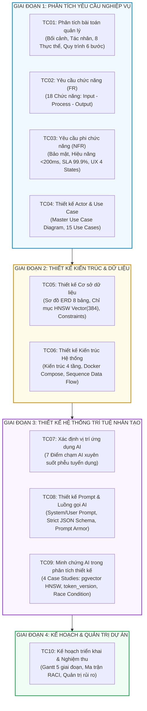

# TỔNG QUAN HỒ SƠ PHÂN TÍCH VÀ THIẾT KẾ HỆ THỐNG
## DỰ ÁN: AI-POWERED JOB PORTAL (NỀN TẢNG TUYỂN DỤNG THÔNG MINH B2B)

---

### 1. GIỚI THIỆU CHUNG
Tài liệu này là bản đồ điều hướng và tổng hợp của **Bộ Hồ sơ Phân tích & Thiết kế Hệ thống (System Analysis & Architecture Design - SRS/SAD)** cho dự án **AI-Powered Job Portal**. Toàn bộ tài liệu được biên soạn dựa trên 100% dữ kiện thực tế từ mã nguồn, cơ sở dữ liệu và các dịch vụ AI đang vận hành của nền tảng.

Bộ tài liệu bao gồm 10 chuyên đề tiêu chí được chuẩn hóa theo quy chuẩn Kỹ nghệ Phần mềm hiện đại:

---

### 2. BẢNG ĐIỀU HƯỚNG 10 TIÊU CHÍ PHÂN TÍCH & THIẾT KẾ

| Tiêu chí | Tên Tài liệu Chi tiết | Nội dung Cốt lõi & Minh chứng Kỹ thuật | Sơ đồ Trực quan |
| :---: | :--- | :--- | :---: |
| **TC01** | [TC01_PHAN_TICH_BAI_TOAN_QUAN_LY.md](file:///d:/ai-job-portal/docs/phantich_thietke/TC01_PHAN_TICH_BAI_TOAN_QUAN_LY.md) | Phân tích thị trường B2B Recruitment ATS; 3 nhóm người dùng (`Candidate`, `Employer`, `Admin`); 8 thực thể dữ liệu; Quy trình tuyển dụng khép kín 6 bước; Mục tiêu giảm 70% thời gian lọc CV. | `flowchart TD` Luồng nghiệp vụ 6 bước |
| **TC02** | [TC02_YEU_CAU_CHUC_NANG.md](file:///d:/ai-job-portal/docs/phantich_thietke/TC02_YEU_CAU_CHUC_NANG.md) | Ma trận 18 yêu cầu chức năng (FR-01 -> FR-18) phân rã qua 7 phân hệ; Cấu trúc đặc tả 3 thành phần chuẩn mực: **Đầu vào (Input) -> Quy trình Xử lý (Process) -> Đầu ra (Output)**. | `mindmap` Phân rã chức năng |
| **TC03** | [TC03_YEU_CAU_PHI_CHUC_NANG.md](file:///d:/ai-job-portal/docs/phantich_thietke/TC03_YEU_CAU_PHI_CHUC_NANG.md) | 6 nhóm chỉ tiêu phi chức năng (NFR): Bảo mật (Bcrypt, JWT `token_version`, PII Sanitization, Prompt Armor), Hiệu năng (< 200ms P95, HNSW pgvector < 150ms), Độ khả dụng (SLA 99.9%, Circuit Breaker), Phân quyền Multi-tenant và UX 4 States. | `flowchart TD` Cây phân cấp NFR |
| **TC04** | [TC04_THIET_KE_ACTOR_VA_USE_CASE.md](file:///d:/ai-job-portal/docs/phantich_thietke/TC04_THIET_KE_ACTOR_VA_USE_CASE.md) | Xác định 3 Human Actors và 1 Service Actor (`AI Engine`); Ma trận 15 Use Cases; Sơ đồ **Master Use Case Toàn hệ thống** với quan hệ `<<include>>` và `<<extend>>`; Đặc tả ca sử dụng UC08 (Kanban Pipeline). | Sơ đồ **Master Use Case** |
| **TC05** | [TC05_THIET_KE_CO_SO_DU_LIEU.md](file:///d:/ai-job-portal/docs/phantich_thietke/TC05_THIET_KE_CO_SO_DU_LIEU.md) | Thiết kế CSDL PostgreSQL 17 + pgvector; Từ điển dữ liệu chi tiết 8 bảng; Ràng buộc `UniqueConstraint("candidate_id", "job_id")`; Chỉ mục HNSW Cosine Similarity; Phân tích quan hệ 1-N và N-N. | Sơ đồ **ERD Hoàn chỉnh** (`erDiagram`) |
| **TC06** | [TC06_THIET_KE_KIEN_TRUC_HE_THONG.md](file:///d:/ai-job-portal/docs/phantich_thietke/TC06_THIET_KE_KIEN_TRUC_HE_THONG.md) | Mô hình Kiến trúc 4 tầng (Presentation - Application - Data - AI Service); Containerization qua Docker Compose; Sơ đồ Sequence Diagram luồng nộp hồ sơ, bóc tách vector và AI chấm điểm. | `flowchart TB` 4 tầng & `sequenceDiagram` |
| **TC07** | [TC07_XAC_DINH_VI_TRI_UNG_DUNG_AI.md](file:///d:/ai-job-portal/docs/phantich_thietke/TC07_XAC_DINH_VI_TRI_UNG_DUNG_AI.md) | Phân tích 7 điểm chạm AI tích hợp trong phễu tuyển dụng (Parsing CV, Matching Score, Semantic Search, JD Generator, Roadmap, CV Copilot, Interview Questions); Nguyên tắc Responsible AI. | `flowchart LR` Tuyến điểm chạm AI |
| **TC08** | [TC08_THIET_KE_PROMPT_VA_LUONG_GOI_AI.md](file:///d:/ai-job-portal/docs/phantich_thietke/TC08_THIET_KE_PROMPT_VA_LUONG_GOI_AI.md) | Kiến trúc Prompt 2 lớp (Bảng `ai_prompt_configs` + Code fallback); Mẫu System/User Prompt chuẩn; Ràng buộc Strict JSON Schema; Kỹ thuật phòng vệ Prompt Armor (XML Delimiters, PII Sanitization, Hyperparameters). | `sequenceDiagram` Luồng gọi AI 5 bước |
| **TC09** | [TC09_MINH_CHUNG_AI_PHAN_TICH_THIET_KE.md](file:///d:/ai-job-portal/docs/phantich_thietke/TC09_MINH_CHUNG_AI_PHAN_TICH_THIET_KE.md) | Nhật ký minh chứng AI-assisted Pair Programming: 4 Case studies thực tế (pgvector HNSW vs IVFFlat, `token_version` vs Redis, Race Condition `UniqueConstraint`, Tái cấu trúc Frontend Components). | `flowchart TD` Luồng kiểm chứng Kỹ sư - AI |
| **TC10** | [TC10_KE_HOACH_TRIEN_KHAI_DU_AN.md](file:///d:/ai-job-portal/docs/phantich_thietke/TC10_KE_HOACH_TRIEN_KHAI_DU_AN.md) | Kế hoạch dự án 5 giai đoạn (Milestones/WBS); Ma trận phân công trách nhiệm RACI theo 3 Persona kỹ thuật; Kế hoạch quản trị rủi ro; Bộ tiêu chí nghiệm thu hệ thống (295 tests passed, 81.08% coverage). | `gantt` Tiến độ 5 giai đoạn |

---

### 3. MA TRẬN TRUY VẾT YÊU CẦU & KIẾN TRÚC (TRACEABILITY MATRIX)

Ma trận chứng minh sự liên kết chặt chẽ và nhất quán xuyên suốt từ Yêu cầu Nghiệp vụ -> Thiết kế Kỹ thuật -> Mã nguồn Cài đặt thực tế:

| Nhóm Nghiệp vụ | Yêu cầu Chức năng (FR) | Tác nhân & Use Case | Bảng CSDL (DB Table) | Thành phần Mã nguồn Backend | Thành phần Giao diện Frontend |
| :--- | :--- | :--- | :--- | :--- | :--- |
| **Xác thực & Bảo mật** | FR-01, FR-02, FR-03 | UC01 (Auth) | `users` (`token_version`, `role`) | `routers/auth.py`, `core/security.py` | `pages/auth/LoginPage.tsx`, `useAuthStore.ts` |
| **Quản lý Tin Tuyển dụng** | FR-04, FR-05, FR-06 | UC06, UC07 (Jobs & JD Gen) | `jobs`, `job_categories` | `routers/jobs.py`, `crud/job.py` | `pages/employer/jobs/CreateJobPage.tsx` |
| **Tìm kiếm & Lọc** | FR-07, FR-08 | UC02, UC11 (Search & Vector) | `jobs.embedding`, `resume_chunks` | `routers/search.py`, `crud/search.py` | `pages/jobs/JobListPage.tsx`, `TalentSearchPage.tsx` |
| **Ứng tuyển & Kanban** | FR-09, FR-10, FR-11 | UC03, UC04, UC08 (Kanban) | `applications`, `resumes` | `routers/applications.py`, `crud/application.py` | `pages/employer/ApplicationsPage.tsx`, `ApplicantCard.tsx` |
| **Vòng Phỏng vấn** | FR-12, FR-13 | UC09, UC10 (Interviews) | `interview_rounds` | `routers/interview_rounds.py` | `pages/employer/interviews/InterviewRoundsPage.tsx` |
| **Phân tích AI & Copilot** | FR-14, FR-15, FR-16 | UC05, UC12 (AI Features) | `applications.ai_score`, `ai_prompt_configs` | `services/ai_service.py`, `rag_service.py` | `CVCopilotDrawer.tsx`, `CareerRoadmapPage.tsx` |
| **Quản trị & Báo cáo** | FR-17, FR-18 | UC13, UC14, UC15 (Admin) | `ai_prompt_configs`, `ai_search_logs` | `routers/admin.py`, `routers/analytics.py` | `pages/admin/AdminDashboardPage.tsx` |
