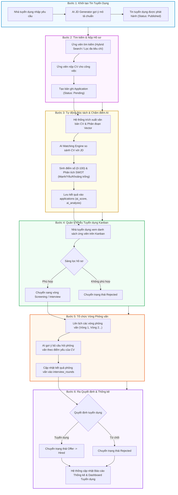

# TIÊU CHÍ 01: PHÂN TÍCH ĐÚNG BÀI TOÁN QUẢN LÝ
## DỰ ÁN: AI-POWERED JOB PORTAL (NỀN TẢNG TUYỂN DỤNG THÔNG MINH B2B)

---

### 1. YÊU CẦU TIÊU CHÍ
> **Tiêu chuẩn:** Xác định rõ bối cảnh thực tế, đối tượng người dùng mục tiêu, danh mục dữ liệu quản trị, quy trình nghiệp vụ cốt lõi và các vấn đề trọng yếu cần giải quyết trong nền tảng tuyển dụng thông minh.

---

### 2. BỐI CẢNH DỰ ÁN (PROJECT CONTEXT)

Trong kỷ nguyên số hóa và thị trường nhân lực công nghệ thông tin cạnh tranh khốc liệt, phương thức tuyển dụng thủ công truyền thống đang bộc lộ những điểm nghẽn nghiêm trọng:
1. **Quá tải hồ sơ (CV Overload):** Một tin tuyển dụng công nghệ có thể nhận hàng trăm hồ sơ, trong đó 60-70% không phù hợp với yêu cầu cơ bản. Bộ phận nhân sự (HR) mất trung bình từ 15 đến 30 phút để đọc và sàng lọc từng CV.
2. **Đánh giá chủ quan và thiên vị (Unconscious Bias):** Việc lọc CV bằng mắt thường dễ bị chi phối bởi các yếu tố bên lề (trường đại học, hình thức trình bày, khoảng trống kinh nghiệm), dẫn đến bỏ sót nhân tài thực tế.
3. **Độ lệch kỹ năng giữa JD và Ứng viên:** Bản mô tả công việc (JD) thường viết chung chung, trong khi ứng viên không rõ mình còn thiếu kỹ năng gì để đáp ứng vị trí công việc.
4. **Trải nghiệm ứng viên rời rạc:** Ứng viên nộp hồ sơ vào "hố đen", không nhận được phản hồi định lượng, không biết hồ sơ đang ở giai đoạn nào.

**Nền tảng "AI-Powered Job Portal"** ra đời như một giải pháp **B2B SaaS hiện đại** kết hợp giữa hệ thống quản trị tuyển dụng toàn diện (Applicant Tracking System - ATS) và công nghệ trí tuệ nhân tạo (Generative AI / Vector Search / LLM) nhằm số hóa và tự động hóa toàn bộ phễu tuyển dụng.

---

### 3. ĐỐI TƯỢNG NGƯỜI DÙNG (STAKEHOLDERS / USERS)

Hệ thống được thiết kế phục vụ 3 nhóm đối tượng tác nhân (Actor) chính:

| Nhóm người dùng | Vai trò nghiệp vụ | Mục tiêu & Kỳ vọng chính |
| :--- | :--- | :--- |
| **Ứng viên (Candidate)** | Tìm kiếm cơ hội nghề nghiệp, xây dựng hồ sơ chuyên nghiệp | - Tiếp cận các tin tuyển dụng chính xác theo kỹ năng. - Nhận đánh giá CV từ AI, phân tích khoảng trống kỹ năng (Skill Gap) và lộ trình học tập gợi ý. - Theo dõi trạng thái ứng tuyển minh bạch theo thời gian thực (Applied Tracker). |
| **Nhà tuyển dụng (Employer / Recruiter)** | Đăng tin, săn tìm nhân tài, quản trị phễu tuyển dụng | - Khởi tạo tin tuyển dụng nhanh chóng với sự hỗ trợ của AI JD Generator. - Quản lý hồ sơ theo mô hình Kanban kéo thả trực quan (Applied -> Screening -> Interview -> Offer -> Hired/Rejected). - Tự động chấm điểm ứng viên (AI Matching Score 0-100) kèm phân tích SWOT. - Tra cứu hồ sơ ứng viên bằng tìm kiếm ngữ nghĩa (Semantic Talent Search). |
| **Quản trị viên (System Admin)** | Quản trị nền tảng, vận hành hệ thống và giám sát chi phí | - Phân quyền người dùng, kiểm duyệt công ty và tin tuyển dụng. - Quản trị cấu hình Prompt AI linh hoạt không cần restart server (`ai_prompt_configs`). - Giám sát chi phí gọi LLM API, token tiêu thụ, cache hit rate và hiệu năng hệ thống. |

---

### 4. DỮ LIỆU QUẢN LÝ (CORE ENTITIES)

Hệ thống tổ chức và chuẩn hóa dữ liệu xung quanh 8 thực thể trọng tâm:

1. **Tài khoản & Hồ sơ (`users`):** Định danh người dùng, mã hóa mật khẩu, phân quyền vai trò (`admin`, `employer`, `candidate`), cờ kích hoạt và phiên bản token (`token_version`).
2. **Doanh nghiệp (`companies`):** Thông tin pháp lý, logo, quy mô nhân sự, địa chỉ, website, trạng thái kích hoạt.
3. **Tin tuyển dụng (`jobs`):** Tiêu đề công việc, cấp bậc, mức lương min/max, yêu cầu kỹ năng, địa điểm làm việc, hạn nộp hồ sơ, trạng thái mở/đóng.
4. **Hồ sơ ứng viên (`resumes`):** Tệp CV (PDF/DOCX), nội dung text trích xuất (`raw_text`), thông tin kỹ năng, kinh nghiệm đã bóc tách.
5. **Hồ sơ ứng tuyển (`applications`):** Quan hệ giữa ứng viên và tin tuyển dụng, trạng thái hồ sơ (Pending, Screening, Interview, Offer, Rejected), điểm số AI Matching (`ai_score`), bản phân tích chi tiết (`ai_analysis`).
6. **Vòng phỏng vấn (`interview_rounds`):** Quản lý tiến trình phỏng vấn theo từng vòng (Vòng 1 Tech, Vòng 2 HR...), thời gian, hình thức, người phỏng vấn và điểm đánh giá.
7. **Vector phân đoạn hồ sơ (`resume_chunks`):** Phân đoạn nội dung CV kèm vector embedding 384 chiều (`vector(384)`) phục vụ tìm kiếm ngữ nghĩa pgvector.
8. **Nhật ký & Cấu hình AI (`ai_prompt_configs`, `ai_search_logs`):** Cấu hình prompt động, lưu vết truy vấn tìm kiếm nhân tài và đo lường thời gian đáp ứng của mô hình.

---

### 5. QUY TRÌNH NGHIỆP VỤ CỐT LÕI (CORE BUSINESS PROCESS)

Toàn bộ hoạt động tuyển dụng trong hệ thống vận hành theo quy trình khép kín 6 bước:

---

### 6. CÁC VẤN ĐỀ TRỌNG TÂM CẦN GIẢI QUYẾT & MỤC TIÊU CỤ THỂ

| Vấn đề của phương thức truyền thống | Giải pháp công nghệ trong hệ thống | Chỉ số đo lường hiệu quả (KPIs) |
| :--- | :--- | :--- |
| **Sàng lọc thủ công chậm chạp** | Hệ thống tự động bóc tách CV và tính toán AI Matching Score ngay khi nộp hồ sơ. | **Giảm 70%** thời gian sàng lọc hồ sơ ban đầu (từ 20 phút xuống < 30 giây/hồ sơ). |
| **Tìm kiếm ứng viên chỉ theo từ khóa chính xác (Exact match)** | Ứng dụng pgvector với thuật toán Cosine Similarity (`<=>`) cho phép tìm kiếm ngữ nghĩa ("Dev làm React giỏi" tìm được ứng viên "Frontend Engineer thạo Next.js/Redux"). | Tăng **45%** độ phủ tìm kiếm ứng viên tiềm năng bị bỏ sót do khác biệt từ khóa. |
| **Quản trị phễu tuyển dụng phân tán** | Xây dựng bảng Kanban tương tác thời gian thực, tích hợp kéo thả ứng viên qua các trạng thái tuyển dụng. | Tập trung 100% dữ liệu phễu tuyển dụng trên một màn hình duy nhất. |
| **Ứng viên thiếu định hướng nghề nghiệp** | Tích hợp tính năng AI Roadmap Advisor phân tích khoảng trống kỹ năng và đề xuất lộ trình cải thiện cho ứng viên. | Nâng cao tỷ lệ giữ chân ứng viên trên nền tảng và cải thiện chất lượng nguồn cung nhân lực. |
| **Bảo mật và cô lập dữ liệu B2B** | Triển khai mô hình Multi-tenant Fencing tại tầng Backend CRUD: Nhà tuyển dụng chỉ được truy xuất hồ sơ nộp vào công ty của mình. | Ngăn chặn 100% rủi ro rò rỉ dữ liệu chéo giữa các doanh nghiệp đối thủ. |
