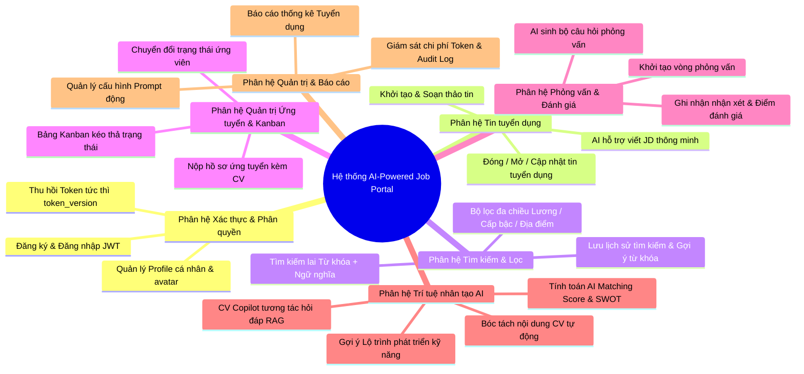

# TIÊU CHÍ 02: XÁC ĐỊNH ĐẦY ĐỦ YÊU CẦU CHỨC NĂNG (FUNCTIONAL REQUIREMENTS)
## DỰ ÁN: AI-POWERED JOB PORTAL (NỀN TẢNG TUYỂN DỤNG THÔNG MINH B2B)

---

### 1. YÊU CẦU TIÊU CHÍ
> **Tiêu chuẩn:** Liệt kê đầy đủ và có hệ thống các chức năng quản lý cốt lõi phù hợp với đề tài, có mô tả chi tiết 3 thành phần cho từng chức năng: **Đầu vào (Input) -> Xử lý nghiệp vụ (Process) -> Đầu ra (Output)**.

---

### 2. SƠ ĐỒ CÂY PHÂN RÃ CHỨC NĂNG HỆ THỐNG (FUNCTIONAL DECOMPOSITION)

---

### 3. MA TRẬN ĐẶC TẢ YÊU CẦU CHỨC NĂNG (INPUT - PROCESS - OUTPUT)

#### Phân hệ 1: Quản lý Xác thực & Tài khoản người dùng (Auth & User Management)

| Mã YC | Tên chức năng | Tác nhân | Đầu vào (Input) | Quy trình Xử lý (Process) | Đầu ra (Output) |
| :--- | :--- | :--- | :--- | :--- | :--- |
| **FR-01** | Đăng ký tài khoản | Khách vãng lai | `email`, `password`, `full_name`, `role` (`candidate` / `employer`) | 1. Kiểm tra định dạng email và độ mạnh mật khẩu (Zod/Pydantic). 2. Kiểm tra tính duy nhất của email trong bảng `users`. 3. Băm mật khẩu bằng thuật toán `bcrypt`. 4. Tạo tài khoản với `token_version = 1`. | Bản ghi User mới; Mã trạng thái HTTP 201 Created; Gợi ý đăng nhập. |
| **FR-02** | Đăng nhập & Cấp JWT | Mọi tác nhân | `email`, `password` (OAuth2 Password Request Form) | 1. Tra cứu user theo email. 2. Xác thực mật khẩu hash bằng `bcrypt.verify`. 3. Kiểm tra cờ `is_active == True`. 4. Ký mã `access_token` chứa `sub` (email), `role`, `token_version` với thời hạn hết hạn. | Trả về `access_token`, `token_type: bearer`, `user` profile object; Lưu token vào Auth State. |
| **FR-03** | Đăng xuất & Thu hồi phiên | Người dùng đã đăng nhập | Header `Authorization: Bearer <token>` | 1. Xác thực token hợp lệ qua Dependency `get_current_user`. 2. Thực thi tăng phiên bản token: `user.token_version += 1`. 3. Commit thay đổi vào CSDL. | Vô hiệu hóa toàn bộ access token cũ ngay lập tức; Trả về `{ "message": "Successfully logged out" }`. |

---

#### Phân hệ 2: Quản lý Tin tuyển dụng (Job Posting & Lifecycle)

| Mã YC | Tên chức năng | Tác nhân | Đầu vào (Input) | Quy trình Xử lý (Process) | Đầu ra (Output) |
| :--- | :--- | :--- | :--- | :--- | :--- |
| **FR-04** | Đăng tin tuyển dụng mới | Employer, Admin | `title`, `description`, `requirements`, `salary_min`, `salary_max`, `location`, `job_type`, `experience_level` | 1. Kiểm tra quyền Employer gắn liền với `company_id`. 2. Validate dữ liệu đầu vào (lương min <= lương max, ngày hết hạn trong tương lai). 3. Khởi tạo tin tuyển dụng trong bảng `jobs` với `status = 'published'`. | Bản ghi Job mới; HTTP 201 Created; Tin hiển thị trên trang tìm việc chung. |
| **FR-05** | AI sinh mô tả công việc (JD Generator) | Employer | `job_title`, `experience_level`, `key_skills` | 1. Kiểm tra quyền Employer. 2. Nạp system prompt cấu hình `job_description_generator`. 3. Gửi payload sang DeepSeek V3 API. 4. Validate JSON kết quả trả về cấu trúc gồm: tổng quan, trách nhiệm, yêu cầu kỹ năng và quyền lợi. | Trả về văn bản gợi ý hoàn chỉnh hiển thị tự động lên form soạn thảo. |
| **FR-06** | Đóng / Chỉnh sửa tin tuyển dụng | Employer sở hữu tin | `job_id`, dữ liệu cần sửa hoặc cập nhật `status = 'closed'` | 1. Kiểm tra quyền sở hữu (multi-tenant check: `job.company_id == employer.company_id`). 2. Cập nhật các trường thông tin trong DB. 3. Lưu `updated_at`. | Bản ghi Job đã cập nhật; Thông báo toast thành công; Tin tự động ẩn khỏi trang tìm kiếm nếu đóng. |

---

#### Phân hệ 3: Tìm kiếm, Khám phá & Lọc việc làm (Search & Filtering)

| Mã YC | Tên chức năng | Tác nhân | Đầu vào (Input) | Quy trình Xử lý (Process) | Đầu ra (Output) |
| :--- | :--- | :--- | :--- | :--- | :--- |
| **FR-07** | Tìm kiếm & Lọc việc làm đa chiều | Candidate, Khách | Query `q`, `location`, `job_type`, `experience_level`, `min_salary`, `skip`, `limit` | 1. Xây dựng câu truy vấn động bằng SQLAlchemy. 2. Áp dụng `ilike` trên `title`, `description`, `requirements`. 3. Áp dụng các điều kiện lọc kết hợp (`AND`). 4. Phân trang dữ liệu và trả về tổng số lượng bản ghi. | Danh sách Job Cards kèm phân trang; Hiển thị đúng 4 trạng thái UI (Loading, Danh sách, Trống, Lỗi). |
| **FR-08** | Săn nhân tài bằng Vector Search (Semantic Talent Search) | Employer, Admin | Câu truy vấn tự nhiên: `query_text`, `top_k`, `min_similarity` | 1. Tạo vector embedding cho câu truy vấn (384 dimensions). 2. Thực hiện truy vấn khoảng cách Cosine trên bảng `resume_chunks` bằng toán tử `<=>`. 3. Nhóm kết quả theo ứng viên, tính điểm tương đồng cao nhất. 4. Ghi log truy vấn vào `ai_search_logs`. | Danh sách hồ sơ ứng viên phù hợp ngữ nghĩa kèm điểm tương đồng phần trăm (0 - 100%). |

---

#### Phân hệ 4: Quản trị Ứng tuyển & Phễu Tuyển dụng Kanban (Applications & Kanban Pipeline)

| Mã YC | Tên chức năng | Tác nhân | Đầu vào (Input) | Quy trình Xử lý (Process) | Đầu ra (Output) |
| :--- | :--- | :--- | :--- | :--- | :--- |
| **FR-09** | Nộp hồ sơ ứng tuyển | Candidate | `job_id`, `resume_id` (hoặc upload CV mới), `cover_letter` | 1. Kiểm tra tính hợp lệ của tin tuyển dụng (`status == 'published'`). 2. Ngăn chặn nộp trùng lặp: Kiểm tra cặp `(job_id, candidate_id)` -> ném lỗi 409 Conflict nếu đã nộp. 3. Tạo bản ghi `applications` với trạng thái `pending`. 4. Kích hoạt tác vụ nền tính toán AI Matching Score. | Bản ghi Application mới; Mã HTTP 201; Trạng thái hiển thị tức thì trên Applied Tracker. |
| **FR-10** | Quản lý bảng Kanban phễu tuyển dụng | Employer | `job_id` | 1. Xác thực quyền sở hữu tin tuyển dụng của công ty. 2. Truy vấn toàn bộ applications thuộc job, gom nhóm theo 5 cột Kanban: `Pending`, `Screening`, `Interview`, `Offer`, `Rejected`. 3. Kèm theo điểm `ai_score` và thông tin ứng viên. | Bảng Kanban hiển thị danh sách thẻ ứng viên trực quan với số lượng đếm ở đầu mỗi cột. |
| **FR-11** | Cập nhật trạng thái ứng viên kéo thả | Employer | `application_id`, `new_status` | 1. Kiểm tra quyền sở hữu công ty. 2. Kiểm tra tính hợp lệ của bước chuyển trạng thái (State Transition). 3. Cập nhật `status` của bản ghi trong CSDL. 4. Tự động cập nhật `updated_at`. | Bản ghi Application cập nhật; Giao diện Kanban phản hồi tức thì (Optimistic Update); Ứng viên thấy trạng thái mới. |

---

#### Phân hệ 5: Vòng phỏng vấn & Đánh giá (Interview Rounds & Feedback)

| Mã YC | Tên chức năng | Tác nhân | Đầu vào (Input) | Quy trình Xử lý (Process) | Đầu ra (Output) |
| :--- | :--- | :--- | :--- | :--- | :--- |
| **FR-12** | Thiết lập vòng phỏng vấn | Employer | `application_id`, `round_number`, `round_type` (Technical/HR/Culture), `scheduled_at`, `interviewer_name` | 1. Kiểm tra trạng thái hồ sơ phải là `interview`. 2. Kiểm tra số vòng hợp lệ và ngày phỏng vấn. 3. Tạo bản ghi trong bảng `interview_rounds`. | Chi tiết lịch phỏng vấn; Hiển thị trên dòng thời gian tiến trình ứng tuyển. |
| **FR-13** | Ghi nhận kết quả & Điểm phỏng vấn | Employer | `round_id`, `score` (1-10), `feedback`, `result` (passed/failed/pending) | 1. Kiểm tra quyền interviewer thuộc công ty. 2. Cập nhật điểm số và nhận xét chi tiết. 3. Nếu vòng cuối đạt -> gợi ý chuyển hồ sơ sang cột `Offer`. | Bản ghi vòng phỏng vấn cập nhật; Lưu vết lịch sử tuyển dụng minh bạch. |

---

#### Phân hệ 6: Phân tích Trí tuệ Nhân tạo (AI Features & Copilot)

| Mã YC | Tên chức năng | Tác nhân | Đầu vào (Input) | Quy trình Xử lý (Process) | Đầu ra (Output) |
| :--- | :--- | :--- | :--- | :--- | :--- |
| **FR-14** | AI Matching Score & Phân tích SWOT | Hệ thống tự động / Employer | `application_id` (nội dung CV + nội dung JD) | 1. Kiểm tra SHA-256 cache để tránh gọi API trùng. 2. Gửi prompt chuẩn hóa sang DeepSeek V3 với ràng buộc JSON Schema. 3. Trích xuất: Điểm tổng hợp (0-100), Điểm kỹ năng, Kinh nghiệm, Học vấn, Phân tích Điểm mạnh, Điểm yếu, Khoảng trống kỹ năng. 4. Lưu kết quả vào cột `ai_score` và `ai_analysis`. | Radar Chart trực quan trên UI; Khuyến nghị tuyển dụng tự động cho HR. |
| **FR-15** | AI Career Roadmap & Skill Gap Advisor | Candidate | `resume_id`, `target_job_role` | 1. Trích xuất hồ sơ kỹ năng hiện tại của ứng viên. 2. Đối chiếu với yêu cầu chuẩn của vị trí mục tiêu. 3. AI thiết kế lộ trình 3 giai đoạn (Ngắn hạn, Trung hạn, Dài hạn) kèm các khóa học, dự án thực hành gợi ý. | Biểu đồ lộ trình học tập tương tác (Gantt/Timeline) kèm gợi ý chi tiết. |
| **FR-16** | CV Copilot (Hỏi đáp ngữ cảnh RAG) | Employer, Recruiter | `application_id`, `question_text` | 1. Khử định danh PII của ứng viên (ẩn tên, số điện thoại, email). 2. Nạp ngữ cảnh CV phân đoạn vào prompt. 3. DeepSeek V3 trả lời các câu hỏi chuyên sâu của HR (ví dụ: "Ứng viên này đã từng làm việc với Docker và Kubernetes thực tế chưa?"). | Khung chat Drawer trả lời tức thì, dẫn chứng cụ thể từ đoạn văn bản trong CV. |

---

#### Phân hệ 7: Quản trị Hệ thống & Báo cáo (Admin Governance & Analytics)

| Mã YC | Tên chức năng | Tác nhân | Đầu vào (Input) | Quy trình Xử lý (Process) | Đầu ra (Output) |
| :--- | :--- | :--- | :--- | :--- | :--- |
| **FR-17** | Quản lý Cấu hình Prompt động | System Admin | `prompt_key`, `system_prompt`, `user_prompt_template`, `temperature`, `max_tokens`, `is_active` | 1. Kiểm tra quyền hạn Admin tối cao. 2. Cập nhật hoặc thêm mới bản ghi trong bảng `ai_prompt_configs`. 3. Cập nhật bộ nhớ đệm cấu hình in-memory. 4. Không cần khởi động lại server. | Thay đổi prompt có hiệu lực ngay lập tức cho toàn bộ người dùng. |
| **FR-18** | Dashboard Thống kê Tuyển dụng & Giám sát Chi phí AI | Admin, Employer | Bộ lọc thời gian (Ngày/Tuần/Tháng), `company_id` | 1. Chạy truy vấn tổng hợp SQL: Đếm tổng hồ sơ nộp, tỷ lệ chuyển đổi qua các vòng Kanban, điểm AI trung bình. 2. Đếm tổng lượt gọi AI, tổng số token tiêu thụ và chi phí ước tính theo USD. | Bảng điều khiển trực quan (Biểu đồ Recharts, Thẻ thống kê KPI, Biểu đồ thanh chi phí). |
