# TIÊU CHÍ 03: XÁC ĐỊNH YÊU CẦU PHI CHỨC NĂNG (NON-FUNCTIONAL REQUIREMENTS)
## DỰ ÁN: AI-POWERED JOB PORTAL (NỀN TẢNG TUYỂN DỤNG THÔNG MINH B2B)

---

### 1. YÊU CẦU TIÊU CHÍ
> **Tiêu chuẩn:** Thiết lập đầy đủ các chỉ số định lượng và quy chuẩn kỹ thuật cho hệ thống về: **Bảo mật, Hiệu năng, Độ khả dụng, Sao lưu & Phục hồi, Phân quyền người dùng và Chất lượng trải nghiệm giao diện (UX/UI)**.

---

### 2. CÂY PHÂN CẤP CHỈ TIÊU PHI CHỨC NĂNG (NFR ARCHITECTURE)

```mermaid
flowchart TD
    NFR["HỆ THỐNG YÊU CẦU PHI CHỨC NĂNG (NFR)"]
    
    SEC["1. Bảo mật & Quyền riêng tư<br>(Security & Privacy)"]
    PERF["2. Hiệu năng & Tải cao<br>(Performance & Scalability)"]
    AVAIL["3. Độ tin cậy & Khả dụng<br>(Reliability & Availability)"]
    BCK["4. Sao lưu & Phục hồi<br>(Backup & Recovery)"]
    RBAC["5. Phân quyền & Cô lập B2B<br>(Multi-tenant RBAC)"]
    UX["6. Trải nghiệm người dùng<br>(UX/UI Quality Attributes)"]

    NFR --> SEC
    NFR --> PERF
    NFR --> AVAIL
    NFR --> BCK
    NFR --> RBAC
    NFR --> UX

    SEC -.-> SEC1["Bcrypt Password Hashing"]
    SEC -.-> SEC2["JWT Instant Revocation token_version"]
    SEC -.-> SEC3["PII Sanitization & Prompt Armor"]

    PERF -.-> PERF1["API Response < 200ms P95"]
    PERF -.-> PERF2["DB Connection Pool & Pre-ping"]
    PERF -.-> PERF3["pgvector HNSW Search < 150ms"]

    AVAIL -.-> AVAIL1["Circuit Breaker for AI Service"]
    AVAIL -.-> AVAIL2["Container Auto-restart & Healthcheck"]

    BCK -.-> BCK1["Volume Persistence & pg_dump"]
    BCK -.-> BCK2["Deterministic Seed Data Restoration"]

    RBAC -.-> RBAC1["3-Tier Roles: Admin/Employer/Candidate"]
    RBAC -.-> RBAC2["Multi-tenant Job/Resume Fencing"]

    UX -.-> UX1["4 UI States: Ideal/Skeleton/Empty/Error"]
    UX -.-> UX2["Mobile-First & Sonner Toast Feedback"]

    style NFR fill:#1e293b,stroke:#0f172a,color:#fff,stroke-width:2px
    style SEC fill:#fef2f2,stroke:#ef4444,stroke-width:1.5px
    style PERF fill:#eff6ff,stroke:#3b82f6,stroke-width:1.5px
    style AVAIL fill:#f0fdf4,stroke:#22c55e,stroke-width:1.5px
    style BCK fill:#fefce8,stroke:#eab308,stroke-width:1.5px
    style RBAC fill:#faf5ff,stroke:#a855f7,stroke-width:1.5px
    style UX fill:#fff7ed,stroke:#f97316,stroke-width:1.5px
```



---

### 3. ĐẶC TẢ CHI TIẾT 6 TRỤ CỘT PHI CHỨC NĂNG

#### 3.1. Bảo mật & An toàn thông tin (Security & Data Privacy)

Hệ thống tuân thủ nghiêm ngặt các tiêu chuẩn an toàn thông tin OWASP Top 10 và bảo vệ dữ liệu cá nhân:

| Chỉ số / Cơ chế | Tiêu chuẩn kỹ thuật áp dụng trong mã nguồn | Minh chứng triển khai thực tế |
| :--- | :--- | :--- |
| **Mã hóa mật khẩu** | Mật khẩu người dùng không bao giờ lưu dưới dạng văn bản thuần. Sử dụng thuật toán `bcrypt` với cost factor = 12. | Triển khai tại `app/core/security.py` qua hàm `get_password_hash` và `verify_password`. |
| **Bảo mật phiên đăng nhập** | Cấp mã JSON Web Token (JWT) mã hóa bằng khóa bí mật `SECRET_KEY` (HS256). Thời gian sống của token: 60 phút. | Token payload bao gồm: `sub` (email), `role`, `token_version`, `exp`. |
| **Thu hồi token tức thì** | Hỗ trợ đăng xuất an toàn (Instant Token Revocation). Nếu người dùng đăng xuất hoặc đổi mật khẩu, token cũ bị từ chối ngay lập tức. | Cơ chế kiểm tra `user.token_version == payload.token_version` tại `app/core/dependencies.py`. |
| **Khử định danh dữ liệu cá nhân (PII Sanitization)** | Trước khi gửi CV của ứng viên sang LLM bên ngoài (DeepSeek), hệ thống tự động bóc tách và ẩn toàn bộ thông tin nhạy cảm: Số điện thoại, Email, Địa chỉ nhà, Tên thật. | Triển khai hàm `sanitize_pii()` sử dụng Regex tại `app/services/rag_service.py`. |
| **Phòng vệ Prompt (Prompt Armor)** | Ngăn chặn tấn công Prompt Injection và Jailbreak: Khử các ký tự điều khiển, giới hạn độ dài câu hỏi, bọc input bằng thẻ delimiter XML an toàn `<cv_data>`. | Cài đặt tại `app/services/ai_service.py` và `app/core/ai_client.py`. |
| **Bảo vệ Khóa bí mật API** | Che giấu API Key (`DEEPSEEK_API_KEY`, `POSTGRES_PASSWORD`) trong toàn bộ logs của hệ thống. | Hàm `mask_secrets()` trong logging engine. |

---

#### 3.2. Hiệu năng & Khả năng mở rộng (Performance & Scalability)

| Tiêu chí | Mục tiêu định lượng | Giải pháp kiến trúc thực tế |
| :--- | :--- | :--- |
| **Thời gian phản hồi API** | **< 200ms** cho 95% request nghiệp vụ đọc (P95 Read Latency). | Tối ưu hóa câu lệnh truy vấn SQLAlchemy, sử dụng `joinedload` để loại bỏ vấn đề truy vấn thừa N+1 queries. |
| **Tốc độ tìm kiếm Vector** | **< 150ms** cho truy vấn tìm kiếm nhân tài trên tập dữ liệu 10,000+ vector chunks. | Thiết lập chỉ mục HNSW (`m=16, ef_construction=64`) trên cột vector trong PostgreSQL với toán tử Cosine Similarity (`<=>`). |
| **Quản lý kết nối CSDL (Connection Pooling)** | Duy trì ổn định dưới tải 100+ người dùng đồng thời không bị cạn kiệt connection. | Cấu hình SQLAlchemy Engine: `pool_size=10`, `max_overflow=20`, `pool_pre_ping=True`, `pool_recycle=300`. Cơ chế `pool_pre_ping` loại bỏ hoàn toàn lỗi "MySQL/PostgreSQL server has gone away". |
| **Bộ nhớ đệm AI (AI Caching)** | Giảm **60%** chi phí gọi API và độ trễ phản hồi khi tính điểm CV trùng lặp. | Bộ nhớ đệm SHA-256 Hash tính toán từ cặp `(CV_text + JD_text)`. Nếu hash đã tồn tại trong DB, trả về kết quả ngay lập tức mà không gọi LLM. |

---

#### 3.3. Độ tin cậy & Tính khả dụng (Availability & Reliability)

```
SLA Mục tiêu: 99.9% Uptime cho toàn bộ phân hệ Core Web & API
```

1. **Cơ chế Ngắt mạch (Circuit Breaker):**
   - Khi dịch vụ AI bên thứ ba (DeepSeek API) gặp sự cố mạng hoặc phản hồi timeout liên tục 3 lần: Hệ thống tự động chuyển trạng thái mạch sang **OPEN**, chặn các lượt gọi tiếp theo và trả về phản hồi fallback thông minh (hoặc hàng đợi phân tích) thay vì làm treo toàn bộ tiến trình của người dùng.
   - Sau 60 giây ở trạng thái **OPEN**, hệ thống chuyển sang **HALF-OPEN** để thăm dò lại dịch vụ.
2. **Đóng gói Cô lập Container (Dockerized Services):**
   - Mỗi phân hệ (Frontend, Backend, PostgreSQL) hoạt động trong Container độc lập với chính sách tự động khởi động lại `restart: unless-stopped`.
3. **Giám sát Sức khỏe Định kỳ (Healthcheck Endpoint):**
   - Endpoint `/health` trả về trạng thái chi tiết của kết nối Database, phiên bản engine và độ sẵn sàng của AI Service.

---

#### 3.4. Sao lưu & Phục hồi Thảm họa (Backup & Disaster Recovery)

- **Lưu trữ Bền vững (Data Persistence):** Dữ liệu CSDL PostgreSQL được gắn kết vào Docker Named Volume `postgres_data`, đảm bảo không mất mát dữ liệu kể cả khi container bị xóa bỏ hoặc cập nhật phiên bản mới.
- **Chiến lược Sao lưu Định kỳ (Backup Plan):**
  - Thực thi tự động script xuất CSDL bằng lệnh `pg_dump` nén dạng `.sql.gz` định kỳ hàng ngày.
  - Mục tiêu điểm phục hồi (**RPO - Recovery Point Objective**): < 24 giờ.
  - Mục tiêu thời gian phục hồi (**RTO - Recovery Time Objective**): < 30 phút từ bản sao lưu gần nhất.
- **Khả năng Tái thiết Lập tức (Deterministic Seed Data):**
  - Hệ thống tích hợp sẵn script tạo lập môi trường demo toàn diện: `python -m app.db.seed_full_demo`. Cho phép tạo mới đầy đủ 10 công ty, 30 việc làm, 50 tài khoản người dùng và hàng trăm vector chunks chỉ trong 1 lệnh duy nhất.

---

#### 3.5. Phân quyền & Cô lập Dữ liệu B2B (Multi-tenant Authorization & RBAC)

Hệ thống thiết lập hàng rào bảo vệ dữ liệu (Data Fencing) nghiêm ngặt giữa 3 vai trò:

```
[System Admin] (Toàn quyền quản trị nền tảng, quản trị Prompt, xem báo cáo tổng thể)
      │
      ├── [Employer] (Chỉ xem và sửa đổi Jobs, Applications, Interiews thuộc Company của mình)
      │
      └── [Candidate] (Chỉ xem và chỉnh sửa Profile, CV, Danh sách Jobs đã ứng tuyển của chính mình)
```

- **Quy tắc cô lập dữ liệu:** Tuyệt đối không cho phép Nhà tuyển dụng A tra cứu hoặc thay đổi hồ sơ ứng viên nộp vào tin tuyển dụng của Doanh nghiệp B (Kiểm tra điều kiện `job.company_id == current_user.company_id` tại tầng CRUD).

---

#### 3.6. Trải nghiệm người dùng (UX/UI Quality Attributes)

Giao diện người dùng tuân thủ các quy chuẩn thiết kế B2B SaaS hiện đại (lấy cảm hứng từ Vercel và Stripe):

1. **Chuẩn mực Bố cục (Layout & Containment):**
   - Toàn bộ nội dung ứng dụng được bọc trong Container chuẩn: `<div className="max-w-7xl mx-auto px-4 sm:px-6 lg:px-8">`, đảm bảo không bao giờ bị tràn màn hình (horizontal scroll overflow) ở mọi độ phân giải.
2. **Thiết kế Đủ 4 Trạng thái Giao diện (The 4 UI States):**
   - **Ideal State:** Hiển thị dữ liệu trọn vẹn, hiệu ứng chuyển động mượt mà bằng Framer Motion.
   - **Loading Skeleton State:** Hiển thị khung xương xám nhạt (`animate-pulse`) tương ứng với hình dạng của thẻ Card hoặc Bảng dữ liệu khi đang chờ API, chống giật khung hình (Cumulative Layout Shift - CLS = 0).
   - **Empty State:** Hiển thị icon trực quan, thông điệp hướng dẫn rõ ràng kèm nút hành động (Call To Action - CTA) khi không có dữ liệu.
   - **Error & Retry State:** Hiển thị cảnh báo lỗi thân thiện kèm nút bấm thử lại (Retry) mà không cần reload trang.
3. **Tương tác Phản hồi Tức thì (Feedback & Toast):**
   - Mọi thao tác cập nhật (nộp đơn, kéo thả Kanban, sửa tin tuyển dụng) đều được thông báo phản hồi ngay lập tức thông qua thư viện thông báo `Sonner Toast`.
4. **Đáp ứng Đa thiết bị (Mobile-First Responsiveness):**
   - Giao diện tối ưu hóa từ màn hình điện thoại (375px), máy tính bảng đến màn hình máy tính lớn (1920px).
