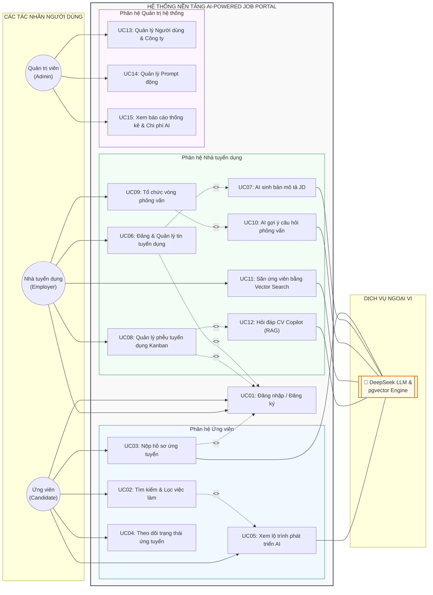

# TIÊU CHÍ 04: THIẾT KẾ ACTOR VÀ USE CASE HỆ THỐNG
## DỰ ÁN: AI-POWERED JOB PORTAL (NỀN TẢNG TUYỂN DỤNG THÔNG MINH B2B)

---

### 1. YÊU CẦU TIÊU CHÍ
> **Tiêu chuẩn:** Xác định rõ ràng các tác nhân (Actors), danh mục ca sử dụng (Use Cases) chính của từng nhóm người dùng, và trực quan hóa qua sơ đồ **Master Use Case Diagram** toàn hệ thống thể hiện rõ ranh giới hệ thống, mối quan hệ `<<include>>` và `<<extend>>`.

---

### 2. XÁC ĐỊNH CÁC TÁC NHÂN (ACTORS)

Hệ thống phân định rõ 3 tác nhân con người (Human Actors) và 1 tác nhân dịch vụ ngoại vi (System Service Actor):

| Tác nhân | Phân loại | Mô tả vai trò và quyền hạn trong hệ thống |
| :--- | :--- | :--- |
| **Ứng viên (Candidate)** | Tác nhân chính (Primary Actor) | Người dùng cá nhân có nhu cầu tìm kiếm việc làm, tải lên CV, ứng tuyển vào các vị trí, theo dõi trạng thái xét duyệt và sử dụng các công cụ AI hỗ trợ nghề nghiệp cá nhân (AI Career Roadmap). |
| **Nhà tuyển dụng (Employer)** | Tác nhân chính (Primary Actor) | Đại diện cho các doanh nghiệp/tổ chức tuyển dụng. Có quyền đăng tin tuyển dụng, quản lý phễu ứng viên qua bảng Kanban kéo thả, lên lịch phỏng vấn, đánh giá kết quả, săn tìm ứng viên bằng Semantic Search và sử dụng CV Copilot. |
| **Quản trị viên (Admin)** | Tác nhân chính (Primary Actor) | Người chịu trách nhiệm quản trị kỹ thuật và nghiệp vụ toàn hệ thống: Quản lý người dùng, duyệt công ty, giám sát chi phí API/token, và trực tiếp điều chỉnh các cấu hình Prompt AI trên giao diện (`ai_prompt_configs`). |
| **AI Engine / External LLM** | Tác nhân phụ trợ (Secondary/Service Actor) | Dịch vụ trí tuệ nhân tạo (DeepSeek V3 / pgvector Embedding Engine) tự động thực thi các tác vụ tính toán phức tạp: Phân tích CV, tính điểm Matching Score (0-100), sinh bộ câu hỏi phỏng vấn, và trả lời câu hỏi ngữ cảnh RAG. |

---

### 3. SƠ ĐỒ MASTER USE CASE TOÀN HỆ THỐNG (SYSTEM USE CASE DIAGRAM)

---

### 4. MA TRẬN ĐẶC TẢ CHI TIẾT CÁC USE CASE TRỌNG YẾU

#### 4.1. Bảng tóm tắt danh mục Use Case

| Mã UC | Tên Ca sử dụng | Tác nhân chính | Tác nhân phụ trợ | Mô tả tóm tắt | Quan hệ phụ thuộc |
| :--- | :--- | :--- | :--- | :--- | :--- |
| **UC01** | Đăng nhập / Đăng ký | Mọi người dùng | - | Xác thực người dùng, cấp và thu hồi JWT token. | Cơ sở cho mọi thao tác |
| **UC02** | Tìm kiếm & Lọc việc làm | Candidate, Khách | - | Tra cứu tin tuyển dụng theo từ khóa, mức lương, địa điểm, cấp bậc. | - |
| **UC03** | Nộp hồ sơ ứng tuyển | Candidate | AI Engine | Tải lên CV hoặc chọn CV có sẵn để nộp vào tin tuyển dụng; Hệ thống tự động bóc tách và tính Matching Score. | `<<include>>` UC01 |
| **UC04** | Theo dõi trạng thái ứng tuyển | Candidate | - | Xem tiến trình xét duyệt hồ sơ trực quan qua Applied Status Tracker (5 chặng). | `<<include>>` UC01 |
| **UC05** | Xem lộ trình nghề nghiệp AI | Candidate | AI Engine | Đối chiếu kỹ năng hiện có của CV với vị trí mục tiêu để nhận lộ trình phát triển. | `<<extend>>` UC02 |
| **UC06** | Đăng & Quản lý tin tuyển dụng | Employer | - | Soạn thảo, chỉnh sửa, đóng hoặc mở lại tin tuyển dụng của công ty. | `<<include>>` UC01 |
| **UC07** | AI sinh mô tả công việc (JD) | Employer | AI Engine | Nhập tiêu đề và kỹ năng chính để AI tự động soạn thảo bản mô tả công việc chi tiết. | `<<extend>>` UC06 |
| **UC08** | Quản trị phễu tuyển dụng Kanban | Employer | AI Engine | Kéo thả hồ sơ ứng viên qua các cột trạng thái (Pending -> Screening -> Interview -> Offer -> Hired/Rejected); Xem điểm AI. | `<<include>>` UC01 |
| **UC09** | Tổ chức vòng phỏng vấn | Employer | - | Lên lịch, chỉ định người phỏng vấn và ghi nhận điểm số, nhận xét từng vòng. | Kích hoạt từ UC08 |
| **UC10** | AI gợi ý câu hỏi phỏng vấn | Employer | AI Engine | Phân tích điểm yếu và khoảng trống kinh nghiệm trong CV để gợi ý bộ câu hỏi phỏng vấn chuẩn xác. | `<<extend>>` UC09 |
| **UC11** | Săn nhân tài bằng Vector Search | Employer, Admin | AI Engine | Tìm kiếm hồ sơ ứng viên bằng câu lệnh ngôn ngữ tự nhiên thông qua thuật toán tương đồng Cosine trên vector embeddings. | `<<include>>` UC01 |
| **UC12** | Hỏi đáp CV Copilot (RAG) | Employer | AI Engine | Mở ngăn kéo tương tác trực tiếp với CV đã khử PII, đặt câu hỏi chi tiết về kinh nghiệm của ứng viên. | `<<extend>>` UC08 |
| **UC13** | Quản lý Người dùng & Công ty | Admin | - | Kích hoạt, khóa tài khoản người dùng, duyệt hồ sơ pháp lý doanh nghiệp. | `<<include>>` UC01 |
| **UC14** | Quản lý Cấu hình Prompt động | Admin | - | Chỉnh sửa System Prompt, nhiệt độ (temperature) của từng tính năng AI không cần restart server. | `<<include>>` UC01 |
| **UC15** | Thống kê Báo cáo & Chi phí AI | Admin, Employer | - | Theo dõi các chỉ số tuyển dụng, tỷ lệ chuyển đổi và chi phí tiêu thụ token LLM. | `<<include>>` UC01 |

---

### 5. ĐẶC TẢ CHI TIẾT CA SỬ DỤNG TRỌNG TÂM: UC08 - QUẢN LÝ PHỄU TUYỂN DỤNG KANBAN

- **Tên ca sử dụng:** Quản lý phễu tuyển dụng Kanban (Kanban Hiring Pipeline).
- **Mã định danh:** UC08.
- **Tác nhân tham gia:** Nhà tuyển dụng (Employer), AI Engine (Hỗ trợ hiển thị điểm Matching Score).
- **Mục đích:** Cung cấp giao diện trực quan giúp nhà tuyển dụng nắm bắt toàn bộ trạng thái của các ứng viên nộp vào tin tuyển dụng và thay đổi trạng thái hồ sơ dễ dàng bằng thao tác kéo thả.
- **Điều kiện tiên quyết (Pre-conditions):**
  1. Nhà tuyển dụng đã đăng nhập thành công vào hệ thống.
  2. Tin tuyển dụng thuộc quyền sở hữu của doanh nghiệp mà nhà tuyển dụng đại diện.
- **Điều kiện sau khi hoàn tất (Post-conditions):**
  1. Trạng thái ứng tuyển (`status`) của bản ghi `applications` được cập nhật chính xác trong CSDL.
  2. Bảng đếm số lượng ứng viên tại mỗi cột Kanban được cập nhật tự động.
  3. Ứng viên nhận được cập nhật trạng thái mới trên trang theo dõi tiến trình của họ.

#### Luồng sự kiện chính (Main Success Scenario):
1. Nhà tuyển dụng truy cập vào màn hình chi tiết của một tin tuyển dụng và chọn tab "Hồ sơ Ứng viên (Kanban)".
2. Hệ thống tải danh sách ứng viên đã nộp và tự động phân loại thành 5 cột:
   - **Chờ duyệt (Pending)**
   - **Sàng lọc (Screening)**
   - **Phỏng vấn (Interview)**
   - **Mời nhận việc (Offer)**
   - **Tuyển dụng / Từ chối (Hired / Rejected)**
3. Mỗi thẻ ứng viên (Applicant Card) hiển thị đầy đủ: Họ tên, Vị trí ứng tuyển, Thời gian nộp, Huy hiệu Điểm AI Matching Score (kèm màu sắc phân cấp: Xanh > 80, Vàng 60-79, Đỏ < 60) và tóm tắt Điểm mạnh nổi bật.
4. Nhà tuyển dụng thực hiện thao tác kéo thẻ ứng viên từ cột "Chờ duyệt" sang cột "Sàng lọc".
5. Giao diện thực hiện cập nhật lạc quan (Optimistic Update) chuyển thẻ ngay lập tức để tạo cảm giác mượt mà.
6. Hệ thống gửi yêu cầu HTTP PATCH đến Backend API: `PATCH /api/v1/applications/{id}/status` với dữ liệu `{ "status": "screening" }`.
7. Backend kiểm tra quyền sở hữu công ty của nhà tuyển dụng (Multi-tenant Security check), cập nhật trường `status` và `updated_at` trong CSDL PostgreSQL.
8. Backend trả về mã trạng thái HTTP 200 OK kèm thông tin đã cập nhật.
9. Hệ thống hiển thị thông báo Sonner Toast: *"Đã chuyển ứng viên sang trạng thái Sàng lọc thành công"*.

#### Các luồng ngoại lệ (Exception Scenarios):
- **E1: Mất kết nối mạng hoặc Backend phản hồi lỗi 500:**
  - Hệ thống hoàn tác (Rollback) thẻ ứng viên về cột ban đầu.
  - Hiển thị thông báo Toast cảnh báo lỗi: *"Không thể cập nhật trạng thái hồ sơ. Vui lòng kiểm tra lại kết nối mạng"*.
- **E2: Nhà tuyển dụng cố gắng thao tác trên hồ sơ của doanh nghiệp khác:**
  - Backend phát hiện vi phạm quyền hạn và trả về mã lỗi HTTP 403 Forbidden.
  - Hệ thống hiển thị cảnh báo từ chối truy cập và tự động tải lại dữ liệu chuẩn của phiên làm việc.
