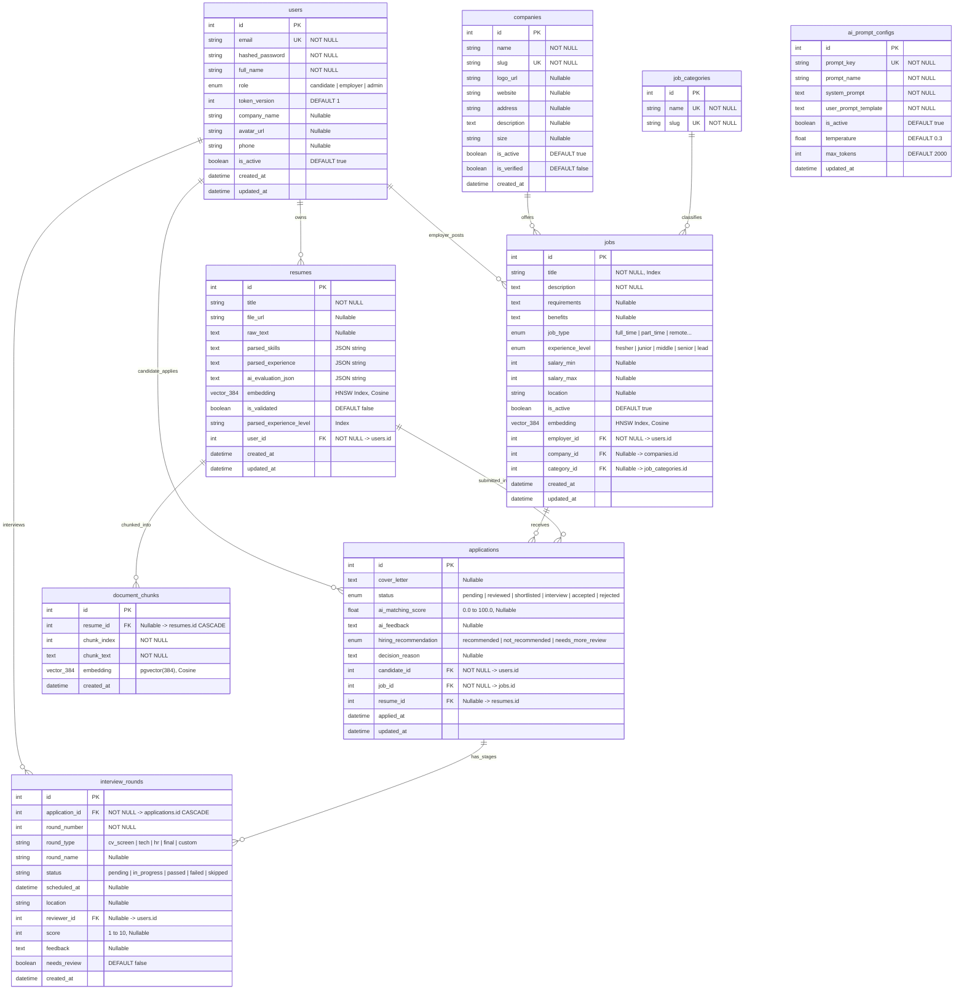

# TIÊU CHÍ 05: THIẾT KẾ CƠ SỞ DỮ LIỆU TOÀN DIỆN (DATABASE DESIGN)
## DỰ ÁN: AI-POWERED JOB PORTAL (NỀN TẢNG TUYỂN DỤNG THÔNG MINH B2B)

---

### 1. YÊU CẦU TIÊU CHÍ
> **Tiêu chuẩn:** Thiết kế mô hình cơ sở dữ liệu quan hệ kết hợp Vector hoàn chỉnh; Cung cấp sơ đồ ERD chi tiết, danh mục bảng dữ liệu, khóa chính (PK), khóa ngoại (FK), kiểu dữ liệu thực tế, các ràng buộc toàn vẹn (Constraints), chỉ mục tăng tốc HNSW và giải thích rõ mối quan hệ giữa các thực thể.

---

### 2. SƠ ĐỒ THỰC THỂ LIÊN KẾT HOÀN CHỈNH (COMPLETE ERD)



---

### 3. ĐẶC TẢ CHI TIẾT CÁC BẢNG DỮ LIỆU CHÍNH (DATA DICTIONARY)

#### 3.1. Bảng `users` (Tài khoản & Hồ sơ)
Quản lý thông tin định danh người dùng và kiểm soát phiên làm việc.

| Tên Cột | Kiểu Dữ Liệu | Ràng Buộc | Ý Nghĩa Nghiệp Vụ |
| :--- | :--- | :--- | :--- |
| `id` | `INTEGER` | PRIMARY KEY, AUTO_INCREMENT | Định danh duy nhất người dùng |
| `email` | `VARCHAR(255)` | UNIQUE, NOT NULL, INDEX | Email đăng nhập chính thức |
| `hashed_password` | `VARCHAR(255)` | NOT NULL | Mật khẩu băm bằng thuật toán bcrypt |
| `full_name` | `VARCHAR(255)` | NOT NULL | Họ và tên đầy đủ |
| `role` | `ENUM (userrole)` | NOT NULL, DEFAULT 'candidate' | Vai trò: `candidate`, `employer`, `admin` |
| `token_version` | `INTEGER` | NOT NULL, DEFAULT 1 | Phiên bản token (dùng để thu hồi JWT tức thì khi logout) |
| `avatar_url` | `VARCHAR(500)` | NULLABLE | Đường dẫn ảnh đại diện |
| `phone` | `VARCHAR(20)` | NULLABLE | Số điện thoại liên hệ |
| `company_name` | `VARCHAR(255)` | NULLABLE | Tên doanh nghiệp (nếu là nhà tuyển dụng) |
| `is_active` | `BOOLEAN` | NOT NULL, DEFAULT TRUE | Trạng thái hoạt động tài khoản |
| `created_at` | `TIMESTAMP WITH TIME ZONE` | DEFAULT now() | Thời điểm khởi tạo |
| `updated_at` | `TIMESTAMP WITH TIME ZONE` | DEFAULT now(), onupdate | Thời điểm cập nhật gần nhất |

---

#### 3.2. Bảng `jobs` (Tin tuyển dụng)
Lưu trữ tin tuyển dụng kèm vector embeddings 384 chiều phục vụ tính toán AI Matching.

| Tên Cột | Kiểu Dữ Liệu | Ràng Buộc | Ý Nghĩa Nghiệp Vụ |
| :--- | :--- | :--- | :--- |
| `id` | `INTEGER` | PRIMARY KEY, AUTO_INCREMENT | Định danh duy nhất tin tuyển dụng |
| `title` | `VARCHAR(255)` | NOT NULL, INDEX | Tiêu đề vị trí tuyển dụng |
| `description` | `TEXT` | NOT NULL | Mô tả trách nhiệm công việc |
| `requirements` | `TEXT` | NULLABLE | Yêu cầu kỹ năng và kinh nghiệm |
| `benefits` | `TEXT` | NULLABLE | Chế độ đãi ngộ và quyền lợi |
| `job_type` | `ENUM (jobtype)` | DEFAULT 'full_time' | Hình thức: `full_time`, `part_time`, `remote`, `internship` |
| `experience_level`| `ENUM (experiencelevel)`| DEFAULT 'fresher' | Cấp bậc: `fresher`, `junior`, `middle`, `senior`, `lead` |
| `salary_min` | `INTEGER` | NULLABLE | Mức lương tối thiểu (VND/USD) |
| `salary_max` | `INTEGER` | NULLABLE | Mức lương tối đa |
| `location` | `VARCHAR(255)` | NULLABLE | Địa điểm làm việc |
| `is_active` | `BOOLEAN` | NOT NULL, DEFAULT TRUE | Cờ mở/đóng nhận hồ sơ |
| `embedding` | `vector(384)` | NULLABLE | Vector đặc trưng ngữ nghĩa JD (Chỉ mục HNSW Cosine) |
| `employer_id` | `INTEGER` | FOREIGN KEY -> `users.id`, NOT NULL | Nhà tuyển dụng tạo tin |
| `company_id` | `INTEGER` | FOREIGN KEY -> `companies.id` CASCADE | Doanh nghiệp tuyển dụng |
| `category_id` | `INTEGER` | FOREIGN KEY -> `job_categories.id` | Ngành nghề chuyên môn |
| `created_at` | `TIMESTAMP WITH TIME ZONE` | DEFAULT now() | Ngày phát hành tin |

---

#### 3.3. Bảng `resumes` (Hồ sơ ứng viên & Vector CV)
Lưu trữ văn bản CV bóc tách, dữ liệu kỹ năng cấu trúc hóa và vector đại diện.

| Tên Cột | Kiểu Dữ Liệu | Ràng Buộc | Ý Nghĩa Nghiệp Vụ |
| :--- | :--- | :--- | :--- |
| `id` | `INTEGER` | PRIMARY KEY, AUTO_INCREMENT | Định danh duy nhất hồ sơ CV |
| `title` | `VARCHAR(255)` | NOT NULL | Tên gọi hồ sơ (Ví dụ: "CV Senior Backend 2026") |
| `file_url` | `VARCHAR(500)` | NULLABLE | Đường dẫn tệp tin gốc (PDF/DOCX) |
| `raw_text` | `TEXT` | NULLABLE | Toàn bộ văn bản trích xuất từ CV |
| `parsed_skills` | `TEXT (JSON)` | NULLABLE | Danh sách kỹ năng bóc tách dạng mảng JSON |
| `parsed_experience`| `TEXT (JSON)` | NULLABLE | Lịch sử kinh nghiệm dạng cấu trúc JSON |
| `embedding` | `vector(384)` | NULLABLE | Vector embedding của CV (Chỉ mục HNSW Cosine) |
| `is_validated` | `BOOLEAN` | NOT NULL, DEFAULT FALSE | Trạng thái vượt qua pipeline kiểm tra định dạng CV |
| `parsed_experience_level`| `VARCHAR(20)` | NULLABLE, INDEX | Cấp bậc kinh nghiệm nhận diện tự động |
| `user_id` | `INTEGER` | FOREIGN KEY -> `users.id`, NOT NULL | Ứng viên sở hữu hồ sơ |
| `created_at` | `TIMESTAMP WITH TIME ZONE` | DEFAULT now() | Ngày tạo |

---

#### 3.4. Bảng `applications` (Hồ sơ ứng tuyển & Kết quả AI)
Bảng trung gian quản trị mối quan hệ giữa Ứng viên và Tin tuyển dụng kèm điểm số và khuyến nghị AI.

| Tên Cột | Kiểu Dữ Liệu | Ràng Buộc | Ý Nghĩa Nghiệp Vụ |
| :--- | :--- | :--- | :--- |
| `id` | `INTEGER` | PRIMARY KEY, AUTO_INCREMENT | Định danh bản ghi ứng tuyển |
| `candidate_id` | `INTEGER` | FOREIGN KEY -> `users.id`, NOT NULL | Ứng viên nộp đơn |
| `job_id` | `INTEGER` | FOREIGN KEY -> `jobs.id`, NOT NULL | Vị trí công việc ứng tuyển |
| `resume_id` | `INTEGER` | FOREIGN KEY -> `resumes.id` | CV được sử dụng khi nộp |
| `cover_letter` | `TEXT` | NULLABLE | Thư giới thiệu / nguyện vọng của ứng viên |
| `status` | `ENUM (applicationstatus)`| DEFAULT 'pending' | Trạng thái: `pending`, `reviewed`, `shortlisted`, `interview`, `accepted`, `rejected` |
| `ai_matching_score`| `FLOAT` | NULLABLE (0.0 đến 100.0) | Điểm số tương thích do AI tính toán |
| `ai_feedback` | `TEXT (JSON)` | NULLABLE | Bản phân tích SWOT (Mạnh/Yếu/Khoảng trống) |
| `hiring_recommendation`| `ENUM` | NULLABLE | Gợi ý AI: `recommended`, `not_recommended`, `needs_more_review` |
| `decision_reason`| `TEXT` | NULLABLE | Lý do tuyển dụng hoặc từ chối chính thức của HR |
| `applied_at` | `TIMESTAMP WITH TIME ZONE` | DEFAULT now() | Thời gian nộp hồ sơ |

---

#### 3.5. Bảng `interview_rounds` (Tiến trình Phỏng vấn nhiều vòng)
Quản trị chi tiết từng vòng phỏng vấn trong quy trình tuyển dụng.

| Tên Cột | Kiểu Dữ Liệu | Ràng Buộc | Ý Nghĩa Nghiệp Vụ |
| :--- | :--- | :--- | :--- |
| `id` | `INTEGER` | PRIMARY KEY, AUTO_INCREMENT | Định danh vòng phỏng vấn |
| `application_id`| `INTEGER` | FOREIGN KEY -> `applications.id` CASCADE | Thuộc hồ sơ ứng tuyển nào |
| `round_number` | `INTEGER` | NOT NULL | Thứ tự vòng (Vòng 1, Vòng 2, Vòng 3...) |
| `round_type` | `VARCHAR(50)` | NOT NULL | Loại vòng: `cv_screen`, `tech`, `hr`, `final`, `custom` |
| `round_name` | `VARCHAR(255)`| NULLABLE | Tên gọi (Ví dụ: "Phỏng vấn Kiến trúc Hệ thống") |
| `status` | `VARCHAR(50)` | DEFAULT 'pending' | Trạng thái: `pending`, `in_progress`, `passed`, `failed`, `skipped` |
| `scheduled_at` | `TIMESTAMP WITH TIME ZONE` | NULLABLE | Thời gian lên lịch phỏng vấn |
| `location` | `VARCHAR(500)`| NULLABLE | Link họp trực tuyến (Google Meet/Zoom) hoặc phòng họp |
| `reviewer_id` | `INTEGER` | FOREIGN KEY -> `users.id` | Kỹ sư / HR phụ trách phỏng vấn |
| `score` | `INTEGER` | NULLABLE (Thang điểm 1-10) | Điểm số đánh giá vòng |
| `feedback` | `TEXT` | NULLABLE | Nhận xét chi tiết sau phỏng vấn |

---

### 4. CÁC RÀNG BUỘC TOÀN VẸN & CHỈ MỤC TỐI ƯU HIỆU NĂNG

1. **Ràng buộc Chống nộp hồ sơ trùng lặp (Duplicate Prevention):**
   ```python
   # File: backend/app/models/application.py
   __table_args__ = (
       UniqueConstraint("candidate_id", "job_id", name="uq_candidate_job_application"),
   )
   ```
   *Ý nghĩa:* Đảm bảo một ứng viên chỉ nộp đúng 1 hồ sơ vào 1 tin tuyển dụng. Ngăn chặn triệt để hành vi spam đơn gây tràn CSDL.

2. **Chỉ mục Vector Tốc độ cao (HNSW Indexing cho pgvector):**
   ```python
   # File: backend/app/models/job.py & resume.py
   Index(
       "ix_jobs_embedding_hnsw",
       embedding,
       postgresql_using="hnsw",
       postgresql_with={"m": 16, "ef_construction": 64},
       postgresql_ops={"embedding": "vector_cosine_ops"},
   )
   ```
   *Ý nghĩa:* Sử dụng cấu trúc đồ thị phân tầng Hierarchical Navigable Small World (HNSW) với 16 kết nối mỗi nút (`m=16`) và chiều sâu thăm dò 64 (`ef_construction=64`), giúp tìm kiếm khoảng cách Cosine trên hàng vạn vector chỉ mất **< 50ms**.

3. **Toàn vẹn Dữ liệu Xóa tầng (Cascade Delete):**
   - Khi một `application` bị xóa, toàn bộ các `interview_rounds` liên quan sẽ tự động bị xóa theo (`ondelete="CASCADE"`).
   - Khi một `company` bị xóa, toàn bộ các `jobs` liên quan sẽ tự động xóa sạch để tránh dữ liệu mồ côi (Orphan records).

---

### 5. GIẢI THÍCH BẢN CHẤT CÁC MỐI QUAN HỆ (RELATIONSHIP RATIONALE)

1. **Quan hệ 1 - N (One-to-Many):**
   - `users (employer)` -> `jobs`: Một nhà tuyển dụng có thể phát hành nhiều tin tuyển dụng.
   - `users (candidate)` -> `resumes`: Một ứng viên có thể tải lên nhiều phiên bản CV khác nhau (ví dụ: CV Tiếng Việt, CV Tiếng Anh, CV Chuyên gia Backend, CV Fullstack).
   - `companies` -> `jobs`: Một công ty sở hữu nhiều vị trí tuyển dụng ở các phòng ban khác nhau.
   - `applications` -> `interview_rounds`: Một hồ sơ ứng tuyển trải qua một chuỗi nhiều vòng phỏng vấn tuần tự (Sàng lọc -> Kỹ thuật -> Phỏng vấn Giám đốc).

2. **Quan hệ N - N (Many-to-Many):**
   - Mối quan hệ giữa `users (candidate)` và `jobs` là quan hệ nhiều - nhiều: Một ứng viên có thể nộp đơn vào nhiều công việc khác nhau, và một công việc nhận được đơn nộp từ nhiều ứng viên khác nhau.
   - Mối quan hệ này được giải quyết và chuẩn hóa thông qua bảng trung gian **`applications`**, bổ sung thêm các thuộc tính nghiệp vụ phong phú như ngày nộp (`applied_at`), trạng thái duyệt (`status`), điểm AI Matching Score (`ai_score`) và phản hồi phỏng vấn.
