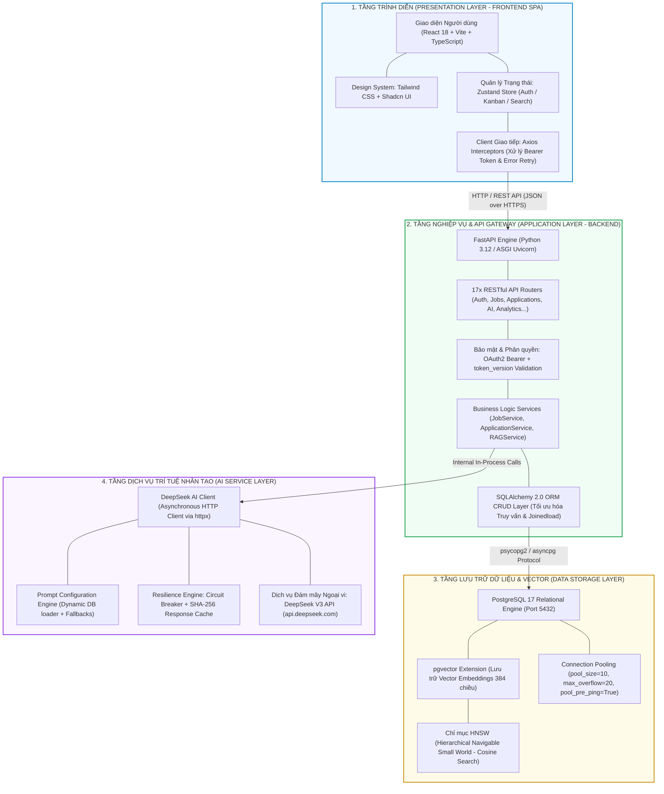

# TIÊU CHÍ 06: THIẾT KẾ KIẾN TRÚC HỆ THỐNG (SYSTEM ARCHITECTURE)
## DỰ ÁN: AI-POWERED JOB PORTAL (NỀN TẢNG TUYỂN DỤNG THÔNG MINH B2B)

---

### 1. YÊU CẦU TIÊU CHÍ
> **Tiêu chuẩn:** Mô tả chi tiết mô hình kiến trúc phân tầng của hệ thống bao gồm: Tầng trình diễn (Frontend), Tầng xử lý nghiệp vụ & API (Backend), Tầng cơ sở dữ liệu quan hệ & Vector (Database), Tầng dịch vụ Trí tuệ nhân tạo (AI Service) và trực quan hóa luồng dữ liệu chính bằng sơ đồ Sequence Diagram.

---

### 2. MÔ HÌNH KIẾN TRÚC TỔNG THỂ 4 TẦNG (4-TIER ARCHITECTURE)

Hệ thống được thiết kế theo mô hình kiến trúc phân tầng chuẩn mực (Layered & Component-based Architecture), đóng gói toàn diện trong môi trường Docker Compose:



---

### 3. ĐẶC TẢ CHI TIẾT TỪNG PHÂN TẦNG KIẾN TRÚC

#### 3.1. Tầng Trình diễn (Presentation Layer - Frontend)
- **Công nghệ nền tảng:** React 18 (Single Page Application), TypeScript (Strict Mode), Vite Bundler.
- **Hệ thống Giao diện (Design System):** Tailwind CSS kết hợp thư viện thành phần nguyên tử Shadcn UI (xây dựng trên Radix UI Primitives). Đảm bảo tính nhất quán thẩm mỹ, khả năng truy cập cao (Accessibility - a11y) và responsive hoàn hảo.
- **Quản lý Trạng thái (State Management):**
  - **Zustand:** Quản lý Global State gọn nhẹ (Auth State, User Profile, Drawer State).
  - **React Query / SWR Pattern:** Quản lý Server Cache State, tối ưu hóa tốc độ hiển thị và tự động đồng bộ khi thay đổi dữ liệu.
- **Tầng Giao tiếp Mạng (HTTP Client):** Axios Client được cấu hình sẵn Interceptors: Tự động đính kèm `Authorization: Bearer <token>` vào header, bắt giữ mã lỗi HTTP 401 để tự động chuyển hướng đăng nhập và hiển thị thông báo lỗi thân thiện qua `Sonner Toast`.

#### 3.2. Tầng Nghiệp vụ & API Gateway (Application Layer - Backend)
- **Công nghệ nền tảng:** Python 3.12, FastAPI framework, ASGI server Uvicorn.
- **Kiến trúc Phân tầng Mã nguồn (Clean Layered Architecture):**
  - `routers/`: Tiếp nhận HTTP Request, parse tham số, định nghĩa response_model chuẩn OpenAPI.
  - `schemas/`: Định nghĩa các Pydantic v2 Models kiểm tra tính hợp lệ dữ liệu đầu vào/ra (Validation & Serialization).
  - `services/`: Xử lý logic nghiệp vụ phức tạp, điều phối luồng gọi AI và bóc tách CV.
  - `crud/`: Thực thi các truy vấn CSDL thuần thông qua SQLAlchemy ORM.
  - `core/`: Cấu hình hệ thống, JWT Security, Hashing, Logging và Middleware.
- **Bảo mật & Phân quyền:** Dependency Injection `get_current_user` kiểm tra token JWT, đối chiếu `token_version` để thu hồi phiên ngay lập tức và thực thi hàng rào bảo mật dữ liệu doanh nghiệp (Multi-tenant Data Fencing).

#### 3.3. Tầng Lưu trữ Dữ liệu & Vector (Data Storage Layer)
- **Công nghệ nền tảng:** PostgreSQL 17 kết hợp phần mở rộng `pgvector`.
- **Hybrid Data Model:**
  - Dữ liệu quan hệ (Relational Data): Chuẩn hóa mức 3NF cho các thực thể người dùng, công ty, tin tuyển dụng, hồ sơ ứng tuyển, các vòng phỏng vấn.
  - Dữ liệu Vector (Vector Embeddings): Lưu trữ vector 384 chiều (`Vector(384)`) của JD và các đoạn trích dẫn trong CV.
- **Chỉ mục HNSW (Hierarchical Navigable Small World):** Thiết lập trên cột embedding với toán tử Cosine Distance (`<=>`), mang lại tốc độ truy vấn ngữ nghĩa **< 50ms** trên hàng vạn bản ghi.
- **Quản lý Kết nối (Connection Pooling):** Cấu hình `pool_size=10, max_overflow=20, pool_pre_ping=True, pool_recycle=300` đảm bảo không bị nghẽn kết nối và tự động phục hồi kết nối bị đứt.

#### 3.4. Tầng Dịch vụ Trí tuệ Nhân tạo (AI Service Layer)
- **Mô hình AI:** Tích hợp trực tiếp với DeepSeek V3 thông qua API bất đồng bộ (`httpx.AsyncClient`).
- **Quản trị Prompt Động (Dynamic Prompt Loader):** Nạp prompt từ bảng `ai_prompt_configs` trong CSDL. Cho phép Admin tinh chỉnh System Prompt và siêu tham số (`temperature`, `max_tokens`) theo thời gian thực mà không cần dừng hay khởi động lại dịch vụ.
- **Phòng vệ & Tối ưu (Resilience & Cost Optimization):**
  - SHA-256 Cache: Lưu kết quả phân tích CV và JD. Nếu nội dung không đổi, trả kết quả tức thì không tốn token.
  - Circuit Breaker: Tự động ngắt mạch khi dịch vụ AI bên ngoài gặp sự cố, đảm bảo toàn bộ hệ thống tuyển dụng cốt lõi vẫn vận hành bình thường.

---

### 4. SƠ ĐỒ SEQUENCE DIAGRAM LUỒNG DỮ LIỆU CỐT LÕI (CORE DATA FLOW)

Quy trình nộp hồ sơ ứng tuyển, bóc tách văn bản, tính điểm AI Matching Score và phản hồi lên giao diện Kanban:

```mermaid
sequenceDiagram
    autonumber
    actor Candidate as Ứng viên (Candidate)
    participant FE as Frontend React SPA
    participant API as FastAPI Router (/applications)
    participant Svc as Application & AI Service
    participant Cache as SHA-256 Cache Engine
    participant LLM as DeepSeek V3 API
    participant DB as PostgreSQL + pgvector
    actor Employer as Nhà tuyển dụng (Employer)

    Candidate->>FE: Chọn CV & Bấm "Nộp Hồ Sơ Ứng Tuyển"
    FE->>API: POST /api/v1/applications (job_id, resume_id, cover_letter)
    Note over API: Kiểm tra JWT Token & Quyền ứng viên
    API->>DB: Kiểm tra UniqueConstraint(candidate_id, job_id)
    alt Đã từng nộp hồ sơ cho Job này
        DB-->>API: Trùng lặp bản ghi
        API-->>FE: HTTP 409 Conflict ("Bạn đã ứng tuyển vị trí này")
        FE-->>Candidate: Hiển thị thông báo Toast cảnh báo
    else Hồ sơ hợp lệ
        API->>DB: INSERT INTO applications (status='pending')
        DB-->>API: Application Created (id=101)
        API-->>FE: HTTP 201 Created (Trạng thái Pending)
        FE-->>Candidate: Hiển thị "Ứng tuyển thành công!" trên Applied Tracker

        Note over API,Svc: Kích hoạt Background Task: Đánh giá AI Matching
        API->)Svc: evaluate_application_ai(app_id=101)
        Svc->>DB: Lấy nội dung raw_text của CV và JD của Job
        DB-->>Svc: CV Text + Job Description Text
        
        Svc->>Cache: Kiểm tra SHA-256 Hash(CV_Text + JD_Text)
        alt Cache Hit (Đã từng tính toán cặp nội dung này)
            Cache-->>Svc: Trả về kết quả JSON có sẵn
        else Cache Miss
            Svc->>Svc: Khử định danh dữ liệu cá nhân (sanitize_pii)
            Svc->>Svc: Đóng gói Prompt Armor (<cv_data>, <job_data>)
            Svc->>LLM: POST /chat/completions (System Prompt + Strict JSON Schema)
            LLM-->>Svc: Trả về JSON: {ai_score: 88.5, swot: {...}, match_reasons: [...]}
            Svc->>Cache: Ghi kết quả vào bộ nhớ đệm
        end

        Svc->>DB: UPDATE applications SET ai_matching_score=88.5, ai_feedback=...
        DB-->>Svc: Cập nhật CSDL thành công

        Employer->>FE: Mở Bảng Kanban Tuyển dụng của Job
        FE->>API: GET /api/v1/applications/job/{id}
        API->>DB: SELECT * FROM applications WHERE job_id = ...
        DB-->>API: Danh sách ứng viên kèm điểm ai_score = 88.5
        API-->>FE: HTTP 200 OK
        FE-->>Employer: Thẻ ứng viên xuất hiện ở cột "Chờ duyệt" với Badge Điểm AI Xanh Lá (88.5/100)
    end
```

---

### 5. GIAO TIẾP VÀ BẢO MẬT GIỮA CÁC TẦNG (INTER-TIER SECURITY)

1. **Giao thức An toàn (HTTPS/TLS):** Toàn bộ lưu lượng truyền tải giữa Trình duyệt và API Gateway đều được mã hóa bằng giao thức HTTPS/TLS 1.3 tiêu chuẩn.
2. **Kiểm soát Truy cập Nguồn gốc chéo (CORS Middleware):** Hệ thống chỉ chấp nhận yêu cầu từ các domain hợp lệ được cấu hình trong `BACKEND_CORS_ORIGINS` (ví dụ: `http://localhost:3000`, domain production), chặn đứng các cuộc tấn công CSRF từ website lạ.
3. **Mô hình Xác thực Phi trạng thái (Stateless Authentication):** Sử dụng chuẩn HTTP Authorization Header `Bearer <JWT_TOKEN>`. API Gateway kiểm tra tính hợp lệ của chữ ký điện tử mà không cần duy trì session trên server, tạo điều kiện thuận lợi cho việc scale ngang (Horizontal Scalability).
4. **Cô lập Mạng lưới Nội bộ (Docker Network Isolation):** CSDL PostgreSQL và Container Backend hoạt động trong mạng nội bộ cô lập `ai-job-portal-net`. Cổng CSDL (5432) chỉ được tiếp nhận kết nối từ Backend Container và Developer Host, ngăn chặn hoàn toàn nguy cơ tấn công dò quét cổng từ bên ngoài Internet.
