# TIÊU CHÍ 07: XÁC ĐỊNH VỊ TRÍ ỨNG DỤNG TRÍ TUỆ NHÂN TẠO (AI PLACEMENT)
## DỰ ÁN: AI-POWERED JOB PORTAL (NỀN TẢNG TUYỂN DỤNG THÔNG MINH B2B)

---

### 1. YÊU CẦU TIÊU CHÍ
> **Tiêu chuẩn:** Lựa chọn các vị trí tích hợp Trí tuệ Nhân tạo (AI) một cách hợp lý, gắn chặt với dữ liệu nghiệp vụ thực tế của hệ thống tuyển dụng; Giải quyết chính xác các nút thắt cổ chai của con người; Đảm bảo AI phục vụ nghiệp vụ cụ thể, không tách rời sản phẩm.

---

### 2. SƠ ĐỒ ĐIỂM CHẠM AI TRONG PHỄU TUYỂN DỤNG (RECRUITMENT AI LIFECYCLE)

Hệ thống tích hợp 7 điểm chạm AI trải dài xuyên suốt từ khâu chuẩn bị tin đăng, nộp hồ sơ, sàng lọc, phỏng vấn cho đến định hướng nghề nghiệp:

```mermaid
flowchart LR
    subgraph Stage1 ["GIAI ĐOẠN 1: KHỞI TẠO TIN"]
        AI_JD["🤖 AI Điểm chạm 1:<br>AI JD Generator<br>(Tự động soạn thảo JD)"]
    end

    subgraph Stage2 ["GIAI ĐOẠN 2: NỘP & BÓC TÁCH"]
        AI_Parse["🤖 AI Điểm chạm 2:<br>Resume Parsing & Chunking<br>(Bóc tách kỹ năng & Vector)"]
        AI_Roadmap["🤖 AI Điểm chạm 3:<br>Career Roadmap Advisor<br>(Gợi ý lộ trình cho Ứng viên)"]
    end

    subgraph Stage3 ["GIAI ĐOẠN 3: SÀNG LỌC & TÌM KIẾM"]
        AI_Match["🤖 AI Điểm chạm 4:<br>AI Matching Score & SWOT<br>(Chấm điểm 0-100 & Radar Chart)"]
        AI_Search["🤖 AI Điểm chạm 5:<br>Semantic Talent Search<br>(pgvector Cosine Search)"]
    end

    subgraph Stage4 ["GIAI ĐOẠN 4: PHỎNG VẤN & HỎI ĐÁP"]
        AI_Copilot["🤖 AI Điểm chạm 6:<br>CV Copilot RAG Drawer<br>(Hỏi đáp ngữ cảnh CV)"]
        AI_Question["🤖 AI Điểm chạm 7:<br>Interview Questions Gen<br>(Sinh câu hỏi theo điểm yếu)"]
    end

    Stage1 --> Stage2
    Stage2 --> Stage3
    Stage3 --> Stage4

    style Stage1 fill:#f0f9ff,stroke:#0284c7,stroke-width:2px
    style Stage2 fill:#fdf4ff,stroke:#c026d3,stroke-width:2px
    style Stage3 fill:#fefce8,stroke:#ca8a04,stroke-width:2px
    style Stage4 fill:#f0fdf4,stroke:#16a34a,stroke-width:2px
```

---

### 3. ĐẶC TẢ CHI TIẾT 7 ĐIỂM CHẠM TRÍ TUỆ NHÂN TẠO

#### 3.1. Điểm chạm 1: AI Job Description Generator (Hỗ trợ Soạn thảo Tin Tuyển dụng)
- **Vị trí tích hợp:** Form tạo mới tin tuyển dụng tại `frontend/src/pages/employer/jobs/CreateJobPage.tsx`.
- **Dữ liệu đầu vào:** Tiêu đề công việc (`job_title`), Cấp bậc (`experience_level`), Các từ khóa kỹ năng chính (`key_skills`).
- **Nghiệp vụ giải quyết:** Nhà tuyển dụng thường mất nhiều thời gian viết JD hoặc sao chép các mẫu JD cũ kỹ không chuẩn SEO. AI phân tích yêu cầu thị trường và tự động sinh bản mô tả chuẩn hóa gồm 4 phần: Tổng quan, Trách nhiệm, Yêu cầu kỹ năng bắt buộc/ưu tiên và Quyền lợi đãi ngộ.
- **Giá trị thực tế:** Rút ngắn thời gian tạo tin tuyển dụng từ 45 phút xuống dưới 2 phút.

#### 3.2. Điểm chạm 2: AI Resume Parsing & Vector Extraction (Bóc tách Văn bản CV)
- **Vị trí tích hợp:** Pipeline xử lý hồ sơ tự động khi ứng viên tải tệp CV lên hệ thống tại `app/services/cv_parser_service.py`.
- **Dữ liệu đầu vào:** Tệp tin CV (PDF hoặc DOCX) từ bảng `resumes`.
- **Nghiệp vụ giải quyết:** Chuyển đổi định dạng CV phi cấu trúc (Unstructured PDF/Word) thành dữ liệu cấu trúc hóa: Danh sách kỹ năng (`parsed_skills`), Kinh nghiệm làm việc (`parsed_experience`), và sinh vector nhúng 384 chiều (`Vector(384)`) lưu vào PostgreSQL pgvector.
- **Giá trị thực tế:** Cho phép hệ thống thực thi các thuật toán so khớp toán học và tìm kiếm ngữ nghĩa chính xác tuyệt đối mà không cần nhập liệu thủ công.

#### 3.3. Điểm chạm 3: Candidate Career Roadmap & Skill Gap Advisor (Tư vấn Lộ trình Nghề nghiệp)
- **Vị trí tích hợp:** Trang chi tiết hồ sơ ứng viên tại `frontend/src/pages/candidate/CareerRoadmapPage.tsx`.
- **Dữ liệu đầu vào:** Kỹ năng hiện tại của ứng viên trong bảng `resumes` và vị trí nghề nghiệp mơ ước (`target_role`).
- **Nghiệp vụ giải quyết:** Phân tích khoảng trống năng lực (Skill Gaps) giữa hiện tại và yêu cầu thị trường, sau đó đề xuất lộ trình phát triển kỹ năng 3 giai đoạn: Ngắn hạn (1-3 tháng), Trung hạn (3-6 tháng) và Dài hạn (6-12 tháng) kèm các đầu mục dự án thực tế cần làm.
- **Giá trị thực tế:** Tạo động lực cho ứng viên gắn bó với nền tảng và chủ động nâng cao năng lực để đáp ứng các tiêu chuẩn tuyển dụng cao hơn.

#### 3.4. Điểm chạm 4: AI Matching Score & SWOT Analysis (Chấm điểm Độ tương thích CV - JD)
- **Vị trí tích hợp:** Thẻ ứng viên trên bảng Kanban (`ApplicantCard.tsx`) và modal chi tiết ứng viên (`ApplicationDetailModal.tsx`).
- **Dữ liệu đầu vào:** Văn bản CV đã khử PII và bản mô tả công việc (JD) của tin tuyển dụng.
- **Nghiệp vụ giải quyết:** Tính toán điểm số định lượng tổng hợp từ 0 đến 100 điểm, chia làm 4 trục đánh giá (Kỹ năng, Kinh nghiệm, Dự án, Tiềm năng phát triển). Đồng thời lập ma trận phân tích SWOT chi tiết:
  - **Strengths:** Những kỹ năng ứng viên vượt trội so với JD.
  - **Weaknesses:** Những tiêu chí bắt buộc trong JD mà CV chưa thể hiện rõ.
  - **Opportunities:** Khả năng thích ứng và đóng góp cho tổ chức.
  - **Threats:** Nguy cơ nhảy việc sớm hoặc yêu cầu mức lương vượt khung ngân sách.
- **Giá trị thực tế:** Giúp HR sàng lọc nhanh 100+ hồ sơ, lập tức nhận diện top 10% ứng viên tiềm năng nhất mà không bị cảm tính chi phối.

#### 3.5. Điểm chạm 5: Semantic Talent Search (Săn Nhân tài bằng Truy vấn Ngữ nghĩa)
- **Vị trí tích hợp:** Màn hình tìm kiếm ứng viên nâng cao dành cho Nhà tuyển dụng tại `frontend/src/pages/employer/TalentSearchPage.tsx`.
- **Dữ liệu đầu vào:** Câu truy vấn ngôn ngữ tự nhiên (Ví dụ: *"Tìm kỹ sư có kinh nghiệm tối ưu hóa cơ sở dữ liệu lớn và triển khai vi dịch vụ trên AWS"*).
- **Nghiệp vụ giải quyết:** Hệ thống mã hóa câu truy vấn thành vector embedding và thực hiện truy vấn Cosine Similarity trên các phân đoạn vector trong bảng `resume_chunks` bằng toán tử `<=>` của pgvector.
- **Giá trị thực tế:** Vượt qua giới hạn của tìm kiếm từ khóa truyền thống (Exact keyword match). Tìm được đúng ứng viên ngay cả khi ứng viên không viết chính xác từ ngữ đó trong CV (Ví dụ: Tìm "quản lý cơ sở dữ liệu" vẫn khớp với ứng viên ghi "PostgreSQL DBA, MySQL performance tuning").

#### 3.6. Điểm chạm 6: CV Copilot (Trợ lý Hỏi đáp Ngữ cảnh Hồ sơ RAG)
- **Vị trí tích hợp:** Ngăn kéo Drawer chuyên dụng trên màn hình quản lý ứng viên (`frontend/src/pages/employer/components/CVCopilotDrawer.tsx`).
- **Dữ liệu đầu vào:** Câu hỏi bất kỳ của HR và toàn bộ dữ liệu phân đoạn CV của ứng viên (đã loại bỏ thông tin định danh PII).
- **Nghiệp vụ giải quyết:** HR có thể chat trực tiếp với tài liệu CV: *"Ứng viên này từng có kinh nghiệm lãnh đạo nhóm chưa?", "Trong dự án thương mại điện tử, ứng viên giải quyết vấn đề nghẽn mạng bằng công nghệ gì?"*. AI trích xuất câu trả lời chuẩn xác và trích dẫn cụ thể từng đoạn văn bản trong CV làm bằng chứng.
- **Giá trị thực tế:** Tiết kiệm thời gian đọc lướt hàng chục trang CV dài dòng, trả lời tức thì những băn khoăn cụ thể của nhà tuyển dụng.

#### 3.7. Điểm chạm 7: AI Interview Questions Generator (Gợi ý Bộ Câu hỏi Phỏng vấn)
- **Vị trí tích hợp:** Màn hình thiết lập vòng phỏng vấn (`frontend/src/pages/employer/interviews/InterviewRoundsPage.tsx`).
- **Dữ liệu đầu vào:** Điểm yếu và khoảng trống kỹ năng được phát hiện từ bước AI Matching Score.
- **Nghiệp vụ giải quyết:** Thay vì hỏi các câu hỏi lý thuyết chung chung trên mạng, AI gợi ý 5-7 câu hỏi phỏng vấn kỹ thuật và tình huống nhắm thẳng vào các điểm nghi vấn trong CV (Ví dụ: *"CV ghi có làm Redis nhưng không nêu rõ cơ chế caching. Hãy hỏi ứng viên cách giải quyết bài toán Cache Stampede"*).
- **Giá trị thực tế:** Nâng cao chất lượng vòng phỏng vấn kỹ thuật, giúp người phỏng vấn dễ dàng thẩm định năng lực thực chiến của ứng viên.

---

### 4. MA TRẬN ĐỐI CHIẾU TÍNH HỢP LÝ & GIÁ TRỊ DOANH NGHIỆP

| Chức năng AI | Căn cứ Dữ liệu trong CSDL | Vấn đề giải quyết | Giá trị Đo lường được |
| :--- | :--- | :--- | :--- |
| **1. AI JD Generator** | `jobs.requirements`, `job_categories` | JD viết sơ sài, thiếu hấp dẫn | Giảm 90% thời gian soạn thảo tin đăng |
| **2. Resume Parsing** | `resumes.raw_text`, `resumes.embedding` | Hồ sơ PDF không thể tìm kiếm máy tính | Chuẩn hóa 100% dữ liệu đầu vào |
| **3. Career Roadmap** | `resumes.parsed_skills`, `jobs` benchmark | Ứng viên mù mờ về hướng phát triển | Tăng 35% tỷ lệ giữ chân ứng viên |
| **4. AI Matching Score**| `applications.ai_score`, `applications.ai_feedback` | HR quá tải khi đọc CV thủ công | Giảm 70% thời gian sàng lọc hồ sơ |
| **5. Semantic Search** | `resume_chunks.embedding` (pgvector) | Tìm kiếm từ khóa bỏ sót ứng viên giỏi | Tăng 45% độ phủ tìm kiếm nhân tài |
| **6. CV Copilot (RAG)**| `document_chunks`, `chat_messages` | Đọc CV dài dòng tốn thời gian | Trả lời câu hỏi thẩm định trong 2 giây |
| **7. Interview Gen** | `applications.ai_feedback.weaknesses` | Phỏng vấn lan man, không đúng trọng tâm | Đạt 100% câu hỏi nhắm đúng điểm nghi vấn |

---

### 5. NGUYÊN TẮC TRÍ TUỆ NHÂN TẠO CÓ TRÁCH NHIỆM (RESPONSIBLE AI)

Hệ thống cam kết tuân thủ các nguyên tắc đạo đức AI:
1. **Con người nắm quyền quyết định tối hậu (Human-in-the-loop):** AI chỉ đóng vai trò hỗ trợ phân tích và gợi ý. Quyết định mời phỏng vấn, tuyển dụng hoặc từ chối ứng viên bắt buộc phải do Nhà tuyển dụng con người thực hiện.
2. **Minh bạch và Cảnh báo rõ ràng (AI Disclaimer Banner):** Mọi màn hình hiển thị kết quả do AI sinh ra (Matching Score, SWOT, Roadmap) đều được đính kèm huy hiệu cảnh báo: *"Kết quả phân tích được thực hiện bởi Trí tuệ Nhân tạo nhằm mục đích tham khảo. Nhà tuyển dụng cần kết hợp đánh giá thực tế tại vòng phỏng vấn"*.
3. **Chống định kiến (Fairness & Bias Mitigation):** Quá trình tính điểm AI tuyệt đối không sử dụng các thông tin phi chuyên môn (giới tính, tôn giáo, chủng tộc, ảnh chân dung, quê quán) để đảm bảo môi trường tuyển dụng công bằng và minh bạch.
