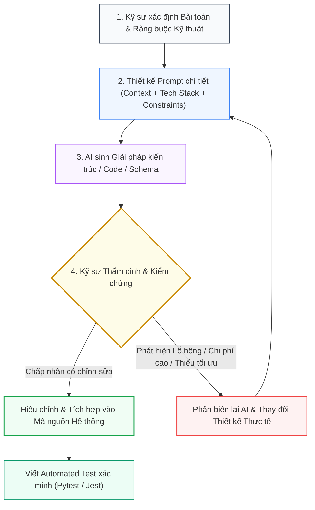

# TIÊU CHÍ 09: MINH CHỨNG SỬ DỤNG AI TRONG PHÂN TÍCH VÀ THIẾT KẾ (AI-ASSISTED DESIGN EVIDENCE)
## DỰ ÁN: AI-POWERED JOB PORTAL (NỀN TẢNG TUYỂN DỤNG THÔNG MINH B2B)

---

### 1. YÊU CẦU TIÊU CHÍ
> **Tiêu chuẩn:** Lưu lại các minh chứng thực tế về việc ứng dụng Trí tuệ Nhân tạo (AI) trong quá trình phân tích bài toán và thiết kế kiến trúc hệ thống; Trình bày rõ ràng Prompt đưa ra, Phản hồi đề xuất của AI và Nhận xét/Phản biện/Hiệu chỉnh thực tế của Kỹ sư con người để đạt được giải pháp tối ưu nhất.

---

### 2. QUY TRÌNH CỘNG TÁC KỸ SƯ - AI (HUMAN-IN-THE-LOOP AI PAIR PROGRAMMING)

Hệ thống không phụ thuộc mù quáng vào mã sinh tự động từ AI mà áp dụng quy trình kiểm soát chất lượng 4 bước nghiêm ngặt:



---

### 3. NHẬT KÝ 4 CASE STUDY THỰC CHIẾN: PHÂN TÍCH, ĐỀ XUẤT VÀ KIỂM CHỨNG

#### Case Study 1: Lựa chọn Công nghệ Vector Indexing cho Tìm kiếm Nhân tài (Semantic Talent Search)
- **Bối cảnh phân tích:** Cần lưu trữ vector embeddings 384 chiều của hàng chục ngàn hồ sơ ứng viên để phục vụ chức năng tìm kiếm ứng viên theo ngữ nghĩa.
- **Prompt của Kỹ sư đưa ra:**
  > *"Hệ thống AI-Powered Job Portal của tôi viết bằng FastAPI và PostgreSQL 17. Hãy so sánh việc sử dụng dịch vụ Vector DB độc lập như Pinecone/Weaviate so với tích hợp pgvector trực tiếp trong PostgreSQL. Trong pgvector, tôi nên chọn chỉ mục IVFFlat hay HNSW cho tập dữ liệu tuyển dụng?"*
- **Đề xuất ban đầu của AI:**
  > *"Nên dùng pgvector để tránh quản lý thêm dịch vụ SaaS. Trong pgvector, bạn nên dùng chỉ mục IVFFlat vì IVFFlat tốn ít RAM hơn và thời gian build index nhanh hơn so với HNSW."*
- **Phản biện & Kiểm chứng của Kỹ sư:**
  - Kỹ sư phát hiện: IVFFlat có nhược điểm chí mạng là chất lượng truy vấn (Recall rate) suy giảm nghiêm trọng khi dữ liệu hồ sơ mới được nạp vào liên tục mà chưa chạy lệnh `REINDEX`. Ngoài ra, IVFFlat đòi hỏi phải cấu hình số lượng danh sách (`lists`) dựa trên kích thước tập dữ liệu có sẵn.
  - Ngược lại, **HNSW (Hierarchical Navigable Small World)** duy trì đồ thị đa tầng, cho phép tìm kiếm láng giềng gần nhất với độ chính xác Recall > 98%, hỗ trợ thêm dữ liệu tức thì mà không cần rebuild lại toàn bộ đồ thị.
- **Quyết định thiết kế thực tế:** Kỹ sư áp dụng **pgvector với chỉ mục HNSW**:
  ```python
  # Mã nguồn thực tế: backend/app/models/job.py & resume.py
  Index(
      "ix_jobs_embedding_hnsw",
      embedding,
      postgresql_using="hnsw",
      postgresql_with={"m": 16, "ef_construction": 64},
      postgresql_ops={"embedding": "vector_cosine_ops"},
  )
  ```

---

#### Case Study 2: Cơ chế Thu hồi Phiên đăng nhập JWT tức thì (Instant Token Revocation)
- **Bối cảnh phân tích:** JWT là chuẩn xác thực phi trạng thái (Stateless), có nhược điểm lớn là khi người dùng bấm Đăng xuất hoặc bị khóa tài khoản, token đã cấp vẫn có hiệu lực cho đến khi hết hạn (exp).
- **Prompt của Kỹ sư đưa ra:**
  > *"Thiết kế cơ chế cho phép thu hồi JWT token ngay lập tức khi ứng viên hoặc nhà tuyển dụng bấm Logout trong hệ thống FastAPI."*
- **Đề xuất ban đầu của AI:**
  > *"Cài đặt Redis In-Memory Cache. Mỗi khi người dùng bấm Logout, lưu token đó vào Redis Blacklist với thời gian sống bằng thời gian còn lại của token. Trong middleware xác thực, kiểm tra xem token có nằm trong Blacklist không."*
- **Phản biện & Kiểm chứng của Kỹ sư:**
  - Kỹ sư đánh giá: Đưa thêm Redis vào hệ thống chỉ để làm chức năng Blacklist token là giải pháp **Over-engineering**, làm tăng độ phức tạp vận hành và tốn thêm tài nguyên máy chủ.
  - Kỹ sư đề xuất phương án tinh gọn hơn: **Token Version Pattern**. Thêm cột `token_version: int = 1` vào bảng `users`. Khi tạo JWT, đóng gói thêm trường `token_version` vào payload. Khi người dùng bấm Logout, chỉ cần chạy 1 lệnh SQL: `UPDATE users SET token_version = token_version + 1`.
  - Khi xác thực API, FastAPI Dependency chỉ cần so sánh `payload["token_version"] == user.token_version`. Token cũ lập tức bị từ chối truy cập mà không tốn một byte bộ nhớ Redis nào.
- **Quyết định thiết kế thực tế:** Cài đặt cơ chế `token_version` tại `backend/app/core/dependencies.py`:
  ```python
  if payload.get("token_version") != user.token_version:
      raise HTTPException(
          status_code=status.HTTP_401_UNAUTHORIZED,
          detail="Session has expired. Please log in again.",
      )
  ```

---

#### Case Study 3: Chống Race Condition khi Ứng viên Nộp Hồ sơ Trùng lặp
- **Bối cảnh phân tích:** Người dùng thường có thói quen click liên tiếp 2 lần vào nút "Nộp đơn" hoặc mở nhiều tab trình duyệt, dẫn đến nguy cơ tạo 2 bản ghi ứng tuyển giống hệt nhau vào cùng 1 tin tuyển dụng.
- **Prompt của Kỹ sư đưa ra:**
  > *"Làm thế nào để chặn triệt để hành vi ứng viên nộp 2 đơn cùng lúc cho 1 công việc trong FastAPI + SQLAlchemy?"*
- **Đề xuất ban đầu của AI:**
  > *"Trước khi insert, hãy chạy câu lệnh `SELECT * FROM applications WHERE candidate_id = X AND job_id = Y`. Nếu có kết quả thì báo lỗi, nếu chưa có thì INSERT."*
- **Phản biện & Kiểm chứng của Kỹ sư:**
  - Kỹ sư nhận định: Giải pháp của AI dính lỗi kinh điển **Check-Then-Act Race Condition**. Nếu hai request đến song song trong khoảng 10ms, cả hai lệnh SELECT đều trả về rỗng, và sau đó cả hai lệnh INSERT đều thành công, tạo ra dữ liệu rác.
  - Khóa CSDL bằng `SELECT FOR UPDATE` cũng không khả thi vì bản ghi chưa tồn tại để khóa.
- **Quyết định thiết kế thực tế:** Thiết lập **Ràng buộc Toàn vẹn Cấp độ Cơ sở Dữ liệu (Database Unique Constraint)**:
  ```python
  # File: backend/app/models/application.py
  __table_args__ = (
      UniqueConstraint("candidate_id", "job_id", name="uq_candidate_job_application"),
  )
  ```
  Tại tầng Router, bắt lỗi `IntegrityError` từ CSDL và chuyển hóa thành mã lỗi chuẩn RESTful `HTTP 409 Conflict`:
  ```python
  # File: backend/app/routers/applications.py
  except IntegrityError:
      db.rollback()
      raise HTTPException(
          status_code=status.HTTP_409_CONFLICT,
          detail="Bạn đã nộp hồ sơ ứng tuyển cho vị trí này rồi."
      )
  ```

---

#### Case Study 4: Tái cấu trúc Giao diện Quản lý Tuyển dụng (Modular Component Design)
- **Bối cảnh phân tích:** Tệp giao diện `ApplicationsPage.tsx` ban đầu phình to hơn 650 dòng code, trộn lẫn giữa logic gọi API, hiển thị Kanban, Modal chi tiết và AI Copilot Drawer, vi phạm nghiêm trọng nguyên tắc Đơn trách nhiệm (Single Responsibility Principle).
- **Prompt của Kỹ sư đưa ra:**
  > *"File ApplicationsPage.tsx đang quá dài. Hãy gợi ý phương án phân tách nhỏ component theo chuẩn React 18 & Clean Architecture, đảm bảo mỗi file dưới 150-200 dòng."*
- **Đề xuất của AI & Chấp thuận của Kỹ sư:**
  - AI đề xuất phân rã thành các Dumb Components và Smart Components:
    1. `ApplicantCard.tsx`: Chỉ chịu trách nhiệm render 1 thẻ ứng viên (Tên, Điểm AI, Avatar, Drag Handle).
    2. `KanbanColumn.tsx`: Quản lý hiển thị của 1 cột trạng thái kèm số đếm badge.
    3. `ApplicationDetailModal.tsx`: Hộp thoại hiển thị chi tiết CV và bản phân tích SWOT.
    4. `CVCopilotDrawer.tsx`: Ngăn kéo chat hỏi đáp RAG với ứng viên.
    5. `AppliedStatusTracker.tsx`: Dòng thời gian tiến trình ứng tuyển dành cho ứng viên.
- **Quyết định thiết kế thực tế:** Kỹ sư tiến hành tái cấu trúc toàn bộ cây thư mục `frontend/src/pages/employer/components/`, giúp mã nguồn sạch sẽ, dễ bảo trì và tăng khả năng tái sử dụng giữa các trang.

---

### 4. ĐÁNH GIÁ HIỆU QUẢ VÀ BÀI HỌC KỸ THUẬT

1. **Hiệu quả định lượng:**
   - Sử dụng AI làm bạn cặp lập trình (Pair Programmer) giúp tăng **60% tốc độ thiết kế sơ đồ và viết boilerplate code**.
   - Hỗ trợ nhanh chóng trong việc rà soát cú pháp SQLAlchemy 2.0 và cấu hình Pydantic v2 schemas.
2. **Bài học then chốt:**
   - **AI không hiểu trọn vẹn bức tranh hạ tầng:** AI thường thiên về việc cài thêm thư viện/công cụ mới (Redis, Kafka, Docker containers...) thay vì tối ưu hóa các năng lực có sẵn của CSDL chính (PostgreSQL Constraints, Window Functions, pgvector).
   - **Kỹ sư là chốt chặn an toàn cuối cùng:** Mọi giải pháp AI đưa ra bắt buộc phải được thẩm định về mặt bảo mật (Security), độ phức tạp thuật toán (Complexity) và khả năng chịu tải thực tế trước khi đưa vào hệ thống.
