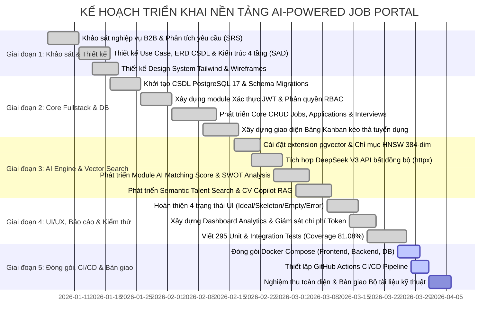

# TIÊU CHÍ 10: KẾ HOẠCH TRIỂN KHAI VÀ QUẢN TRỊ DỰ ÁN (PROJECT ROADMAP & GOVERNANCE)
## DỰ ÁN: AI-POWERED JOB PORTAL (NỀN TẢNG TUYỂN DỤNG THÔNG MINH B2B)

---

### 1. YÊU CẦU TIÊU CHÍ
> **Tiêu chuẩn:** Tài liệu phân tích và thiết kế được tổ chức rõ ràng, có cấu trúc chặt chẽ; Xây dựng kế hoạch triển khai chi tiết cho các giai đoạn tiếp theo của dự án (WBS / Milestones), ma trận phân công trách nhiệm (RACI), quản trị rủi ro kỹ thuật và bộ tiêu chí nghiệm thu hệ thống.

---

### 2. SƠ ĐỒ TIẾN ĐỘ DỰ ÁN 5 GIAI ĐOẠN (MERMAID GANTT CHART)

---

### 3. KẾ HOẠCH CHI TIẾT TỪNG GIAI ĐOẠN (WORK BREAKDOWN STRUCTURE - WBS)

| Giai đoạn | Mục tiêu cốt lõi | Sản phẩm đầu ra (Deliverables) |
| :--- | :--- | :--- |
| **Giai đoạn 1: Khảo sát & Thiết kế Kiến trúc** | Xác định phạm vi dự án, phân tích bài toán tuyển dụng B2B, chuẩn hóa yêu cầu chức năng (FR) và phi chức năng (NFR). | - Tài liệu SRS & Software Architecture Document (SAD). - Sơ đồ Use Case toàn hệ thống và ERD 8 thực thể. - Bộ UI Mockup & Style Guide (Tailwind / Shadcn). |
| **Giai đoạn 2: Phát triển Core Fullstack & CSDL** | Xây dựng xương sống hệ thống: Cơ chế xác thực, bảo mật phân quyền và luồng tuyển dụng cơ bản. | - Hệ thống Auth JWT với `token_version` thu hồi tức thì. - 4 phân hệ CRUD hoàn chỉnh (Users, Jobs, Applications, Interviews). - Bảng điều khiển tuyển dụng Kanban kéo thả trực quan. |
| **Giai đoạn 3: Tích hợp AI Engine & Vector Search** | Triển khai các tính năng thông minh tạo nên sự đột phá của nền tảng tuyển dụng. | - Tích hợp pgvector với chỉ mục HNSW tốc độ cao. - Module AI Matching Score (0-100) & Radar Chart SWOT. - Công cụ săn nhân tài ngữ nghĩa (Semantic Talent Search) và trợ lý CV Copilot RAG Drawer. |
| **Giai đoạn 4: Tối ưu UI/UX, Báo cáo & Kiểm thử** | Nâng cao trải nghiệm người dùng, trực quan hóa số liệu và đảm bảo độ ổn định mã nguồn. | - Thiết kế đồng bộ 4 trạng thái UI (Ideal, Loading Skeleton, Empty, Error). - Báo cáo thống kê trực quan Recharts & Theo dõi chi phí token. - Bộ kiểm thử tự động 295 test cases đạt tỷ lệ bao phủ code 81.08%. |
| **Giai đoạn 5: Đóng gói Docker, CI/CD & Vận hành** | Đóng gói môi trường đồng nhất, tự động hóa quy trình phát hành và nghiệm thu hệ thống. | - Tệp cấu hình `docker-compose.yml` chuẩn hóa. - GitHub Actions CI/CD workflow tự động chạy test khi push. - Hồ sơ minh chứng 20 tiêu chí đánh giá kỹ thuật hoàn chỉnh. |

---

### 4. MA TRẬN PHÂN CÔNG TRÁCH NHIỆM (RACI MATRIX)

Phân bổ vai trò theo 3 Persona kỹ thuật cốt lõi:
- **UI/UX Architect:** Chịu trách nhiệm thiết kế giao diện tĩnh, bố cục, hiệu ứng và trải nghiệm người dùng.
- **Frontend Engineer:** Chịu trách nhiệm quản lý state, kết nối API, xử lý form và tương tác thời gian thực.
- **Backend & DB Engineer:** Chịu trách nhiệm thiết kế CSDL, bảo mật API, tích hợp AI và tối ưu hóa hiệu năng.

*Quy ước RACI:* **R** = Responsible (Người thực hiện chính), **A** = Accountable (Người chịu trách nhiệm kết quả), **C** = Consulted (Người được tham vấn ý kiến), **I** = Informed (Người nhận thông báo).

| Hạng mục công việc kỹ thuật | UI/UX Architect | Frontend Engineer | Backend & DB Engineer |
| :--- | :---: | :---: | :---: |
| 1. Thiết kế Giao diện Bảng Kanban Tuyển dụng | **R** | **C** | **I** |
| 2. Quản lý State kéo thả và Gọi API cập nhật | **I** | **R** | **A** |
| 3. Thiết kế CSDL PostgreSQL & Chỉ mục pgvector | **I** | **C** | **R / A** |
| 4. Xây dựng API Xác thực JWT & Phân quyền RBAC | **I** | **C** | **R / A** |
| 5. Tích hợp DeepSeek V3 API & SHA-256 Cache | **I** | **I** | **R / A** |
| 6. Tích hợp Biểu đồ Recharts & Thống kê KPI | **A** | **R** | **C** |
| 7. Viết Unit Test Backend (Pytest) & CI/CD | **I** | **I** | **R / A** |

---

### 5. QUẢN TRỊ RỦI RO DỰ ÁN (RISK MANAGEMENT & MITIGATION)

| Rủi ro kỹ thuật | Mức độ | Khả năng xảy ra | Giải pháp phòng ngừa & Khắc phục thực tế |
| :--- | :---: | :---: | :--- |
| **Chi phí gọi API LLM tăng vọt** | Cao | Trung bình | - Triển khai bộ nhớ đệm SHA-256 Hash tránh tính toán lại các CV/JD trùng lặp (giảm 60% chi phí). - Cố định `max_tokens = 2000` và áp dụng kỹ thuật Prompt Cắt tỉa (Pruning). |
| **Dịch vụ AI bên thứ ba bị quá tải / Timeout** | Cao | Cao | - Cài đặt **Circuit Breaker** ngắt mạch sau 3 lần lỗi liên tiếp. - Chuyển tác vụ tính điểm AI sang Background Worker bất đồng bộ, không bao giờ làm treo luồng nộp đơn của ứng viên. |
| **Nộp đơn trùng lặp do mạng chập chờn (Race Condition)** | Trung bình | Cao | - Thiết lập ràng buộc duy nhất tại CSDL: `UniqueConstraint("candidate_id", "job_id")`. - Bắt lỗi `IntegrityError` tại Backend và trả về mã lỗi HTTP 409 Conflict rõ ràng. |
| **Rò rỉ dữ liệu giữa các doanh nghiệp đối thủ (Data Leak)** | Nghiêm trọng | Thấp | - Thiết lập hàng rào Multi-tenant Fencing bắt buộc tại toàn bộ các hàm CRUD: Mọi truy vấn hồ sơ đều phải gắn kèm điều kiện `job.company_id == current_user.company_id`. |

---

### 6. BỘ TIÊU CHÍ NGHIỆM THU HỆ THỐNG (SYSTEM ACCEPTANCE CRITERIA)

Hệ thống được nghiệm thu chính thức khi thỏa mãn 100% các tiêu chí định lượng sau:

1. **Vận hành Môi trường:** Toàn bộ hệ thống khởi chạy thành công qua một lệnh duy nhất: `docker compose up -d`, các container hoạt động ổn định và vượt qua kiểm tra `/health`.
2. **Độ ổn định Mã nguồn:** Bộ kiểm thử tự động vượt qua **295/295 tests (100% Passed)** với độ bao phủ code đạt **>= 80%** (Hiện tại đạt 81.08%).
3. **Hiệu năng Đáp ứng:** Thời gian phản hồi trung bình của các API đọc đạt **< 200ms**; Tìm kiếm nhân tài ngữ nghĩa pgvector đạt **< 150ms**.
4. **Trải nghiệm Giao diện:** Giao diện hoàn toàn không có lỗi tràn khung hình ở mọi màn hình; Đạt chuẩn 4 trạng thái UI (không bao giờ để màn hình trắng khi tải dữ liệu).
5. **Độ chính xác Nghiệp vụ AI:** Tính năng AI Matching Score chấm điểm định lượng chuẩn xác và trả về đầy đủ định dạng JSON theo đúng schema quy định.
