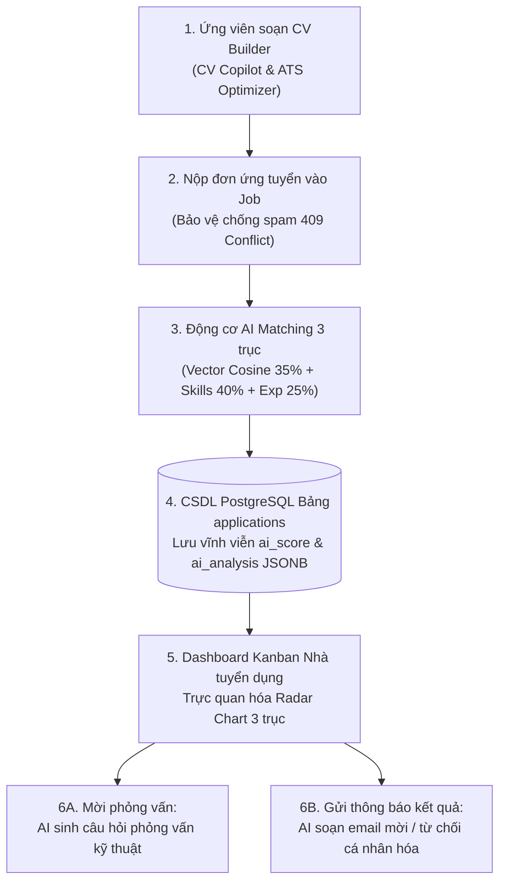

# TIÊU CHÍ 01: TÍCH HỢP CHỨC NĂNG AI VÀO HỆ THỐNG
## DỰ ÁN: AI-POWERED JOB PORTAL (NỀN TẢNG TUYỂN DỤNG THÔNG MINH B2B)

---

### 1. YÊU CẦU TIÊU CHÍ
> **Tiêu chuẩn:** Chức năng AI chạy trực tiếp bên trong hệ thống, phục vụ nghiệp vụ cụ thể của sản phẩm, không tách rời hay hoạt động độc lập như một công cụ bên ngoài.

---

### 2. HIỆN TRẠNG TRIỂN KHAI TRONG HỆ THỐNG

Hệ thống **AI-Powered Job Portal** không sử dụng AI dưới dạng các tiện ích rời rạc (widget bên ngoài hoặc trang demo tách biệt). Thay vào đó, toàn bộ các chức năng AI được tích hợp sâu vào **quy trình tuyển dụng khép kín (End-to-End Recruitment Lifecycle)**:



---

### 3. DANH SÁCH 7 CHỨC NĂNG AI CỐT LÕI VÀ VỊ TRÍ MÃ NGUỒN

| STT | Tên chức năng AI | Endpoint API | Service xử lý | Đối tượng phục vụ | Nghiệp vụ cụ thể trong hệ thống |
| :---: | :--- | :--- | :--- | :--- | :--- |
| **1** | **AI Matching & Radar Chart 3 Trục** | `POST /ai/match` | `app/services/ai_matching.py` | Nhà tuyển dụng & Ứng viên | Tự động đối soát CV với JD, tính điểm tương đồng Vector kết hợp Rubric 3 trục (Skills 40%, Experience 25%, Vector 35%). |
| **2** | **AI CV Review & ATS Optimization** | `POST /ai/evaluate-cv` | `app/services/cv_evaluator.py` | Ứng viên | Chấm điểm CV theo thang 10, phân tích điểm mạnh, điểm yếu và gợi ý từ khóa chuẩn ATS cần bổ sung. |
| **3** | **AI Interview Question Generator** | `POST /ai/interview-questions` | `app/services/interview_question_generator.py` | Nhà tuyển dụng (HR/Tech Lead) | Tự động sinh câu hỏi phỏng vấn kỹ thuật bám sát khoảng cách năng lực (Skill Gaps) của từng hồ sơ ứng viên. |
| **4** | **AI Recruitment Email Composer** | `POST /ai/generate-email` | `app/services/email_generator.py` | Nhà tuyển dụng | Soạn thảo email mời phỏng vấn, thư cảm ơn hoặc từ chối bám sát ngữ cảnh vòng tuyển dụng với tone giọng tùy chỉnh. |
| **5** | **AI Career Roadmap Generator** | `POST /ai/roadmap` | `app/services/career_roadmap.py` | Ứng viên | Gợi ý lộ trình phát triển sự nghiệp 6-12 tháng dựa trên CV hiện tại và kết quả trắc nghiệm tính cách nghề nghiệp. |
| **6** | **AI CV Copilot & Trợ lý thông minh** | `POST /rag/cv-chat`<br>`POST /ai/assistant/chat` | `app/services/rag_service.py` | Ứng viên & Nhà tuyển dụng | Trợ lý RAG thông minh tương tác trực tiếp khi người dùng đang soạn thảo CV hoặc tra cứu hồ sơ tuyển dụng. |
| **7** | **AI Job Description Generator** | `POST /ai/generate-job-description` | `app/services/job_description_generator.py` | Nhà tuyển dụng | Tự động sinh bản mô tả công việc (JD) chuẩn mực từ tiêu đề vị trí và danh mục kỹ năng cốt lõi. |

---

### 4. BẰNG CHỨNG TÍCH HỢP MÃ NGUỒN VÀ CƠ SỞ DỮ LIỆU

#### A. CSDL Quan hệ lưu trữ trực tiếp kết quả AI
Kết quả phân tích của AI không biến mất sau khi gọi API mà được lưu trữ bền vững vào thực thể `Application` trong cơ sở dữ liệu PostgreSQL.

*Đoạn mã trích từ [backend/app/models/application.py](file:///d:/ai-job-portal/backend/app/models/application.py):*
```python
class Application(Base):
    __tablename__ = "applications"

    id = Column(Integer, primary_key=True, index=True)
    job_id = Column(Integer, ForeignKey("jobs.id", ondelete="CASCADE"), nullable=False)
    candidate_id = Column(Integer, ForeignKey("users.id", ondelete="CASCADE"), nullable=False)
    resume_id = Column(Integer, ForeignKey("resumes.id", ondelete="SET NULL"), nullable=True)
    cv_document_id = Column(Integer, ForeignKey("cv_documents.id", ondelete="SET NULL"), nullable=True)
    status = Column(Enum(ApplicationStatus), default=ApplicationStatus.PENDING, nullable=False)
    
    # === TÍCH HỢP DỮ LIỆU AI TRỰC TIẾP VÀO THỰC THỂ TUYỂN DỤNG ===
    ai_score = Column(Float, nullable=True)          # Điểm tương thích tổng hợp (0.0 - 100.0)
    ai_analysis = Column(JSONB, nullable=True)       # Chi tiết 3 trục điểm, strengths, gaps, deal_breakers
```

#### B. Router tập trung kết nối các phân hệ nghiệp vụ
Tất cả các endpoint AI được quản lý tập trung và tích hợp xác thực JWT, phân quyền truy cập và bảo vệ dữ liệu.

*Đoạn mã trích từ [backend/app/routers/ai.py](file:///d:/ai-job-portal/backend/app/routers/ai.py):*
```python
@router.post("/match", response_model=AIMatchResponse)
async def match_resume_to_job(
    payload: AIMatchRequest,
    db: Session = Depends(get_db),
    current_user: User = Depends(get_current_user),
):
    """Tính toán điểm phù hợp giữa CV và công việc theo thuật toán AI 3 trục."""
    job = db.query(Job).filter(Job.id == payload.job_id).first()
    if not job:
        raise HTTPException(status_code=404, detail="Không tìm thấy công việc")

    # Kiểm tra phân quyền truy cập hồ sơ
    await _authorize_resume_access(db, payload.resume_id, current_user)

    # Thực hiện tính toán AI Matching kết hợp Vector và Deep Rubric
    return await ai_matching_service.compute_match(
        db,
        resume=resume,
        job_embedding=job.embedding,
        job=job,
        deep_analysis=payload.deep_analysis,
    )
```

#### C. Công thức AI Matching 3 trục kết hợp Deal-breakers
Thuật toán AI Matching phân tích hồ sơ dựa trên công thức phối hợp trọng số và cơ chế trừng phạt khi có vi phạm điều kiện tiên quyết (Deal-breakers).

*Đoạn mã trích từ [backend/app/services/ai_matching.py](file:///d:/ai-job-portal/backend/app/services/ai_matching.py#L190-L198):*
```python
# Weighted Formula: 35% Vector Semantic + 40% Hard Skills + 25% Experience Level
weighted = 0.35 * base_cosine_score + 0.40 * skills_score + 0.25 * experience_score

# Deal-breaker Penalty Cap: nếu có rủi ro nghiêm trọng (ví dụ thiếu chứng chỉ bắt buộc, lệch cấp bậc), trần điểm tối đa 60%
if deal_breakers:
    final_score = round(min(weighted, 60.0), 1)
else:
    final_score = round(max(0.0, min(100.0, weighted)), 1)
```

---

### 5. KẾT LUẬN TIÊU CHÍ 01
* Hệ thống sở hữu **7 chức năng AI nghiệp vụ** vận hành ổn định trên cùng một hạ tầng mã nguồn.
* Kết quả phân tích của AI được lưu trữ trực tiếp vào CSDL (`applications.ai_score`, `applications.ai_analysis`), tham gia trực tiếp vào việc sắp xếp ứng viên trên Kanban của Nhà tuyển dụng.
* **Mức độ đáp ứng:** **100% - ĐẠT XUẤT SẮC**.
