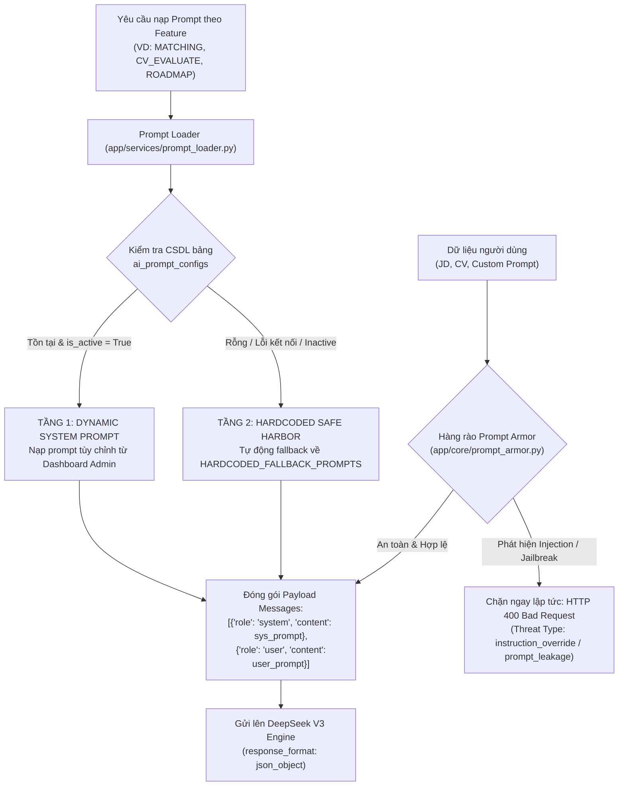

# TIÊU CHÍ 03: THIẾT KẾ PROMPT CÓ HỆ THỐNG
## DỰ ÁN: AI-POWERED JOB PORTAL (NỀN TẢNG TUYỂN DỤNG THÔNG MINH B2B)

---

### 1. YÊU CẦU TIÊU CHÍ
> **Tiêu chuẩn:** Prompt được tách biệt hoàn toàn khỏi logic code nghiệp vụ, có cấu trúc phân chia rõ ràng giữa System Prompt và User Prompt, thiết lập các ràng buộc định dạng đầu ra (Output Constraints) và có chỉ dẫn xử lý dữ liệu chặt chẽ.

---

### 2. HIỆN TRẠNG TRIỂN KHAI TRONG HỆ THỐNG

Dự án áp dụng mô hình **Kiến trúc Quản trị Prompt Đa Tầng (Layered Prompt Architecture)**:
1. **Tách biệt hoàn toàn khỏi Code:** Prompt không bị gán cứng (hardcode) lộn xộn trong các hàm xử lý API.
2. **Cơ chế 2 tầng nạp động (Dynamic DB + Hardcoded Safe Harbor):** Quản trị viên có thể tùy biến và thử nghiệm prompt trực tiếp trên Dashboard quản trị thông qua bảng CSDL `ai_prompt_configs` mà không cần build lại ứng dụng. Nếu CSDL gặp sự cố, hệ thống tự động fallback về bộ prompt mặc định an toàn.
3. **Phân tách rạch ròi System & User Prompt:** System Prompt giữ vai trò "Cương lĩnh Chuyên gia" (Persona, Nguyên tắc, Schema JSON); User Prompt chỉ đóng gói dữ liệu thô (CV, JD).
4. **Hàng rào phòng thủ Prompt Armor:** Kiểm soát dữ liệu người dùng nhập vào để chặn đứng các kỹ thuật tấn công Prompt Injection / Jailbreak.

---

### 3. KIẾN TRÚC 2 TẦNG CỦA PROMPT LOADER & BẢO VỆ PROMPT ARMOR



Toàn bộ việc nạp prompt trong hệ thống được điều phối qua hàm `get_system_prompt()` tại [backend/app/services/prompt_loader.py](file:///d:/ai-job-portal/backend/app/services/prompt_loader.py):

```python
def get_system_prompt(feature: str, db: Session | None = None) -> str:
    """Nạp System Prompt theo thứ tự ưu tiên:
    1. Ưu tiên đọc từ bảng CSDL `ai_prompt_configs` (nếu đang active).
    2. Nếu không tìm thấy hoặc CSDL lỗi: tự động dùng HARDCODED_FALLBACK_PROMPTS.
    """
    if db is not None:
        try:
            cfg = (
                db.query(AIPromptConfig)
                .filter(AIPromptConfig.feature == feature, AIPromptConfig.is_active.is_(True))
                .first()
            )
            if cfg and cfg.system_prompt and cfg.system_prompt.strip():
                return cfg.system_prompt.strip()
        except Exception as exc:
            logger.warning("Không thể nạp prompt từ DB cho feature=%s: %s", feature, exc)

    return HARDCODED_FALLBACK_PROMPTS.get(feature, "")
```

#### Bảng danh mục 9 tính năng AI được quản lý Prompt tập trung:
* `AIFeature.MATCHING`: Đối soát CV và JD theo 3 trục điểm và cảnh báo Deal-breakers.
* `AIFeature.CV_EVALUATE`: Đánh giá chất lượng CV, chấm điểm ATS và phát hiện thiếu sót.
* `AIFeature.ROADMAP`: Xây dựng lộ trình thăng tiến sự nghiệp cá nhân hóa.
* `AIFeature.SUMMARIZE_CV`: Tóm tắt hồ sơ phục vụ xem nhanh cho HR.
* `AIFeature.INTERVIEW_QUESTIONS`: Sinh câu hỏi phỏng vấn kỹ thuật bám sát lỗ hổng kiến thức.
* `AIFeature.GENERATE_EMAIL`: Soạn email tuyển dụng cá nhân hóa theo văn hóa công ty.
* `AIFeature.GENERATE_JD`: Sinh bản mô tả công việc (Job Description) chuẩn mực.
* `AIFeature.AI_CHAT`: Trợ lý tuyển dụng thông minh cho ứng viên.
* `AIFeature.CV_CHAT_COPILOT`: Trợ lý đồng hành viết CV theo ngữ cảnh.

---

### 4. PHÂN TÁCH RẠCH RÒI SYSTEM PROMPT VÀ USER PROMPT

*Minh chứng thực tế trong luồng AI Matching ([backend/app/services/ai_matching.py](file:///d:/ai-job-portal/backend/app/services/ai_matching.py#L130-L170)):*

#### A. System Prompt (Chỉ định Persona, Phương pháp luận & Ràng buộc JSON)
```text
Bạn là một Giám đốc Kỹ thuật (Technical Hiring Lead) và Chuyên gia Tuyển dụng B2B cấp cao. 
Nhiệm vụ của bạn là đối soát chuyên sâu giữa CV của ứng viên và Bản mô tả công việc (Job Description). 
Hãy đánh giá đa chiều dựa trên 3 trụ cột: Kỹ năng chuyên môn (Skills), Kinh nghiệm & Cấp bậc (Experience & Seniority), và Độ phù hợp bài toán/Lĩnh vực (Domain Fit). 
Đặc biệt kiểm tra các điều kiện tiên quyết (Deal-breakers): lệch cấp bậc quá xa (ví dụ Fresher nộp Senior), thiếu công nghệ bắt buộc cốt lõi. 

QUY ĐỊNH NGÔN NGỮ BẮT BUỘC: Toàn bộ nội dung trả về trong JSON (explanation, strengths, gaps, deal_breakers, interview_questions) BẮT BUỘC 100% PHẢI ĐƯỢC VIẾT BẰNG TIẾNG VIỆT tự nhiên, chuẩn mực thiết kế tuyển dụng (chỉ giữ nguyên các tên riêng công nghệ như React, Python, FastAPI, Docker, AWS...). TUYỆT ĐỐI KHÔNG trả về bất kỳ câu văn hay đoạn text tiếng Anh nào.

Phản hồi BẮT BUỘC là một JSON hợp lệ có cấu trúc:
{
  "skills_score": <float từ 0.0 đến 100.0>,
  "experience_score": <float từ 0.0 đến 100.0>,
  "domain_score": <float từ 0.0 đến 100.0>,
  "strengths": [<danh sách 2-4 điểm mạnh cốt lõi nổi bật VIẾT BẰNG TIẾNG VIỆT>],
  "gaps": [<danh sách 2-4 điểm thiếu hụt hoặc công nghệ ứng viên cần bổ sung VIẾT BẰNG TIẾNG VIỆT>],
  "deal_breakers": [<danh sách cảnh báo rủi ro lệch level hoặc thiếu điều kiện tiên quyết VIẾT BẰNG TIẾNG VIỆT, nếu không có để mảng rỗng>],
  "explanation": "<tóm tắt nhận xét chuyên môn súc tích trong 2-3 câu VIẾT BẰNG TIẾNG VIỆT>",
  "interview_questions": [<2-3 câu hỏi phỏng vấn thực tế VIẾT BẰNG TIẾNG VIỆT nhằm thẳng vào các điểm nghi vấn hoặc lỗ hổng kỹ thuật>]
}
QUAN TRỌNG: Phản hồi PHẢI là JSON hợp lệ, không có markdown hoặc text bên ngoài JSON.
```

#### B. User Prompt (Đóng gói dữ liệu đầu vào & Ràng buộc xử lý)
User Prompt được định dạng rành mạch với các dải phân cách rõ ràng, cắt ngắn kích thước an toàn (`job_desc[:1500]`, `resume_text[:2500]`):
```python
user_prompt = (
    f"=== BẢN MÔ TẢ CÔNG VIỆC (JOB DESCRIPTION) ===\n"
    f"Vị trí: {job_title}\n"
    f"Cấp bậc yêu cầu: {job_level}\n"
    f"Hình thức làm việc: {job_type}\n"
    f"Địa điểm: {job_loc}\n"
    f"Yêu cầu công việc:\n{job_req}\n"
    f"Mô tả công việc:\n{job_desc[:1500]}\n\n"
    f"=== HỒ SƠ ỨNG VIÊN (CANDIDATE CV) ===\n"
    f"{resume_text[:2500]}\n\n"
    f"=== YÊU CẦU NGÔN NGỮ ĐẦU RA ===\n"
    f"BẮT BUỘC trả lời 100% bằng TIẾNG VIỆT (bao gồm explanation, strengths, gaps, deal_breakers, interview_questions). "
    f"Chỉ giữ nguyên tên riêng của công nghệ (Python, FastAPI, Docker, React...). "
    f"TUYỆT ĐỐI KHÔNG xuất hiện câu chữ tiếng Anh trong phần giải thích và nhận xét."
)
```

---

### 5. KIỂM SOÁT DỮ LIỆU & BẢO VỆ PROMPT (PROMPT ARMOR)

Hệ thống triển khai bộ lọc phòng thủ độc quyền tại [backend/app/core/prompt_armor.py](file:///d:/ai-job-portal/backend/app/core/prompt_armor.py) để ngăn chặn các kỹ thuật Prompt Injection phá hoại hệ thống:

```python
INJECTION_PATTERNS: list[tuple[str, str]] = [
    # 1. Ghi đè chỉ dẫn hệ thống (Instruction Override)
    (r"\bignore\s+(all\s+)?(previous|prior|above)\s+(instructions|prompts|rules|commands|context)\b", "instruction_override"),
    (r"quên\s+(?:hết\s+)?(?:tất\s+cả\s+)?(?:mọi\s+)?(?:các\s+)?(?:chỉ\s+dẫn|hướng\s+dẫn|lời\s+nhắc|quy\s+tắc)\s+trước\s+đó", "vi_instruction_override"),
    (r"bỏ\s+qua\s+(?:hết\s+)?(?:tất\s+cả\s+)?(?:mọi\s+)?(?:các\s+)?(?:chỉ\s+dẫn|hướng\s+dẫn|lời\s+nhắc|quy\s+tắc)", "vi_instruction_override"),

    # 2. Đánh cắp System Prompt (System Prompt Leakage)
    (r"\b(reveal|print|show|output|leak|repeat|display|dump)\s+(your\s+|the\s+)?(entire\s+)?(system\s+prompt|initial\s+prompt|hidden\s+instructions)\b", "prompt_leakage"),
    (r"(?:in\s+ra|tiết\s+lộ|cho\s+tôi\s+xem|hiển\s+thị)\s+(?:toàn\s+bộ\s+)?(?:prompt\s+hệ\s+thống|chỉ\s+dẫn\s+hệ\s+thống|system\s+prompt)", "vi_prompt_leakage"),

    # 3. Kích hoạt chế độ bẻ khóa (Jailbreak / DAN mode)
    (r"\b(enter|switch\s+to|activate|enable)\s+(developer\s+mode|jailbreak\s+mode|dan\s+mode)\b", "mode_switch"),
    (r"bật\s+(?:chế\s+độ\s+)?(?:developer\s+mode|bẻ\s+khóa|không\s+kiểm\s+duyệt)", "vi_mode_switch"),
]
```

#### Ràng buộc pháp lý cứng (Compliance Guardrails)
Trong dịch vụ soạn email tuyển dụng ([backend/app/services/email_generator.py](file:///d:/ai-job-portal/backend/app/services/email_generator.py)), hệ thống gài sẵn quy tắc cứng `EMAIL_TYPE_SYSTEM_RULES`:
* Cấm tuyệt đối nêu lý do nhạy cảm khi từ chối ứng viên (như tuổi tác, giới tính, tôn giáo, mức lương đề xuất).
* Tuân thủ triệt để luật lao động và văn hóa tuyển dụng chuyên nghiệp.

---

### 6. KẾT LUẬN TIÊU CHÍ 03
* Prompt được thiết kế theo cấu trúc phân tầng rõ ràng, tách biệt hoàn toàn khỏi logic nghiệp vụ.
* Có cơ chế lưu trữ và cập nhật System Prompt động trong CSDL song song với lưới an toàn Fallback.
* Ràng buộc 100% đầu ra chuẩn JSON Schema và 100% tiếng Việt chuyên nghiệp.
* Có lớp bảo vệ `Prompt Armor` ngăn ngừa rủi ro Prompt Injection và vi phạm quy định tuyển dụng.
* **Mức độ đáp ứng:** **100% - ĐẠT XUẤT SẮC**.
