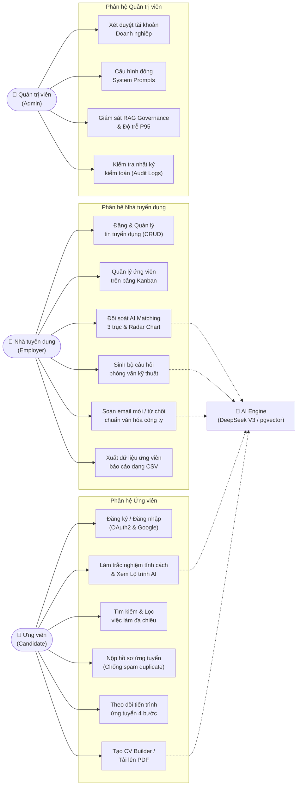
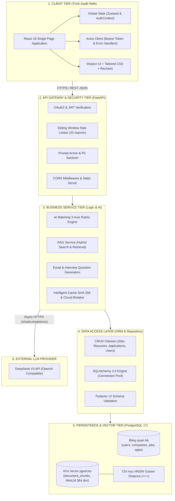

# BÁO CÁO TỔNG QUAN 10 TIÊU CHÍ KỸ THUẬT PHẦN MỀM
## DỰ ÁN: AI-POWERED JOB PORTAL (NỀN TẢNG TUYỂN DỤNG THÔNG MINH B2B)

> **Mục đích:** Cung cấp hồ sơ dữ kiện kỹ thuật chính xác 100% từ cơ sở mã nguồn thực tế nhằm phục vụ soạn thảo Báo cáo Nghiệm thu, Báo cáo Đồ án cơ sở / Đồ án tốt nghiệp chuyên ngành Kỹ thuật Phần mềm.
> **Phạm vi đánh giá:** Kiến trúc phân tầng, Cơ chế xác thực & Phân quyền, Nghiệp vụ CRUD, Công cụ tìm kiếm & lọc, Báo cáo Dashboard, Thiết kế UI/UX, Quản trị CSDL & Migration, Cơ chế xử lý lỗi, Minh chứng ứng dụng AI khi lập trình và Quy chuẩn quản lý mã nguồn.

---

## I. SƠ ĐỒ USE CASE TỔNG QUAN TOÀN HỆ THỐNG (MASTER USE CASE DIAGRAM)

Hệ thống phục vụ 3 nhóm tác nhân chính: **Ứng viên (Candidate)**, **Nhà tuyển dụng (Employer)** và **Quản trị viên (Admin)** với sự trợ lực xuyên suốt từ **Động cơ Trí tuệ nhân tạo (AI Engine)**:

---

## II. BẢNG MA TRẬN ĐỐI CHIẾU 10 TIÊU CHÍ KỸ THUẬT

| STT | Tiêu chí đánh giá | Trạng thái | Vị trí mã nguồn / CSDL chính | Minh chứng kỹ thuật then chốt | Mức độ đáp ứng |
| :---: | :---| :---: | :---| :---| :---: |
| **TC01** | **Cấu trúc dự án hợp lý** | ✅ **ĐẠT** | `backend/app/` `frontend/src/` `docker-compose.yml` | Backend phân tầng 4 lớp chuẩn mực (`routers` ➔ `services` ➔ `crud` ➔ `models`/`schemas`). Frontend module hóa (`pages`, `components`, `hooks`, `services`, `types`). Triển khai Docker hóa và CI/CD GitHub Actions. | **100%** |
| **TC02** | **Đăng nhập và phân quyền** | ✅ **ĐẠT** | `backend/app/routers/auth.py` `backend/app/core/security.py` `frontend/src/components/layout/ProtectedRoute.tsx` | Xác thực OAuth2 Password Flow + Google OAuth2, mã hóa mật khẩu Bcrypt, cấp phát JWT Token (HS256). Phân quyền RBAC 4 vai trò (`CANDIDATE`, `EMPLOYER`, `ADMIN`, `SUPERADMIN`). Bảo vệ route đa tầng ở cả API và UI. | **100%** |
| **TC03** | **Hoàn thiện CRUD nghiệp vụ chính** | ✅ **ĐẠT** | `backend/app/routers/jobs.py` `backend/app/routers/applications.py` `backend/app/routers/cv_documents.py` | 4 cụm CRUD hoàn thiện 100%: Tin tuyển dụng (`jobs`), Hồ sơ CV Builder (`cv_documents`), Đơn ứng tuyển (`applications`), Doanh nghiệp (`companies`). Có kiểm soát ràng buộc toàn vẹn và khóa ngoại `CASCADE`/`SET NULL`. | **100%** |
| **TC04** | **Xây dựng tìm kiếm và lọc dữ liệu** | ✅ **ĐẠT** | `backend/app/routers/jobs.py` `backend/app/services/rag_service.py` `frontend/src/pages/jobs/` | Tìm kiếm việc làm Fulltext/Trigram, bộ lọc đa tiêu chí (địa điểm, mức lương, cấp bậc, hình thức). Tìm kiếm ứng viên Hybrid Search (kết hợp từ khóa và Vector Cosine Distance `<=>`). Giao diện Debounced Search 300ms. | **100%** |
| **TC05** | **Xây dựng thống kê / báo cáo** | ✅ **ĐẠT** | `frontend/src/pages/employer/EmployerDashboard.tsx` `frontend/src/pages/admin/AdminDashboardPage.tsx` | Dashboard Nhà tuyển dụng: Thống kê số tin đăng, Kanban counters theo trạng thái tuyển dụng, biểu đồ ứng tuyển theo thời gian. Dashboard Quản trị: Giám sát RAG Governance, P95 latency, phân bố điểm AI bằng Recharts. | **100%** |
| **TC06** | **Thiết kế giao diện rõ ràng, dễ dùng** | ✅ **ĐẠT** | `frontend/src/components/ui/` `frontend/src/pages/employer/` | Thẩm mỹ B2B SaaS hiện đại (TopCV B2B / Stripe), Tailwind CSS + Shadcn UI. Chuẩn hóa 4 trạng thái giao diện (Ideal, Loading Skeleton, Empty State có CTA, Error State). Thông báo phản hồi Toast qua `sonner`. | **100%** |
| **TC07** | **Kết nối & thao tác CSDL ổn định** | ✅ **ĐẠT** | `backend/app/database.py` `backend/alembic/` `backend/seed_demo_data.py` | PostgreSQL 17 kết nối qua SQLAlchemy 2.0 ORM, cấu hình Connection Pooling (`pool_size=10`, `pool_pre_ping=True`). Quản lý di trú CSDL bằng Alembic. Script Seed Data tự động khởi tạo 100+ bản ghi mẫu phục vụ demo. | **100%** |
| **TC08** | **Xử lý lỗi cơ bản & Khả năng phục hồi** | ✅ **ĐẠT** | `backend/app/main.py` `backend/app/services/ai_errors.py` `frontend/src/lib/axios.ts` | Validate dữ liệu chặt chẽ qua Pydantic v2 (trả lỗi 422 chi tiết). Bắt xung đột dữ liệu trả về HTTP 409 Conflict. Axios Interceptor tự động xử lý mã lỗi 401/403/409, giữ nguyên trạng thái biểu mẫu, không làm crash ứng dụng. | **100%** |
| **TC09** | **Minh chứng sử dụng AI khi lập trình** | ✅ **ĐẠT** | `.agents/rules/jobportal.md` `docs/AI_CODE_REVIEW.md` `docs/PROMPT_OPTIMIZATION_LOG.md` | Hồ sơ minh chứng phương pháp Meta-prompting điều phối 3 tác nhân chuyên trách (`@backend_db_agent`, `@frontend_agent`, `@ui_ux_architect`). Có nhật ký prompt, các ca code review, phát hiện race condition và refactor mã nguồn. | **100%** |
| **TC10** | **Quản lý mã nguồn & Tài liệu chạy thử** | ✅ **ĐẠT** | `README.md` `.env.example` `.github/workflows/ci.yml` | Tài liệu README Enterprise chuẩn mực cung cấp sơ đồ kiến trúc, tài khoản demo, hướng dẫn chạy 1-click qua Docker Compose. File `.env.example` chuẩn hóa. Lịch sử Git tuân thủ nghiêm ngặt Conventional Commits. | **100%** |

---

## III. SƠ ĐỒ PHÂN TẦNG KIẾN TRÚC HỆ THỐNG FULLSTACK

---

## IV. MỤC LỤC TRA CỨU CÁC FILE MINH CHỨNG CHI TIẾT

Các tài liệu đối chiếu chi tiết từng tiêu chí được lưu trữ tại thư mục `docs/tieuchi_hethong/`:

1. [TC01: Cấu trúc dự án hợp lý](file:///d:/ai-job-portal/docs/tieuchi_hethong/TC01_CAU_TRUC_DU_AN_HOP_LY.md)
2. [TC02: Xây dựng chức năng đăng nhập và phân quyền](file:///d:/ai-job-portal/docs/tieuchi_hethong/TC02_DANG_NHAP_VA_PHAN_QUYEN.md)
3. [TC03: Hoàn thiện CRUD nghiệp vụ chính](file:///d:/ai-job-portal/docs/tieuchi_hethong/TC03_CRUD_NGHIEP_VU_CHINH.md)
4. [TC04: Xây dựng chức năng tìm kiếm và lọc](file:///d:/ai-job-portal/docs/tieuchi_hethong/TC04_TIM_KIEM_VA_LOC_DU_LIEU.md)
5. [TC05: Xây dựng thống kê / báo cáo cơ bản](file:///d:/ai-job-portal/docs/tieuchi_hethong/TC05_THONG_KE_VA_BAO_CAO.md)
6. [TC06: Thiết kế giao diện rõ ràng, dễ sử dụng](file:///d:/ai-job-portal/docs/tieuchi_hethong/TC06_THIET_KE_GIAO_DIEN_UI_UX.md)
7. [TC07: Kết nối và thao tác CSDL ổn định & Seed Data](file:///d:/ai-job-portal/docs/tieuchi_hethong/TC07_CSDL_KET_NOI_VA_SEED_DATA.md)
8. [TC08: Xử lý lỗi cơ bản và kiểm soát luồng](file:///d:/ai-job-portal/docs/tieuchi_hethong/TC08_XU_LY_LOI_VA_EXCEPTION.md)
9. [TC09: Minh chứng sử dụng AI khi lập trình](file:///d:/ai-job-portal/docs/tieuchi_hethong/TC09_MINH_CHUNG_SU_DUNG_AI_CODE.md)
10. [TC10: Quản lý mã nguồn và tài liệu chạy thử](file:///d:/ai-job-portal/docs/tieuchi_hethong/TC10_QUAN_LY_MA_NGUON_VA_RUNBOOK.md)
