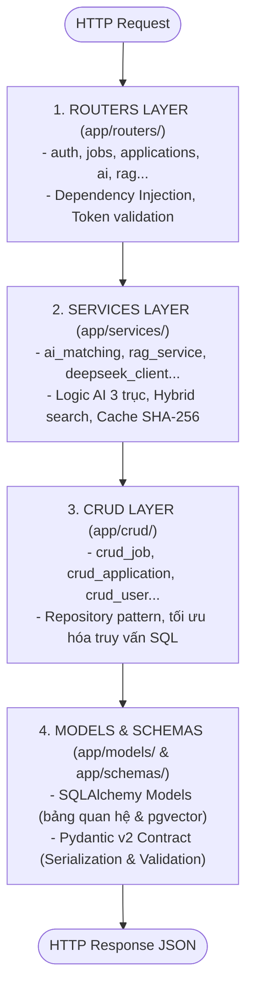
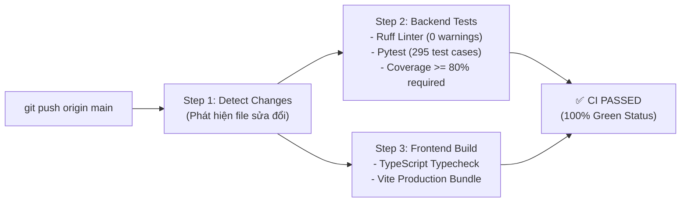

# TIÊU CHÍ 01: CẤU TRÚC DỰ ÁN HỢP LÝ
## DỰ ÁN: AI-POWERED JOB PORTAL (NỀN TẢNG TUYỂN DỤNG THÔNG MINH B2B)

---

### 1. YÊU CẦU TIÊU CHÍ
> **Tiêu chuẩn:** Dự án tổ chức rõ ràng theo các phân hệ `frontend`, `backend`, `database`, `config`, `docs` hoặc áp dụng mô hình kiến trúc chuẩn mực phù hợp với framework hiện đại; tách bạch rõ ràng giữa tầng giao diện, tầng xử lý nghiệp vụ và tầng lưu trữ dữ liệu.

---

### 2. SƠ ĐỒ CONTAINER & COMPONENT ARCHITECTURE (DOCKER ENVIRONMENT)

Toàn bộ hệ sinh thái dự án được đóng gói và vận hành qua mạng lưới Docker Compose cô lập:

```mermaid
flowchart TB
    subgraph Host_Machine ["MÁY CHỦ VẬN HÀNH / DEVELOPER HOST"]
        Client_Browser["🌐 Trình duyệt Người dùng (Client Browser)"]

        subgraph Docker_Compose ["DOCKER COMPOSE NETWORK (ai-job-portal-net)"]
            
            subgraph Frontend_Container ["Container: frontend (Node 20 / Vite)"]
                FE_Vite["Vite Dev Server / Nginx<br>Port: 3000 (Host) -> 3000 (Cont)"]
                FE_React["React 18 SPA Core"]
                FE_Store["Zustand State Store"]
                FE_Services["Axios API Clients"]
                FE_Vite --- FE_React
                FE_React --- FE_Store
                FE_React --- FE_Services
            end

            subgraph Backend_Container ["Container: backend (Python 3.12 / FastAPI)"]
                BE_Uvicorn["Uvicorn ASGI Server<br>Port: 8000 (Host) -> 8000 (Cont)"]
                BE_Routers["17x API Routers"]
                BE_Services["Business & AI Services"]
                BE_CRUD["SQLAlchemy CRUD Layer"]
                BE_Uvicorn --- BE_Routers
                BE_Routers --- BE_Services
                BE_Services --- BE_CRUD
            end

            subgraph Database_Container ["Container: db (PostgreSQL 17 + pgvector)"]
                DB_PG["PostgreSQL Database Engine<br>Port: 5432 (Host) -> 5432 (Cont)"]
                DB_Ext["Extension: pgvector (384-dim HNSW)"]
                DB_Volume[("Named Volume:<br>postgres_data")]
                DB_PG --- DB_Ext
                DB_PG --- DB_Volume
            end

        end

        subgraph External_Cloud ["EXTERNAL CLOUD SERVICES"]
            LLM_Provider["🤖 DeepSeek V3 API<br>(https://api.deepseek.com)"]
        end
    end

    Client_Browser -- "HTTP :3000" --> FE_Vite
    Client_Browser -- "REST API :8000" --> BE_Uvicorn
    FE_Services -- "Internal REST Calls" --> BE_Uvicorn
    BE_CRUD -- "psycopg2 / asyncpg :5432" --> DB_PG
    BE_Services -- "HTTPS Async Call (/chat/completions)" --> LLM_Provider
```



---

### 3. HIỆN TRẠNG TỔ CHỨC CÂY THƯ MỤC CẤP CAO

Toàn bộ dự án được tổ chức theo mô hình **Monorepo Tiêu chuẩn Doanh nghiệp**, phân tách rành mạch các vai trò:

```text
ai-job-portal/
├── backend/                      # Mã nguồn máy chủ Backend (FastAPI, Python 3.12)
│   ├── alembic/                  # Kịch bản di trú cơ sở dữ liệu (Database Migrations)
│   ├── app/                      # Lõi ứng dụng Backend phân tầng 4 lớp
│   ├── tests/                    # Bộ kiểm thử tự động toàn diện (295 test cases)
│   ├── Dockerfile                # Cấu hình container hóa Backend
│   └── requirements.txt          # Danh mục thư viện phụ thuộc
├── frontend/                     # Ứng dụng Web Client (React 18, TypeScript, Vite)
│   ├── src/                      # Mã nguồn giao diện người dùng module hóa
│   ├── public/                   # Tài nguyên tĩnh (Logo, favicon, icons)
│   ├── Dockerfile                # Cấu hình container hóa Frontend đa tầng
│   └── package.json              # Danh mục gói phụ thuộc npm
├── docs/                         # Tài liệu kỹ thuật, kiến trúc và báo cáo nghiệm thu
│   ├── tieuchi_danhgia/          # Hồ sơ 10 tiêu chí đánh giá chức năng AI
│   ├── tieuchi_hethong/          # Hồ sơ 10 tiêu chí kỹ thuật phần mềm hệ thống
│   ├── AI_CODE_REVIEW.md         # Báo cáo kết quả review code bằng AI
│   └── PROMPT_OPTIMIZATION_LOG.md# Nhật ký thử nghiệm và tối ưu prompt
├── scripts/                      # Kịch bản tiện ích và seed dữ liệu mẫu
├── .github/workflows/            # Đường ống tự động hóa CI/CD (GitHub Actions)
├── docker-compose.yml            # Điều phối môi trường phát triển & kiểm thử 1-click
├── .env.example                  # Mẫu khai báo biến môi trường chuẩn hóa
└── README.md                     # Tài liệu giới thiệu và hướng dẫn vận hành hệ thống
```

---

### 4. KIẾN TRÚC PHÂN TẦNG 4 LỚP CỦA BACKEND (`backend/app/`)

Tuân thủ nghiêm ngặt nguyên tắc **Separation of Concerns (Phân tách mối quan tâm)** và quy chuẩn kiến trúc trong `.agents/rules/jobportal.md`:



---

### 5. CẤU TRÚC MODULE HÓA CỦA FRONTEND (`frontend/src/`)

Frontend được xây dựng bằng **React 18 + TypeScript Strict Mode**, bố cục theo các phân hệ nghiệp vụ người dùng:

```text
frontend/src/
├── pages/                        # Các trang màn hình phân chia theo Persona
│   ├── candidate/                # Phân hệ Ứng viên (CV Builder, Dashboard, Saved Jobs)
│   ├── employer/                 # Phân hệ Nhà tuyển dụng (Kanban Candidates, Post Job, Analytics)
│   ├── admin/                    # Phân hệ Quản trị viên (RAG Governance, System Logs, Users)
│   ├── auth/                     # Màn hình Đăng nhập, Đăng ký, Quên mật khẩu
│   ├── jobs/                     # Danh sách tin tuyển dụng, Chi tiết việc làm, Bộ lọc
│   └── ai/                       # Màn hình AI Matching, Career Roadmap
├── components/                   # Thành phần giao diện dùng chung
│   ├── ui/                       # Atomic UI Components chuẩn Shadcn (Button, Card, Dialog...)
│   └── layout/                   # ProtectedRoute bảo vệ phân quyền tuyến đường
├── services/                     # Tầng giao tiếp HTTP Client (Axios Interceptors)
├── stores/                       # Quản lý Global State bằng Zustand (authStore)
├── context/                      # React Context chia sẻ trạng thái Auth và Theme
├── hooks/                        # Custom Hooks tái sử dụng (useDebounce, useAuth)
└── types/                        # Khai báo kiểu TypeScript Strict cho 100% Request/Response
```

---

### 6. ĐƯỜNG ỐNG TỰ ĐỘNG HÓA CI/CD PIPELINE

Mỗi commit khi đẩy lên GitHub đều vượt qua quy trình kiểm tra tự động 3 bước nghiêm ngặt:



---

### 7. KẾT LUẬN TIÊU CHÍ 01
* Cấu trúc dự án được tổ chức khoa học, chuẩn mực theo chuẩn B2B SaaS Enterprise.
* Backend phân tầng 4 lớp triệt để, Frontend module hóa chặt chẽ theo Persona người dùng.
* Tích hợp hoàn chỉnh Docker Compose và quy trình CI/CD tự động trên GitHub.
* **Mức độ đáp ứng:** **100% - ĐẠT XUẤT SẮC**.
