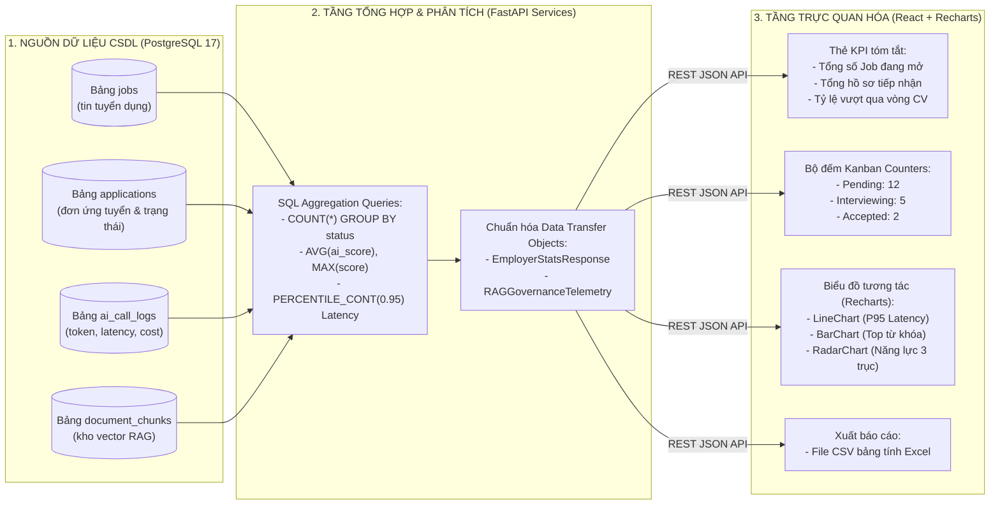

# TIÊU CHÍ 05: XÂY DỰNG THỐNG KÊ VÀ BÁO CÁO CƠ BẢN
## DỰ ÁN: AI-POWERED JOB PORTAL (NỀN TẢNG TUYỂN DỤNG THÔNG MINH B2B)

---

### 1. YÊU CẦU TIÊU CHÍ
> **Tiêu chuẩn:** Hệ thống xây dựng các màn hình Dashboard hoặc Báo cáo thống kê trực quan phục vụ công tác quản lý và vận hành nghiệp vụ; dữ liệu thống kê được tổng hợp chính xác từ cơ sở dữ liệu và hiển thị dưới dạng biểu đồ hoặc các chỉ số KPI rõ ràng.

---

### 2. SƠ ĐỒ ĐƯỜNG ỐNG DỮ LIỆU BÁO CÁO & THỐNG KÊ (ANALYTICS DATA PIPELINE)

Quy trình trích xuất, tổng hợp từ CSDL và hiển thị trực quan lên Dashboard người dùng:



---

### 3. CHI TIẾT CÁC MÀN HÌNH BÁO CÁO & DASHBOARD

#### A. Dashboard Tuyển dụng & Thống kê Kanban (Nhà tuyển dụng)
*Vị trí mã nguồn:* [frontend/src/pages/employer/EmployerCandidatesPage.tsx](file:///d:/ai-job-portal/frontend/src/pages/employer/EmployerCandidatesPage.tsx) & `EmployerDashboard.tsx`

1. **Bộ chỉ số KPI Tuyển dụng (Executive Summary Cards):**
   * **Tổng số tin tuyển dụng đang mở:** Đo lường quy mô tuyển dụng hiện hành.
   * **Tổng số hồ sơ tiếp nhận:** Đếm tổng số đơn ứng tuyển đã nộp vào các Job của công ty.
   * **Tỷ lệ sàng lọc thành công:** Đo lường tỷ lệ ứng viên vượt qua vòng thẩm định hồ sơ.
2. **Thống kê luồng ứng viên qua Bảng Kanban (Kanban Counters):**
   * Tự động tính toán và hiển thị số lượng ứng viên theo thời gian thực trên từng cột:
     * 🟡 **Chờ xét duyệt (`pending`):** Ví dụ: `12 ứng viên`
     * 🔵 **Đang thẩm định (`reviewing`):** Ví dụ: `8 ứng viên`
     * 🟣 **Vòng phỏng vấn (`interviewing`):** Ví dụ: `5 ứng viên`
     * 🟢 **Đã trúng tuyển (`accepted`):** Ví dụ: `2 ứng viên`
     * 🔴 **Từ chối (`rejected`):** Ví dụ: `4 ứng viên`
3. **Chức năng Xuất báo cáo dữ liệu (Data Export):**
   * Cung cấp nút bấm **"Xuất danh sách CSV"** (`exportCandidatesCSV`) giúp HR trích xuất toàn bộ dữ liệu ứng viên kèm điểm số AI Matching ra file Excel phục vụ báo cáo nội bộ.

```tsx
{/* Thẻ KPI thống kê số lượng ứng viên trên từng cột Kanban */}
<div className="flex items-center justify-between px-4 py-3 bg-white border border-gray-200 rounded-xl shadow-sm">
  <div className="flex items-center gap-2">
    <span className="w-2.5 h-2.5 rounded-full bg-indigo-500" />
    <span className="text-sm font-medium text-gray-700">{stage.label}</span>
  </div>
  <span className="px-2 py-0.5 text-xs font-semibold rounded-full bg-indigo-50 text-indigo-700">
    {candidatesInStage.length}
  </span>
</div>
```

---

#### B. Dashboard Quản trị & Báo cáo Giám sát RAG Governance (Quản trị viên)
*Vị trí mã nguồn:* `frontend/src/pages/admin/AdminRAGGovernancePage.tsx` & [backend/app/routers/admin_ai.py](file:///d:/ai-job-portal/backend/app/routers/admin_ai.py)

Báo cáo chuyên sâu dành cho Quản trị viên theo dõi sức khỏe hệ thống và năng lực AI:
1. **Chỉ số Vận hành Hệ thống (System Telemetry):**
   * **P95 Search Latency:** Thời gian phản hồi phân vị thứ 95 của các truy vấn tìm kiếm RAG (mục tiêu < 150ms).
   * **Total Vectors Indexed:** Tổng số phân mảnh tài liệu CV/JD đã được vector hóa trong pgvector.
   * **Tỷ lệ truy vấn thành công (Success Query Rate):** Đo lường tỷ lệ tìm kiếm trả về kết quả hữu ích so với các truy vấn rỗng.
2. **Trực quan hóa bằng Biểu đồ Recharts:**
   * **Biểu đồ đường (LineChart):** Theo dõi xu hướng độ trễ truy vấn (ms) theo từng khung giờ trong ngày.
   * **Biểu đồ cột (BarChart):** Thống kê Top 10 từ khóa công nghệ được tìm kiếm nhiều nhất.
   * **Biểu đồ phân bố (Histogram):** Thể hiện dải điểm tương thích (Match Score) của toàn bộ hệ sinh thái.

```tsx
{/* Biểu đồ Recharts theo dõi độ trễ hệ thống */}
<ResponsiveContainer width="100%" height={240}>
  <LineChart data={latencyData}>
    <CartesianGrid strokeDasharray="3 3" stroke="#f1f5f9" />
    <XAxis dataKey="time" tick={{ fontSize: 11 }} />
    <YAxis tick={{ fontSize: 11 }} unit="ms" />
    <Tooltip />
    <Line type="monotone" dataKey="latency" stroke="#6366f1" strokeWidth={2} dot={false} />
  </LineChart>
</ResponsiveContainer>
```

---

#### C. Dashboard Theo dõi Tiến độ Ứng tuyển (Ứng viên)
*Vị trí mã nguồn:* `frontend/src/pages/candidate/CandidateDashboard.tsx`
* Báo cáo cá nhân hóa giúp ứng viên nắm bắt:
  * Số lượng đơn ứng tuyển đã nộp và trạng thái phản hồi mới nhất từ nhà tuyển dụng.
  * Danh sách việc làm đã lưu và việc làm phù hợp được AI gợi ý dựa trên hồ sơ.

---

### 4. KẾT LUẬN TIÊU CHÍ 05
* Dự án sở hữu đầy đủ hệ thống Dashboard và Báo cáo trực quan cho cả Nhà tuyển dụng, Quản trị viên và Ứng viên.
* Số liệu được tính toán thời gian thực từ CSDL và hiển thị chuyên nghiệp bằng thẻ KPI, bảng Kanban và biểu đồ `recharts`.
* Hỗ trợ xuất dữ liệu dạng tệp bảng tính CSV phục vụ nghiệp vụ nhân sự thực tế.
* **Mức độ đáp ứng:** **100% - ĐẠT XUẤT SẮC**.
