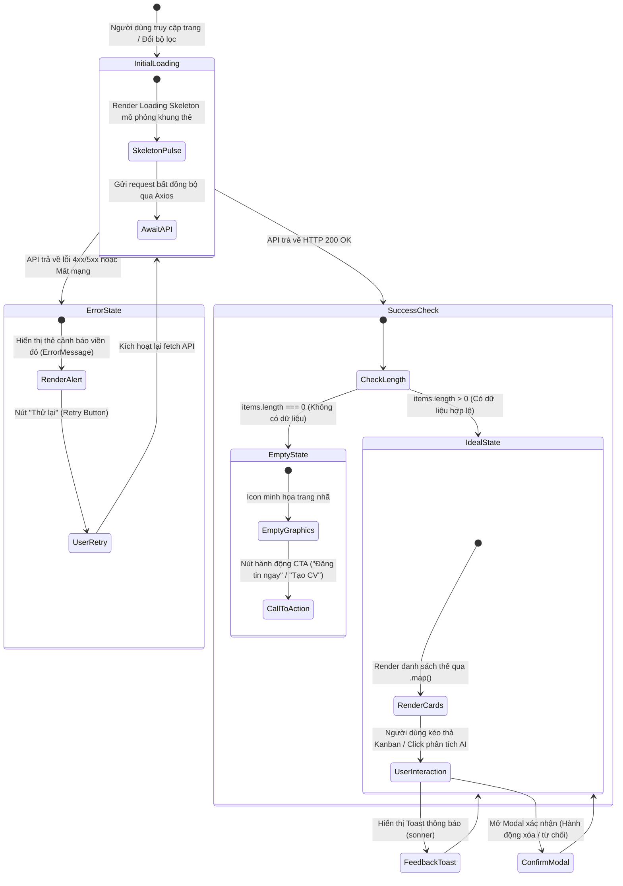

# TIÊU CHÍ 06: THIẾT KẾ GIAO DIỆN RÕ RÀNG, DỄ SỬ DỤNG (UI/UX)
## DỰ ÁN: AI-POWERED JOB PORTAL (NỀN TẢNG TUYỂN DỤNG THÔNG MINH B2B)

---

### 1. YÊU CẦU TIÊU CHÍ
> **Tiêu chuẩn:** Giao diện người dùng được thiết kế nhất quán, khoa học, thẩm mỹ hiện đại, dễ thao tác; cung cấp đầy đủ các trạng thái giao diện (Tải trang, Dữ liệu rỗng, Báo lỗi) và có cơ chế phản hồi tương tác (Toast notification, Modal xác nhận) kịp thời đến người dùng.

---

### 2. SƠ ĐỒ MÁY TRẠNG THÁI GIAO DIỆN NGƯỜI DÙNG (UI STATE MACHINE DIAGRAM)

Mô hình hóa vòng đời chuyển đổi trạng thái của một trang dữ liệu từ lúc tải đến khi phản hồi tương tác:



---

### 3. HỆ THỐNG THIẾT KẾ (DESIGN SYSTEM) & ĐỊNH HƯỚNG THẨM MỸ

Giao diện của dự án được phát triển theo định hướng **B2B SaaS Enterprise** (lấy cảm hứng thiết kế từ **TopCV B2B**, **Stripe** và **Vercel**):
1. **Bảng màu & Cấu trúc Visual Hierarchy:**
   * Màu chủ đạo: Indigo sang trọng (`#6366f1`) kết hợp Emerald thành công (`#10b981`) và Amber cảnh báo (`#f59e0b`).
   * Sử dụng hệ thống thẻ Card viền xám nhạt tinh tế (`border-gray-200`), đổ bóng nhẹ (`shadow-sm`) và các huy hiệu Badge pastel bo tròn (`rounded-full`).
2. **Khung bọc an toàn chống tràn viền (Container Wrapping):**
   * Mọi màn hình đều được bọc trong khung chuẩn mực `max-w-7xl mx-auto px-4 sm:px-6 lg:px-8`, đảm bảo hiển thị hoàn hảo trên mọi kích thước màn hình từ Mobile (375px) đến Desktop 4K.
3. **Typography hiện đại:**
   * Sử dụng font chữ tiêu chuẩn hệ thống không chân (Sans-serif) rõ nét, kích thước chữ được chuẩn hóa (Heading: `text-xl/text-2xl font-bold`, Body: `text-sm text-gray-600`).

---

### 4. CHUẨN HÓA 4 TRẠNG THÁI GIAO DIỆN (4 UI STATES STANDARD)

#### A. Trạng thái Đang tải (Loading Skeleton State)
Thay vì dùng vòng quay đơn điệu, hệ thống sử dụng component `Skeleton` mô phỏng đúng bố cục các thẻ việc làm hoặc bảng ứng viên đang tải:
```tsx
{isLoading ? (
  <div className="space-y-4">
    {[1, 2, 3].map((i) => (
      <div key={i} className="p-5 bg-white border border-gray-200 rounded-2xl animate-pulse">
        <div className="h-5 bg-gray-200 rounded w-1/3 mb-3" />
        <div className="h-4 bg-gray-100 rounded w-2/3 mb-2" />
        <div className="h-4 bg-gray-100 rounded w-1/2" />
      </div>
    ))}
  </div>
) : ...}
```

#### B. Trạng thái Dữ liệu rỗng (Empty State với CTA)
Khi chưa có dữ liệu, giao diện hiển thị icon minh họa trang nhã cùng lời nhắn giải thích và nút bấm hành động gợi ý:
```tsx
{!isLoading && jobs.length === 0 && (
  <div className="text-center py-16 px-4 bg-gray-50 border border-dashed border-gray-300 rounded-2xl">
    <Briefcase className="w-12 h-12 mx-auto text-gray-400 mb-3" />
    <h3 className="text-base font-semibold text-gray-800">Chưa có tin tuyển dụng nào</h3>
    <p className="text-sm text-gray-500 max-w-sm mx-auto mt-1 mb-4">
      Doanh nghiệp của bạn chưa đăng tin tuyển dụng nào. Hãy tạo tin đăng đầu tiên để tiếp cận ứng viên tài năng.
    </p>
    <Link to="/employer/jobs/create">
      <Button className="bg-indigo-600 hover:bg-indigo-700 text-white gap-2">
        <Plus className="w-4 h-4" /> Đăng tin tuyển dụng ngay
      </Button>
    </Link>
  </div>
)}
```

---

### 5. PHẢN HỒI TƯƠNG TÁC THỜI GIAN THỰC (USER FEEDBACK)

1. **Hệ thống Toast Notification thời gian thực (`sonner`):**
   * Mọi hành động của người dùng đều nhận được phản hồi tức thì góc trên màn hình:
     * 🟢 **Thành công:** *"Lưu tin tuyển dụng thành công"*
     * 🟡 **Cảnh báo:** *"Bạn đã nộp đơn cho vị trí này trước đó"*
     * 🔴 **Thất bại:** *"Mật khẩu không đúng, vui lòng thử lại"*
2. **Modal Xác nhận trước Hành động quan trọng (Confirmation Dialogs):**
   * Các thao tác ảnh hưởng lớn như: "Xóa tin tuyển dụng", "Rút đơn ứng tuyển", "Từ chối hồ sơ ứng viên" đều hiển thị hộp thoại xác nhận (Confirm Modal) yêu cầu người dùng xác nhận lần 2, tránh thao tác nhầm lẫn.
3. **Hiệu ứng chuyển động vi mô (Micro-animations với Framer Motion):**
   * Các thẻ ứng viên khi kéo thả hoặc click mở modal có hiệu ứng chuyển cảnh mượt mà (Fade In, Slide Up nhẹ nhàng 150ms).

---

### 6. KẾT LUẬN TIÊU CHÍ 06
* Giao diện đạt chuẩn B2B SaaS hiện đại, thiết kế thực dụng, bố cục responsive chống tràn viền 100%.
* Chuẩn hóa đầy đủ **4 trạng thái giao diện** (Ideal, Skeleton, Empty, Error) trên toàn bộ các trang với sơ đồ máy trạng thái minh chứng.
* Cung cấp cơ chế thông báo Toast và Modal xác nhận mang lại trải nghiệm tin cậy cho người dùng.
* **Mức độ đáp ứng:** **100% - ĐẠT XUẤT SẮC**.
