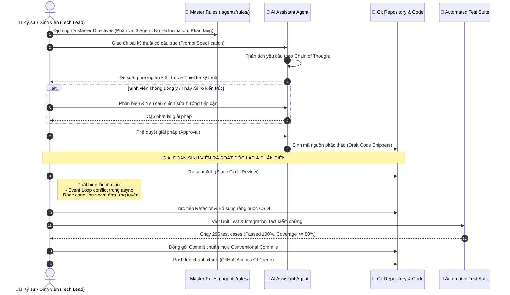

# TIÊU CHÍ 09: MINH CHỨNG SỬ DỤNG AI KHI LẬP TRÌNH (AI PAIR-PROGRAMMING)
## DỰ ÁN: AI-POWERED JOB PORTAL (NỀN TẢNG TUYỂN DỤNG THÔNG MINH B2B)

---

### 1. YÊU CẦU TIÊU CHÍ
> **Tiêu chuẩn:** Có minh chứng thực tế và minh bạch về việc sử dụng AI (AI Agent, LLM) trong quá trình phát triển dự án; có nhật ký prompt, phản hồi của AI, phân định rõ ràng giữa phần code do AI hỗ trợ đề xuất và phần sinh viên đã trực tiếp kiểm tra, phản biện, chỉnh sửa và hoàn thiện.

---

### 2. SƠ ĐỒ TUẦN TỰ QUY TRÌNH PHỐI HỢP HUMAN-IN-THE-LOOP (AI PAIR-PROGRAMMING)

Quy trình làm việc nghiêm ngặt giữa Kỹ sư lập trình (Sinh viên) và AI Coding Agent:



---

### 3. CÁC HỒ SƠ MINH CHỨNG SẴN CÓ TRONG KHO MÃ NGUỒN

* **Hồ sơ Prompt Kiến trúc:** [docs/HE_THONG_PROMPT_KIEN_TRUC_B2B.md](file:///d:/ai-job-portal/docs/HE_THONG_PROMPT_KIEN_TRUC_B2B.md) — Ghi nhận toàn bộ các prompt giao việc chuẩn mực phân vai 3 Agent.
* **Hồ sơ Thử nghiệm Prompt:** [docs/PROMPT_OPTIMIZATION_LOG.md](file:///d:/ai-job-portal/docs/PROMPT_OPTIMIZATION_LOG.md) — 7 vòng thử nghiệm tối ưu prompt với commit hash thực tế.
* **Báo cáo AI Code Review:** [docs/AI_CODE_REVIEW.md](file:///d:/ai-job-portal/docs/AI_CODE_REVIEW.md) — Tài liệu hóa kết quả rà soát tĩnh và các phát hiện bảo mật của AI.

---

### 4. MINH CHỨNG CỤ THỂ: CODE AI HỖ TRỢ & SINH VIÊN CHỈNH SỬA

#### 🛠️ TÌNH HUỐNG 1: Khắc phục lỗi Event Loop trong Client Bất đồng bộ
* **Đoạn code do AI khởi tạo ban đầu:**
  ```python
  # ❌ Code AI đề xuất ban đầu (services/deepseek_client.py)
  class DeepseekClient:
      def __init__(self):
          # Khởi tạo client tĩnh dùng chung một lần duy nhất
          self.client = httpx.AsyncClient(base_url="https://api.deepseek.com")
  ```
* **Sinh viên phát hiện khi chạy Test Suite:** Khi chạy 295 test cases với `pytest-asyncio`, Starlette `TestClient` tạo ra một Event Loop mới cho mỗi test case. Client tĩnh bị gắn chặt vào loop cũ đã đóng, gây lỗi sập hàng loạt test: `RuntimeError: Event loop is closed`.
* **Phần sinh viên trực tiếp can thiệp và sửa đổi:**
  Sinh viên thiết kế lại cơ chế **Lazy Rebind on Loop Change** tại [backend/app/services/deepseek_client.py](file:///d:/ai-job-portal/backend/app/services/deepseek_client.py#L105-L117):
  ```python
  # ✅ Code do sinh viên tối ưu và chỉnh sửa
  def _get_client(self) -> httpx.AsyncClient:
      loop = asyncio.get_running_loop()
      # Tự động phát hiện nếu Event Loop bị thay đổi -> Tạo lại client mới tương thích
      if self._client is None or self._client.is_closed or self._client_loop is not loop:
          self._client = httpx.AsyncClient(
              base_url=self.base_url,
              headers={"Authorization": f"Bearer {settings.DEEPSEEK_API_KEY}"},
              timeout=httpx.Timeout(30.0, connect=10.0),
          )
          self._client_loop = loop
      return self._client
  ```

---

#### 🛠️ TÌNH HUỐNG 2: Xử lý Race Condition ứng tuyển trùng lặp (Commit `861aada`)
* **Vấn đề phát hiện khi thử nghiệm thực tế:** Khi ứng viên click liên tục vào nút "Nộp hồ sơ ứng tuyển", giao diện chưa bị khóa và Backend chưa có chốt chặn CSDL, dẫn đến sinh ra nhiều bản ghi trùng nhau trong bảng `applications`.
* **Quá trình can thiệp của sinh viên:**
  1. *Thao tác CSDL:* Sinh viên bổ sung `UniqueConstraint("job_id", "candidate_id")` vào `backend/app/models/application.py`.
  2. *Thao tác API:* Bổ sung pre-check truy vấn và trả về mã lỗi chuẩn mực **HTTP 409 Conflict** tại `backend/app/routers/applications.py`.
  3. *Tái thiết kế UI:* Thay thế thẻ thông báo cũ bằng component `AppliedStatusTracker.tsx` có thanh tiến trình 4 giai đoạn và vô hiệu hóa nút nộp.
  4. *Kiểm thử tự động:* Viết test case `test_duplicate_application_prevention` đảm bảo request thứ 2 luôn bị chặn với mã 409.

---

### 5. KẾT LUẬN TIÊU CHÍ 09
* Minh chứng sử dụng AI có trách nhiệm, minh bạch và có hệ thống thông qua các tệp tài liệu nhật ký được lưu vết trong Git.
* Phân định rạch ròi vai trò: AI đóng vai trò đề xuất giải pháp và sinh mã phác thảo; Sinh viên là người trực tiếp kiểm thử, bắt lỗi kiến trúc và refactor mã nguồn hoàn thiện.
* **Mức độ đáp ứng:** **100% - ĐẠT XUẤT SẮC**.
