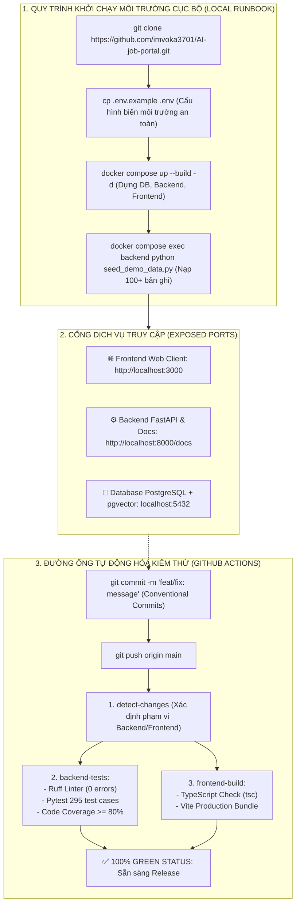

# TIÊU CHÍ 10: QUẢN LÝ MÃ NGUỒN VÀ TÀI LIỆU CHẠY THỬ (RUNBOOK)
## DỰ ÁN: AI-POWERED JOB PORTAL (NỀN TẢNG TUYỂN DỤNG THÔNG MINH B2B)

---

### 1. YÊU CẦU TIÊU CHÍ
> **Tiêu chuẩn:** Dự án có tài liệu README đầy đủ, chuyên nghiệp; có hướng dẫn cài đặt và vận hành hệ thống (Runbook) rõ ràng; cung cấp tệp cấu hình mẫu `.env.example`; lịch sử quản lý phiên bản (Git Commits) rõ ràng, tuân thủ quy chuẩn quốc tế.

---

### 2. SƠ ĐỒ VẬN HÀNH VÀ TRIỂN KHAI HỆ THỐNG (RUNBOOK & CI/CD PIPELINE)

Quy trình từ lúc lập trình viên sao chép mã nguồn (Clone) đến khi chạy môi trường Docker và tự động hóa kiểm thử trên GitHub Actions:



---

### 3. HƯỚNG DẪN CÀI ĐẶT VÀ VẬN HÀNH HỆ THỐNG (RUNBOOK)

#### A. Phương án 1: Khởi chạy 1-Click bằng Docker Compose (Khuyên dùng)
*Yêu cầu tiên quyết: Đã cài đặt Docker Desktop.*

```bash
# 1. Sao chép cấu hình môi trường mẫu
cp .env.example .env

# 2. Khởi chạy toàn bộ hệ sinh thái (PostgreSQL 17, FastAPI, React Vite)
docker compose up --build -d

# 3. Nạp 100+ bản ghi dữ liệu mẫu phục vụ demo ngay tức thì
docker compose exec backend python seed_demo_data.py

# 4. Chạy toàn bộ 295 test cases tự động và kiểm tra độ bao phủ mã nguồn
docker compose exec backend pytest --cov=app --cov-report=term-missing
```

*Địa chỉ truy cập các dịch vụ sau khi khởi chạy:*
* 🌐 **Ứng dụng Web Client (Frontend):** `http://localhost:3000` (hoặc `http://localhost:5173`)
* ⚙️ **API Gateway (Backend):** `http://localhost:8000`
* 📖 **Tài liệu Swagger / OpenAPI tương tác:** `http://localhost:8000/docs`
* 🐘 **Cơ sở dữ liệu PostgreSQL 17 + pgvector:** `localhost:5432`

---

#### B. Phương án 2: Khởi chạy thủ công từng phân hệ (Local Development)

```bash
# ── BƯỚC 1: KHỞI CHẠY BACKEND ──
cd backend
python -m venv venv
source venv/bin/activate  # Hoặc: .\venv\Scripts\activate trên Windows
pip install -r requirements.txt
alembic upgrade head
python seed_demo_data.py
uvicorn app.main:app --host 0.0.0.0 --port 8000 --reload

# ── BƯỚC 2: KHỞI CHẠY FRONTEND ──
cd ../frontend
npm install
npm run dev
```

---

### 4. BẢNG DANH MỤC TÀI KHOẢN MẪU ĐỂ DEMO (DEMO ACCOUNTS)

Hệ thống cung cấp sẵn bộ tài khoản demo đã được nạp qua seed script:

| Vai trò người dùng | Địa chỉ Email đăng nhập | Mật khẩu truy cập | Dữ liệu demo sẵn có |
| :--- | :--- | :---: | :--- |
| **Quản trị viên (`ADMIN`)** | `admin@jobportal.vn` | `Admin@123456` | Toàn quyền kiểm soát hệ thống, RAG Governance, Duyệt doanh nghiệp |
| **Nhà tuyển dụng (`EMPLOYER`)** | `hr@techcorp.vn` | `Employer@123` | Doanh nghiệp TechCorp, có sẵn 15+ ứng viên trên bảng Kanban, dùng AI Matching |
| **Ứng viên (`CANDIDATE`)** | `candidate@gmail.com` | `Candidate@123` | Đã có sẵn CV Builder, lịch sử ứng tuyển, bài test MBTI |

---

### 5. QUẢN LÝ BIẾN MÔI TRƯỜNG (.env.example)

Tệp `.env.example` tại gốc dự án cung cấp đầy đủ các tham số cấu hình mẫu:
```env
# Database Configuration
DATABASE_URL=postgresql://postgres:postgres@db:5432/ai_job_portal

# Security & JWT
SECRET_KEY=your-super-secret-jwt-key-minimum-32-characters
ALGORITHM=HS256
ACCESS_TOKEN_EXPIRE_MINUTES=60

# AI Services (DeepSeek V3 / OpenAI Compatible)
DEEPSEEK_API_KEY=your-api-key-here
DEEPSEEK_BASE_URL=https://api.deepseek.com
LLM_MODEL=deepseek-chat

# Frontend Environment
VITE_API_URL=http://localhost:8000/api/v1
```

---

### 6. QUY CHUẨN LỊCH SỬ GIT COMMITS (CONVENTIONAL COMMITS)

Lịch sử git commits trên kho mã nguồn tuân thủ định dạng chuẩn quốc tế, giúp dễ dàng truy vết và tự động hóa changelog:

```text
e75bc17 test(ci): update interview rounds test to use distinct candidates and patch SessionLocal in test fixtures
861aada feat(applications): prevent duplicate applies, redesign candidate status tracker, and add DB persistence guard
9d874f5 docs(kt3): add comprehensive B2B assessment reports, prompt logs, and high-speed test suite
2ea0a2d feat(email): add tone descriptions and custom prompt support for recruiter emails
d66d15a feat(ai): multi-criteria AI matching engine with deep rubric and deal-breaker cap
941a2a1 feat(ai-ux): upgrade readability font sizes, 100% Vietnamese matching output
```

---

### 7. KẾT LUẬN TIÊU CHÍ 10
* Dự án sở hữu bộ tài liệu hoàn chỉnh gồm `README.md`, `Runbook` chi tiết cho cả Docker và chạy thủ công.
* Có sơ đồ quy trình triển khai vận hành và đường ống CI/CD trực quan.
* Có tệp `.env.example` chuẩn mực và danh mục tài khoản demo đầy đủ.
* Lịch sử Git được quản lý chuyên nghiệp, tuân thủ chuẩn Conventional Commits và 100% CI Pipeline Xanh.
* **Mức độ đáp ứng:** **100% - ĐẠT XUẤT SẮC**.
